# rulecad archive

## Experiments

- **[Disc launcher: a toy pistol whose springs, sear, trigger and feeder are printed flexures](experiments/launcher/)** (2026-10-31): A leaf bow, a snap-hook sear, a trigger on a living hinge and a serpentine feeder, all sized from one rule set; first as one optimised body, then as two cartridges pinned into a frame. [On the site](https://jonibach.github.io/rulecad-archive/experiments/launcher/)
- **[Bin: a lattice wall for the X1C's whole build volume](experiments/bin/)** (2026-10-30): At 5% four legs become pointed arches; at 8% diagonals brace them and the rim is reached: settled, print-ready, 1.06 kg. [On the site](https://jonibach.github.io/rulecad-archive/experiments/bin/)
- **[Flexure samplers: twenty-two flexures and mechanisms to measure](experiments/flexures/)** (2026-10-30): Four printed plates with every flexure in the library and its predicted stiffness and travel; measured, they give the material its strain limit. [On the site](https://jonibach.github.io/rulecad-archive/experiments/flexures/)
- **[Guitar hanger: a wall mount grown from two screws to a cradle](experiments/guitar/)** (2026-10-30): A Telecaster hanger grown from two screw bosses to two arm pads; the second attempt keeps the neck's channel and the screw columns empty, settled in 57 minutes, every check passing. [On the site](https://jonibach.github.io/rulecad-archive/experiments/guitar/)
- **[The force inverter: a mechanism grown from a block](experiments/inverter/)** (2026-10-30): The first generated compliant mechanism; its point hinges, and the robust formulation that gives it real ones. [On the site](https://jonibach.github.io/rulecad-archive/experiments/inverter/)
- **[Tree stand: from stool to goblet to Y to tree](experiments/tree/)** (2026-10-30): Where the loads sit decides whether a part branches; finer cells with bridges gave a lattice canopy, stiffer and print-ready. [On the site](https://jonibach.github.io/rulecad-archive/experiments/tree/)
- **[Bracket bench: four wall brackets of equal mass](experiments/bracket-bench/)** (2026-10-28): Optimised brackets predicted 1.5 times as stiff as a plain web; what printing without supports costs. [On the site](https://jonibach.github.io/rulecad-archive/experiments/bracket-bench/)
- **[L-bracket: stiffest against stress-limited](experiments/lbracket/)** (2026-10-28): Stress limits cut the peak stress by 46% for the same material. [On the site](https://jonibach.github.io/rulecad-archive/experiments/lbracket/)
- **[Lever bench: four levers of equal mass](experiments/lever-bench/)** (2026-10-28): The optimised lever predicted 27 times as stiff as a lightened plate. [On the site](https://jonibach.github.io/rulecad-archive/experiments/lever-bench/)
- **[Twisted tube: the first showcase part](experiments/twist/)** (2026-10-28): Printed in one piece at the second attempt, but with flat blocks and icicles that need supports. [On the site](https://jonibach.github.io/rulecad-archive/experiments/twist/)
- **[Verification: how sure are the predictions?](experiments/verification/)** (2026-10-28): Finer cells showed the first bracket predictions were 15–35% too flexible. [On the site](https://jonibach.github.io/rulecad-archive/experiments/verification/)

## Models

Models made with [rulecad](https://github.com/JoniBach/rulecad), newest first: a picture of each, and a link that opens it in the 3D viewer (turn it, download STL or 3MF). Everything here is public.

- **Add one:** `node add.mjs <workspace> <project>/<object>`, then commit and push.
- **Bring in links shared as Gists:** `node import-gists.mjs`.

### The disc launcher: the frame with its two cartridges pinned in, the sled, the magazine insert and a disc; cocked, and run forward to its rest

2026-10-31 · `launcher/launcher` in bench: The launcher as cartridges in a frame, cocked: thirteen parts, every fit checked, a disc leaving the muzzle

[Open in 3D](https://jonibach.github.io/rulecad-archive/m/launcher-2/)

[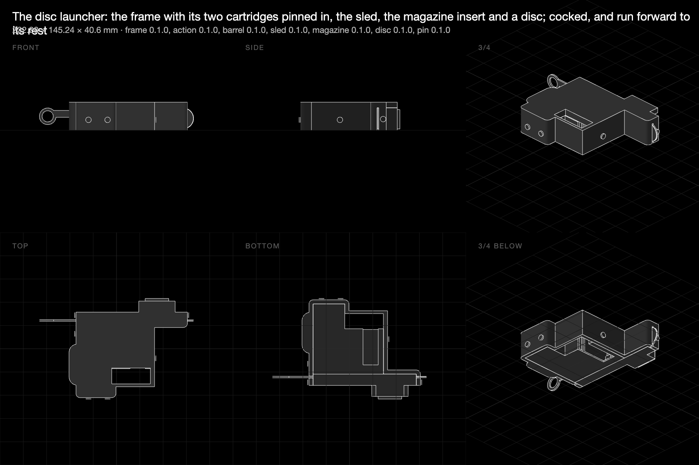](https://jonibach.github.io/rulecad-archive/m/launcher-2/)

### The barrel cartridge: the slot the sled and the disc run in, with the magazine column over its mouth 0.1.0

2026-10-31 · `launcher/barrel` in bench: The barrel cartridge: the slot out through the muzzle, the magazine column, the hollow for the pins

[Open in 3D](https://jonibach.github.io/rulecad-archive/m/launcher-barrel/)

[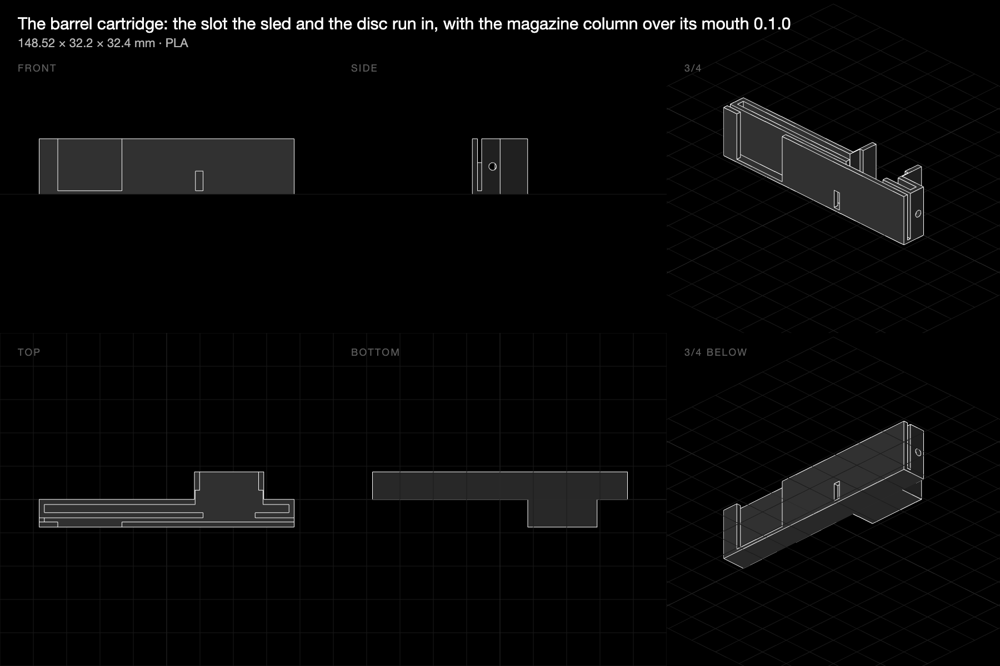](https://jonibach.github.io/rulecad-archive/m/launcher-barrel/)

### The frame: grip with a palm swell, receiver and trigger guard round two cavities the cartridges pin into 0.1.0

2026-10-31 · `launcher/frame` in bench: The frame: a rounded skin round two cavities, a palm swell, the trigger guard, the muzzle's opening, six pin holes; prints on its back plate

[Open in 3D](https://jonibach.github.io/rulecad-archive/m/launcher-frame/)

[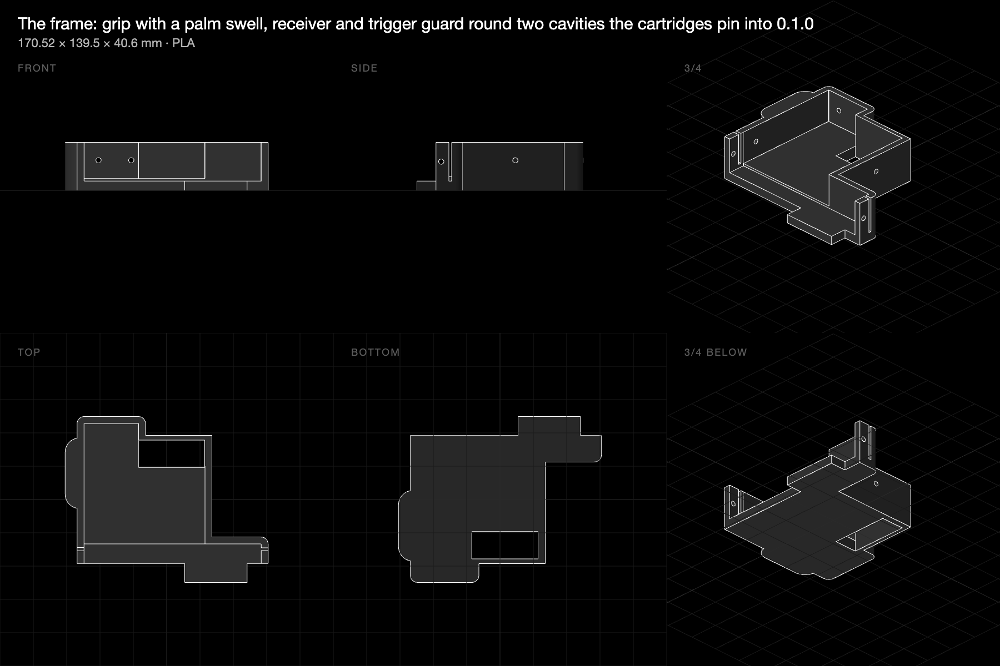](https://jonibach.github.io/rulecad-archive/m/launcher-frame/)

### The action cartridge: bow, sear and trigger printed in place in a tray that pins into the frame (cocked) 0.1.0

2026-10-31 · `launcher/action:cocked` in bench: The action cartridge at full draw: bow, sear and trigger printed in place in a tray

[Open in 3D](https://jonibach.github.io/rulecad-archive/m/launcher-action/)

[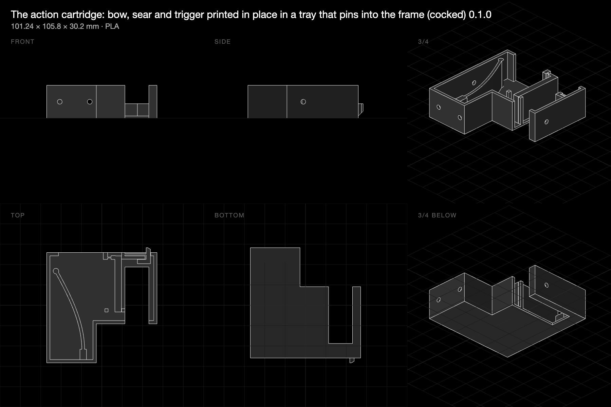](https://jonibach.github.io/rulecad-archive/m/launcher-action/)

### The disc launcher: the body on its optimised frame with the bow at full draw, the sled, the magazine insert, a disc at the mouth, and the lid

2026-10-31 · `launcher/launcher` in bench: The whole launcher, cocked: the body on its optimised frame with the bow at full draw, the sled, the magazine insert, a disc at the mouth and the lid

[Open in 3D](https://jonibach.github.io/rulecad-archive/m/launcher/)

[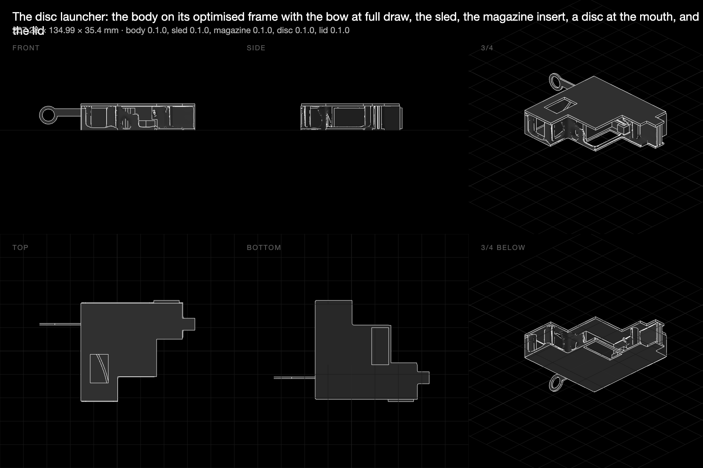](https://jonibach.github.io/rulecad-archive/m/launcher/)

### The body: bow, sear and trigger printed in place, the magazine column and the barrel, on an optimised frame 0.1.0

2026-10-31 · `launcher/body` in bench: The body on its optimised frame: bow, sear and trigger printed in place, the magazine column, the barrel; 164 g, every check passing

[Open in 3D](https://jonibach.github.io/rulecad-archive/m/launcher-body/)

[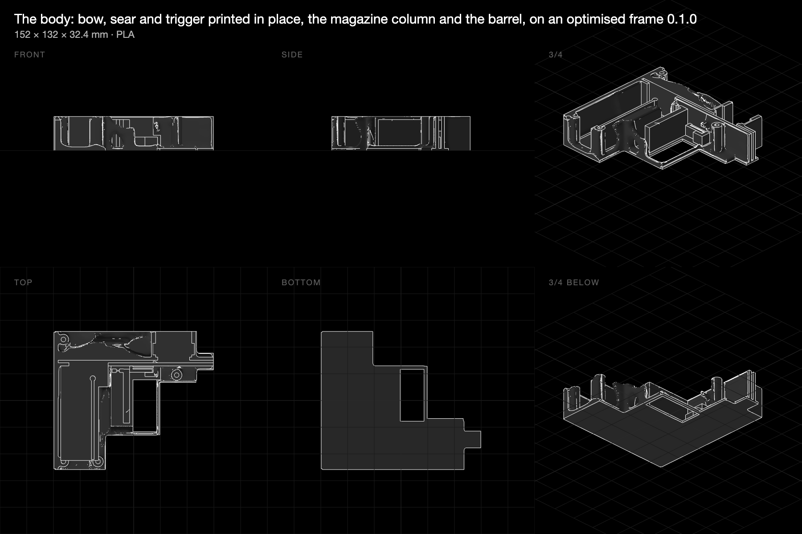](https://jonibach.github.io/rulecad-archive/m/launcher-body/)

### The action with its sled: cocked, and run forward to its rest

2026-10-31 · `launcher/rig` in bench: The action on its test base with the sled cocked: bow at full draw, sear, trigger on its living hinge

[Open in 3D](https://jonibach.github.io/rulecad-archive/m/launcher-rig/)

[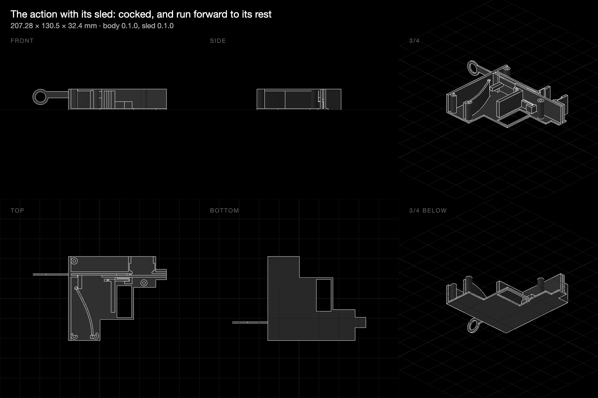](https://jonibach.github.io/rulecad-archive/m/launcher-rig/)

### The magazine insert: follower, serpentine spring and a snap-in cap in one piece (full) 0.1.0

2026-10-31 · `launcher/magazine:full` in bench: The magazine insert, squeezed as it sits over a full stack: follower, serpentine, cap with snap hooks

[Open in 3D](https://jonibach.github.io/rulecad-archive/m/launcher-magazine/)

[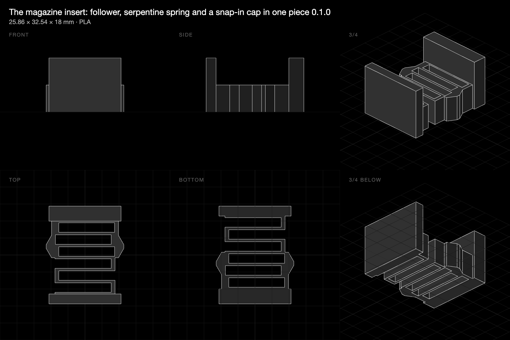](https://jonibach.github.io/rulecad-archive/m/launcher-magazine/)

### The sled: pushed by the bow, it pushes the disc 0.1.0

2026-10-31 · `launcher/sled` in bench: The sled: plate and nose under the magazine, a rod back through the grip to the tab the bow pushes, and the cocking ring

[Open in 3D](https://jonibach.github.io/rulecad-archive/m/launcher-sled/)

[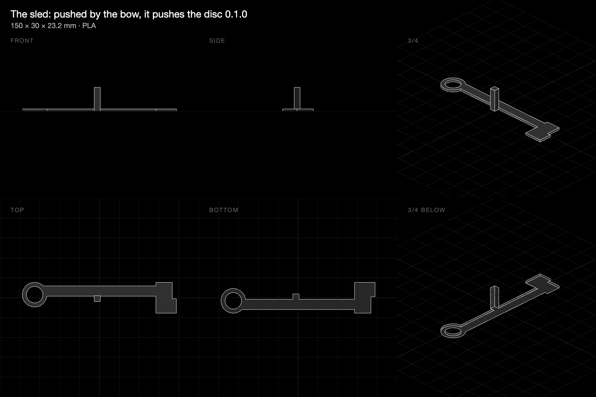](https://jonibach.github.io/rulecad-archive/m/launcher-sled/)

### The disc: what the launcher throws 0.1.0

2026-10-31 · `launcher/disc` in bench: The disc the launcher throws: 30 × 2 mm, chamfered, a dimple on top

[Open in 3D](https://jonibach.github.io/rulecad-archive/m/launcher-disc/)

[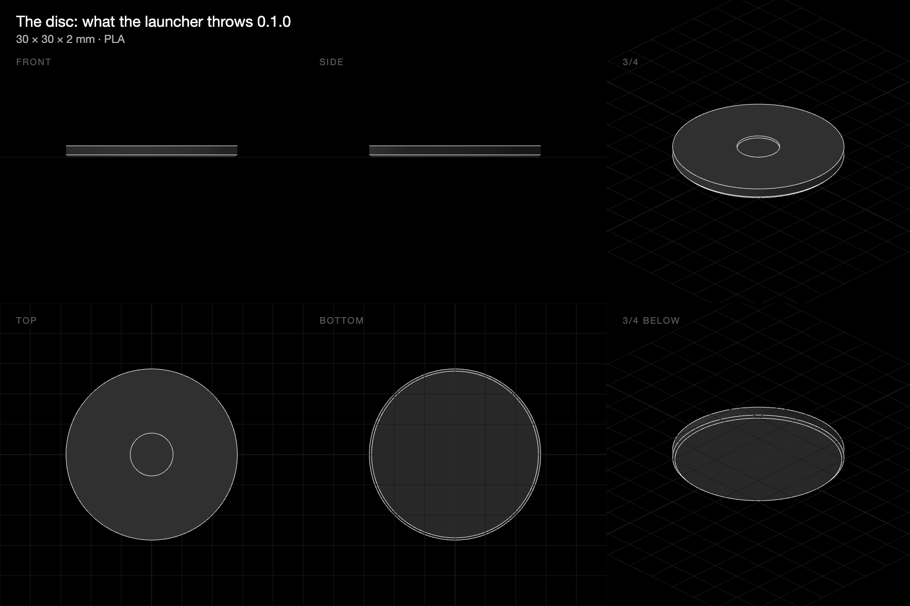](https://jonibach.github.io/rulecad-archive/m/launcher-disc/)

### Guitar hanger: optimised 0.1.0

2026-10-31 · `showcase/guitar` in bench: Second attempt: the neck's channel and a driver column over each screw kept empty; drawn at print resolution and sliced clean: no islands in 350 layers

[Open in 3D](https://jonibach.github.io/rulecad-archive/m/guitar-2/)

[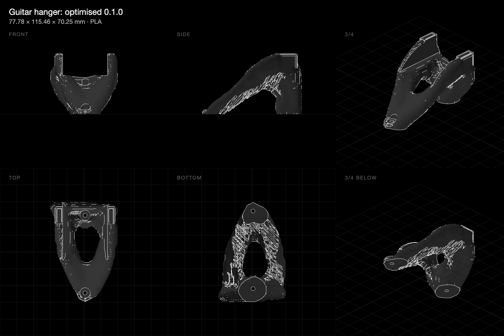](https://jonibach.github.io/rulecad-archive/m/guitar-2/)

### Flexure sampler 4: travel stops, a curved leaf, a contact-aided leaf, a parallelogram and tweezers 0.1.0

2026-10-30 · `flexures/sampler4` in bench: Stops and mechanisms made compliant: a leaf with travel stops where the strain limit says, a pre-curved leaf, a contact-aided leaf with two rates, a parallelogram four-bar on notch hinges, and tweezers on a post

[Open in 3D](https://jonibach.github.io/rulecad-archive/m/flexure-sampler-4/)

[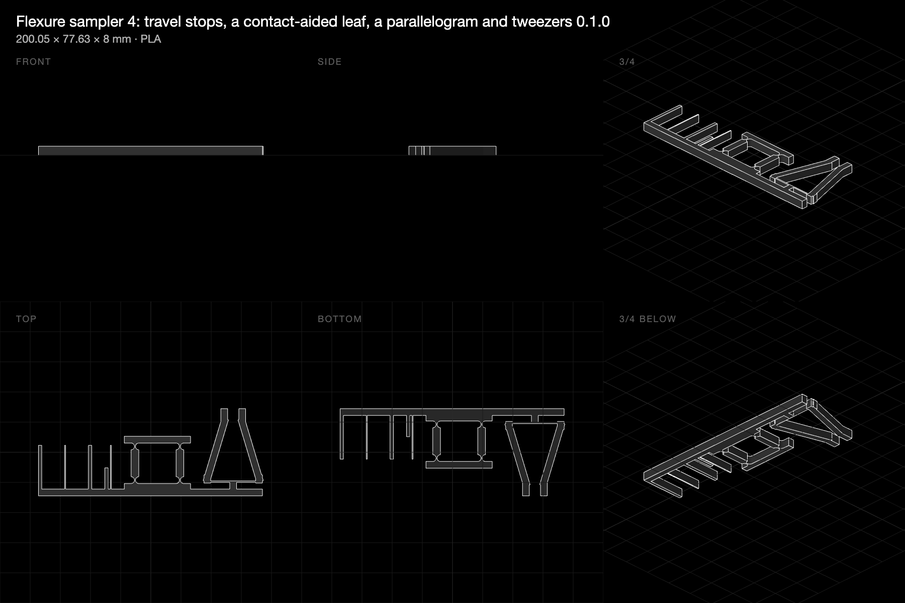](https://jonibach.github.io/rulecad-archive/m/flexure-sampler-4/)

### Flexure sampler 3: a folded guide, a cartwheel pivot, an elliptical hinge, two snap hooks and a ratchet 0.1.0

2026-10-30 · `flexures/sampler3` in bench: Things that click, turn and hold: a folded-beam guide, a cartwheel pivot, an elliptical notch hinge, two snap hooks under catch lips (gaps widened to the fit plus a margin after the first print fused them), and a ratchet wheel to pin on a boss beside its pawl

[Open in 3D](https://jonibach.github.io/rulecad-archive/m/flexure-sampler-3/)

[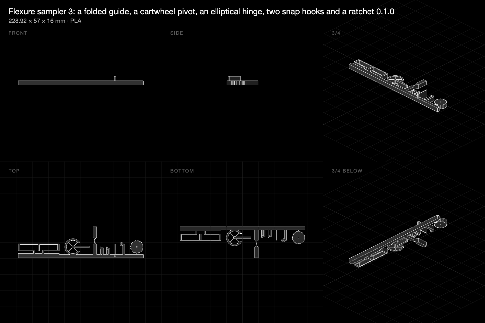](https://jonibach.github.io/rulecad-archive/m/flexure-sampler-3/)

### Guitar hanger: optimised 0.1.0

2026-10-30 · `showcase/guitar` in bench: A wall hanger that cradles a Telecaster's neck: grown from two screw bosses to the two pads the headstock rests on, against the guitar's weight, a tug and a knock; settled at step 234, printable lying on its back

[Open in 3D](https://jonibach.github.io/rulecad-archive/m/guitar/)

[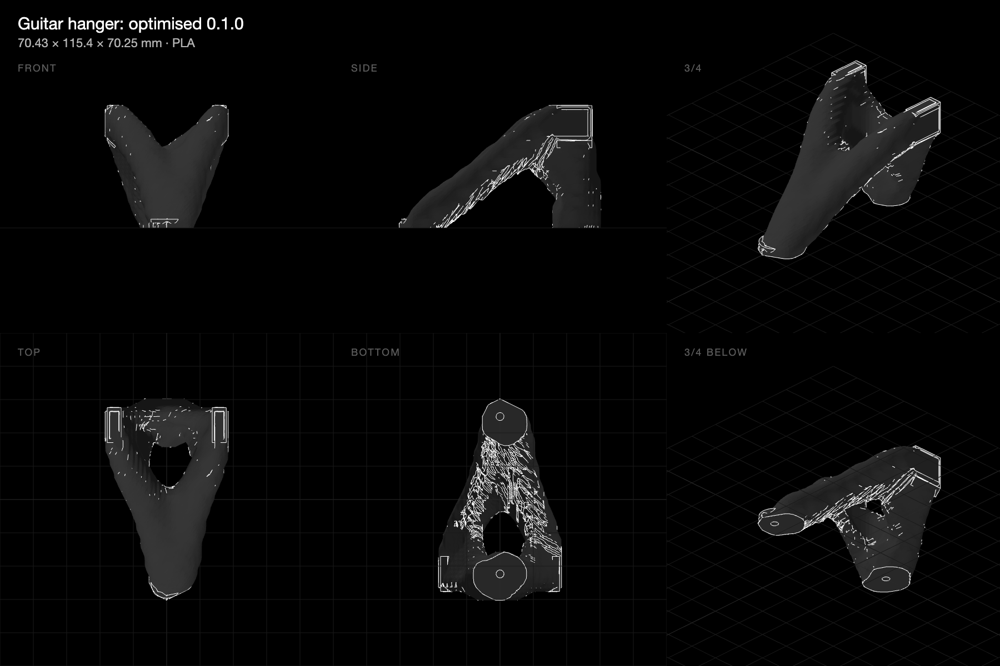](https://jonibach.github.io/rulecad-archive/m/guitar/)

### Joints that aren't flexures: a pin joint printed in place, and a snap pin with its socket 0.1.0

2026-10-30 · `flexures/joints` in bench: Joints that aren't flexures, for comparison: a pin joint printed in place that breaks free with a twist, and a snap pin standing beside its socket

[Open in 3D](https://jonibach.github.io/rulecad-archive/m/flexure-joints/)

[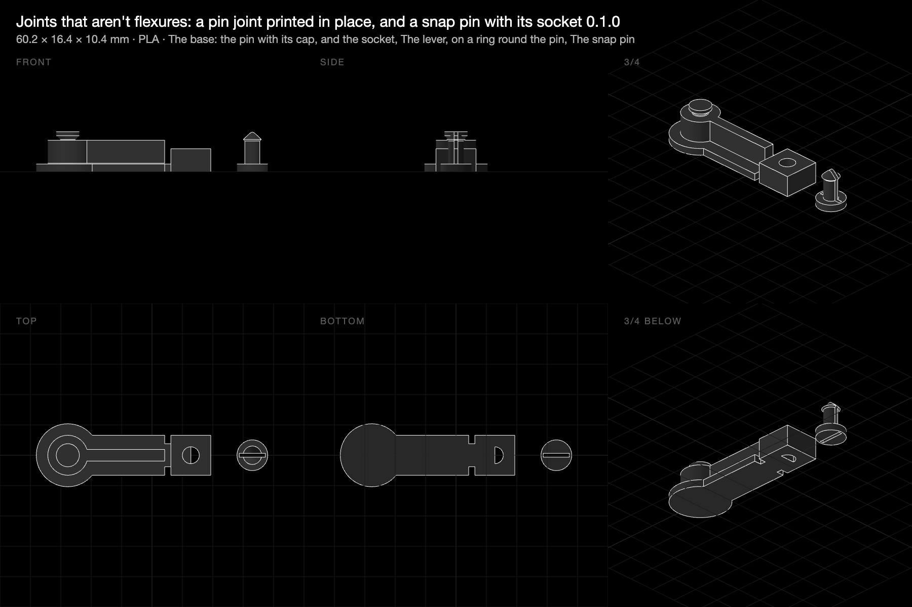](https://jonibach.github.io/rulecad-archive/m/flexure-joints/)

### Flexure sampler 2: a compound guide, a constant-force mechanism and a LET joint, on one rail 0.1.0

2026-10-30 · `flexures/sampler2` in bench: Three mechanisms on one rail: a compound parallel guide (no drop), a constant-force slider-crank with a leaf coupler and filament pins, and a LET joint cut into a six-layer sheet

[Open in 3D](https://jonibach.github.io/rulecad-archive/m/flexure-sampler-2/)

### Bin: optimised lattice wall 0.1.0

2026-10-30 · `showcase/bin` in bench: Third attempt, 8% of the space: a lattice wall settled at step 211, one piece, printable without supports

[Open in 3D](https://jonibach.github.io/rulecad-archive/m/bin-3/)

[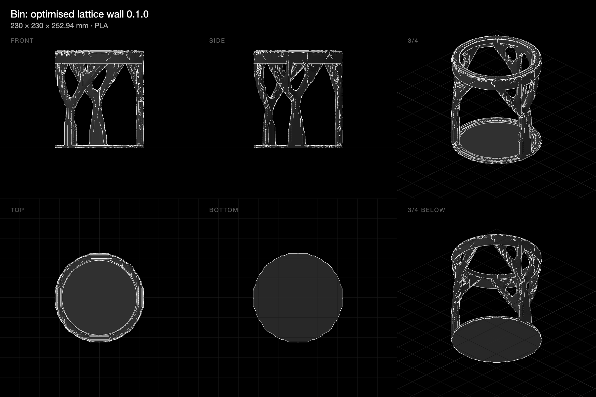](https://jonibach.github.io/rulecad-archive/m/bin-3/)

### Tree stand: optimised 0.1.0

2026-10-30 · `showcase/tree` in bench: Sixth attempt, 1.5 mm cells with the bridged overhang filter: converged at step 347, one piece, printable without supports

[Open in 3D](https://jonibach.github.io/rulecad-archive/m/tree-6/)

### Flexure sampler: seven flexures at three thicknesses, on two rails 0.1.0

2026-10-30 · `flexures/sampler` in bench: The flexure sampler: seven kinds of flexure at two, three and four lines thick on two rails, 152 × 122 × 8 mm, printed flat so every one bends within its layers. Each has a predicted stiffness and travel to 2% strain to measure against.

[Open in 3D](https://jonibach.github.io/rulecad-archive/m/flexure-sampler/)

[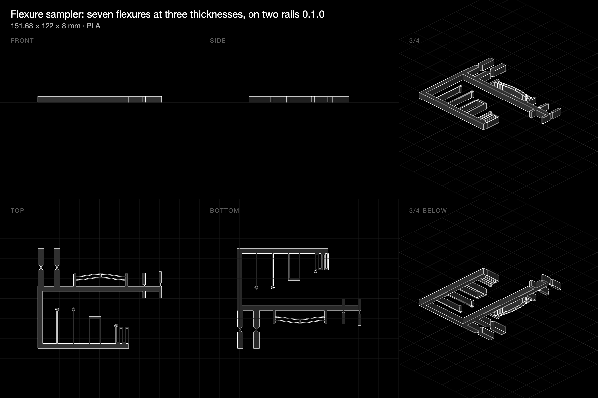](https://jonibach.github.io/rulecad-archive/m/flexure-sampler/)

### A leaf spring on its block, at rest and pressed (pressed) 0.1.0

2026-10-30 · `flexures/spring:pressed` in bench: A leaf spring (40 × 1.26 × 8 mm, PLA) on its block, drawn pressed 15 mm sideways by the elastica: the tip has come 2.5 mm nearer the block and turned. From the flexure bench (@rulecad/flexures).

[Open in 3D](https://jonibach.github.io/rulecad-archive/m/spring-pressed/)

[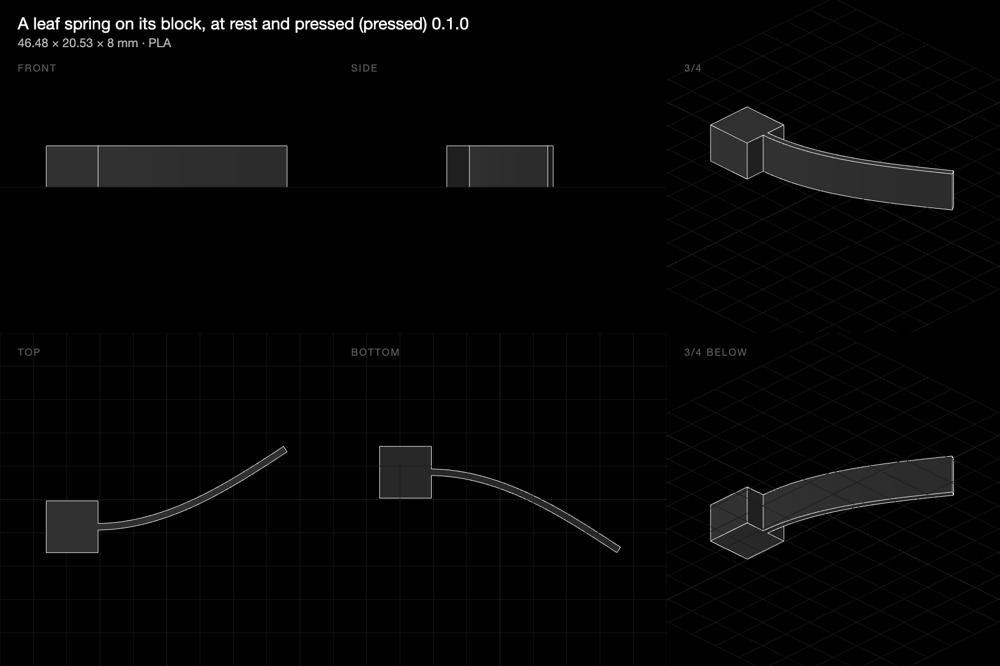](https://jonibach.github.io/rulecad-archive/m/spring-pressed/)

### Bin: optimised lattice wall 0.1.0

2026-10-29 · `showcase/bin` in bench: Second attempt, at 5% of the cylinder (about 17% of the wall): four legs rise from the foot ring into pointed arches that meet under the rim, like a crown. One piece, nothing in mid-air, no overhang past 45° (the design's ledge under the rim slopes a touch steeper than 45°). 664 g of PLA; leant on 4,240 N/mm, kicked 54 N/mm; 300 steps in an hour on the faster solver, not settled, and 17% of the kept rim had nothing under it before the ledge. On 6 mm cells the optimiser can't bridge (its reach rounds to zero).

[Open in 3D](https://jonibach.github.io/rulecad-archive/m/bin-2/)

[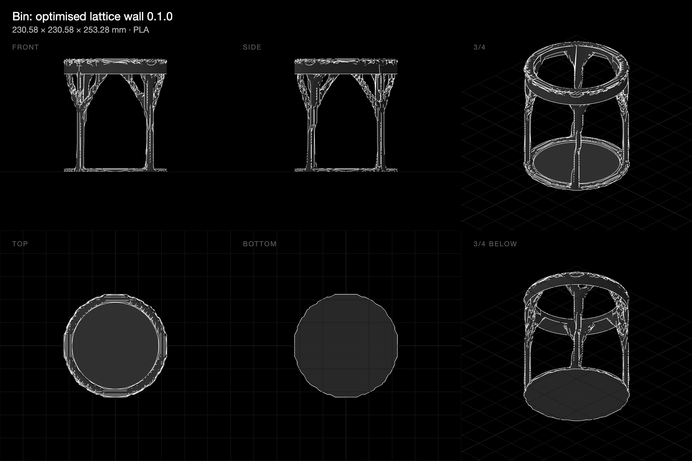](https://jonibach.github.io/rulecad-archive/m/bin-2/)

### Tree stand: optimised 0.1.0

2026-10-29 · `showcase/tree` in bench: Fifth attempt, complete and print-ready: a trunk from all three feet, branching into a canopy under the plate. With a sideways push from three directions every foot is needed. One piece, nothing in mid-air, no overhang past 45°, bridges 2.6 mm; 32 g of PLA, 4,380 N/mm down, 126–133 N/mm sideways; 300 steps in 50 min on the faster solver.

[Open in 3D](https://jonibach.github.io/rulecad-archive/m/tree-5/)

[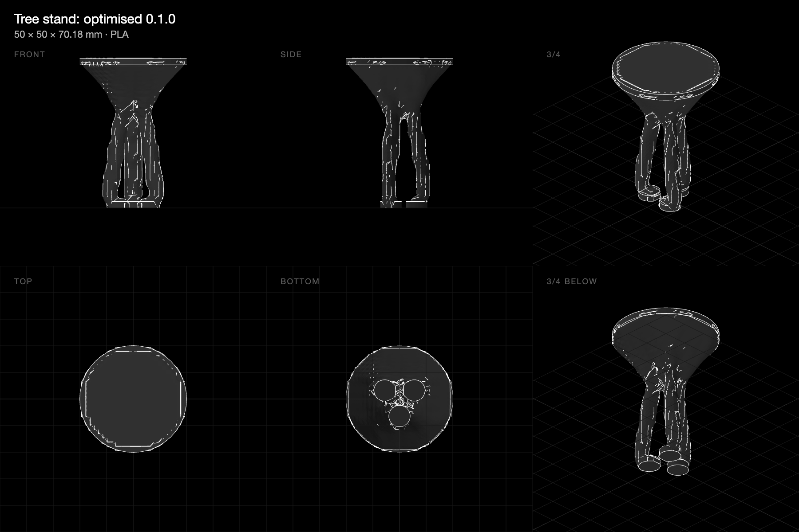](https://jonibach.github.io/rulecad-archive/m/tree-5/)

### Tree stand: optimised 0.1.0

2026-10-29 · `showcase/tree` in bench: Fourth attempt, on the faster solver with kept regions held up: the trunk splits into branches that fan out under the plate, and every bridge is short (2.6 mm), nothing starts in mid-air, no overhang past 45°. But the trunk grows from two feet and the third, kept, sits loose: the loads never needed it. 10% of the space, 3,960 N/mm down; 300 steps, not settled, 22 min.

[Open in 3D](https://jonibach.github.io/rulecad-archive/m/tree-4/)

[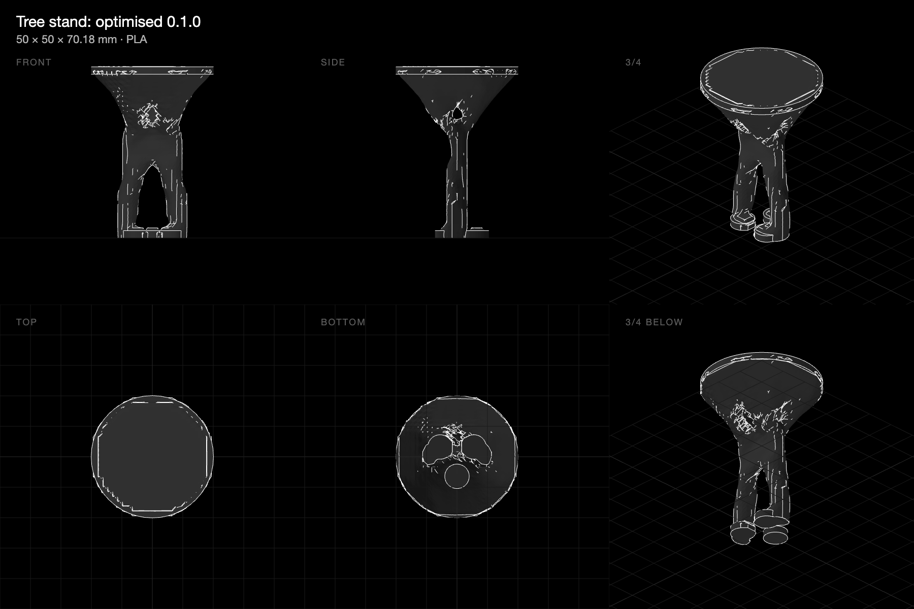](https://jonibach.github.io/rulecad-archive/m/tree-4/)

### Bin: optimised lattice wall 0.1.0

2026-10-29 · `showcase/bin` in bench: First attempt, too heavy and not yet support-free: 230 × 250 mm, a wall that's mostly solid with tall pointed-arch windows (the 45° rule's own shape), about 2 kg of PLA. The 15% share counted the whole cylinder, the empty inside too, so it filled half the wall; about 4–5% would give a lattice. Leant on: 35,700 N/mm; kicked: 1,380 N/mm. The print check still finds 523 mm² past 45° and two tips under the rim. 246 steps on 76,800 cells of 6 mm in about 4 hours.

[Open in 3D](https://jonibach.github.io/rulecad-archive/m/bin/)

[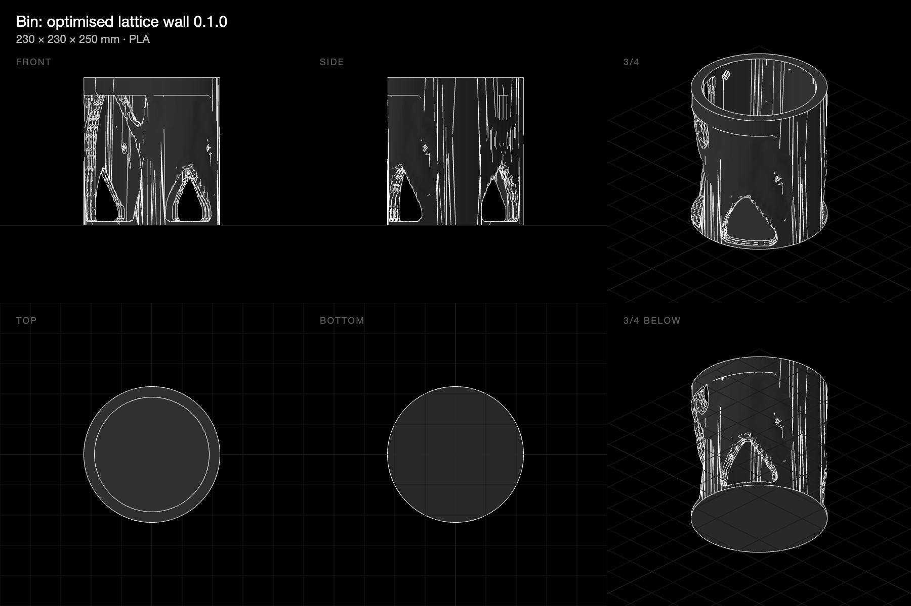](https://jonibach.github.io/rulecad-archive/m/bin/)

### Tree stand: optimised 0.1.0

2026-10-29 · `showcase/tree` in bench: Third attempt: a Y. A trunk rises from the feet and splits into three arms under the plate, one to each load. 10% of the space, three loads between the feet, no twist. In one piece apart from four specks of 1–2 cells, no overhangs past 45°, bridges 3.3 mm; 32 g of PLA; 239 steps in 87 min.

[Open in 3D](https://jonibach.github.io/rulecad-archive/m/tree-3/)

[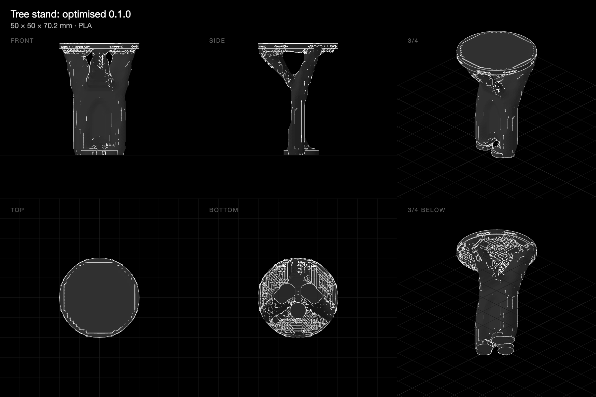](https://jonibach.github.io/rulecad-archive/m/tree-3/)

### Tree stand: optimised 0.1.0

2026-10-29 · `showcase/tree` in bench: Second attempt: a goblet, not a tree. With the feet together as a trunk and the load round the plate's edge, it grew a cone flaring out at 45° to the plate. The twisting case and six evenly spaced loads favour a closed shell over separate branches. In one piece, no overhangs past 45°, bridges 2.6 mm; 48 g of PLA; 266 steps in 55 min.

[Open in 3D](https://jonibach.github.io/rulecad-archive/m/tree-2/)

[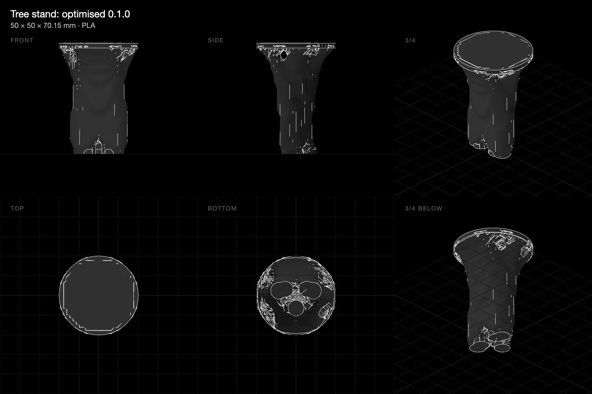](https://jonibach.github.io/rulecad-archive/m/tree-2/)

### Tree stand: optimised 0.1.0

2026-10-29 · `showcase/tree` in bench: First attempt: came out as a stool, three straight legs under a plate, not a tree. The loads sit right above the feet and the solid plate spreads them, so straight columns are stiffest. In one piece, prints standing on its feet with 3 mm bridges under the plate, 48 g of PLA; 237 steps on 40,960 cells in 49 min.

[Open in 3D](https://jonibach.github.io/rulecad-archive/m/tree/)

[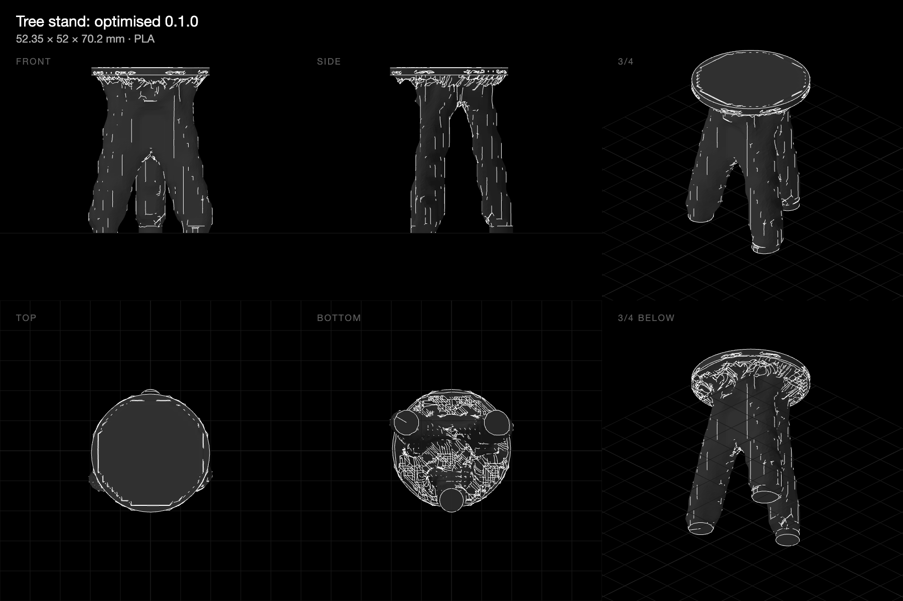](https://jonibach.github.io/rulecad-archive/m/tree/)

### Twisted tube: optimised 0.1.0

2026-10-28 · `showcase/twist` in bench: Second attempt, in one piece: 25% of a 40 × 80 mm cylinder with struts at least 5 mm thick. The wall opens into diamond windows running round it in a spiral. 249 steps on 23,040 cells of 2 mm in 19 min; printable standing up, 32 g of PLA.

[Open in 3D](https://jonibach.github.io/rulecad-archive/m/twist-2/)

[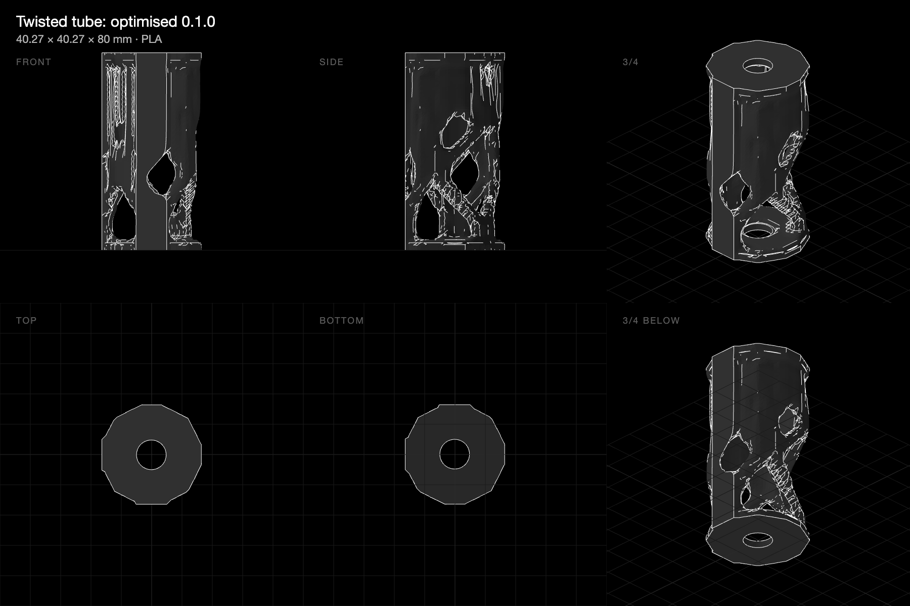](https://jonibach.github.io/rulecad-archive/m/twist-2/)

### Twisted tube, first attempt: falls apart

2026-10-28 · `showcase/twist` in bench: Failed: the struts came out one cell thick, and a one-cell strut at 45° on a cube grid touches only at edges, so the part fell into 11 pieces with many thin, non-solid bits. Settings: 15% of a 40 × 80 mm cylinder, filter 3 mm on 2 mm cells. Rerun with a 5 mm filter and 25% material.

[Open in 3D](https://jonibach.github.io/rulecad-archive/m/twist/)

[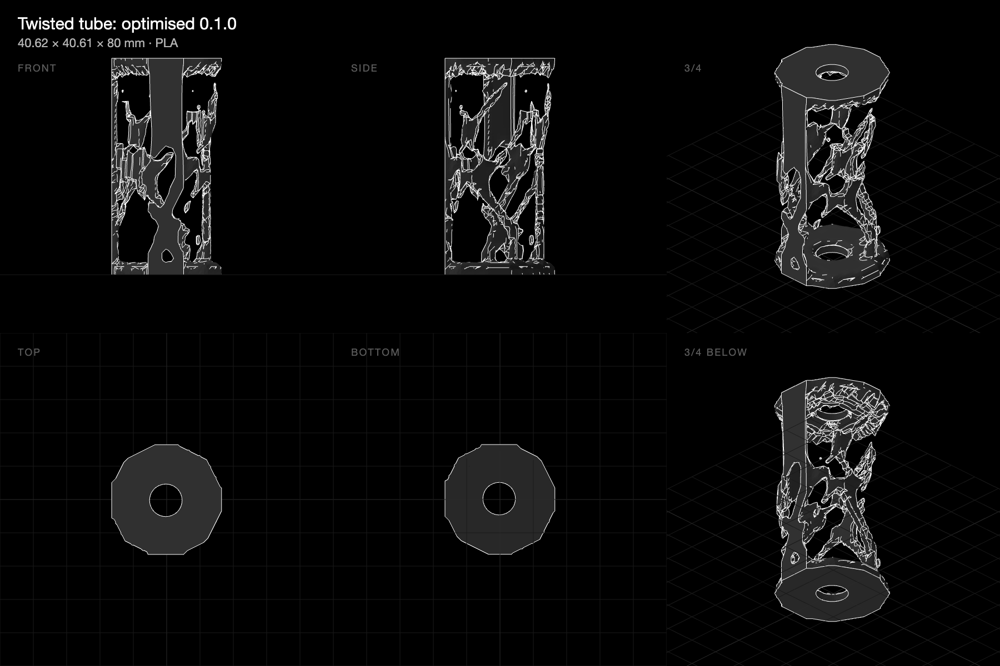](https://jonibach.github.io/rulecad-archive/m/twist/)

### Lever bench: optimised lever (both) 0.1.0

2026-10-28 · `bench/lever:both` in bench: optimised for two loads

[Open in 3D](https://jonibach.github.io/rulecad-archive/m/lever-d/)

[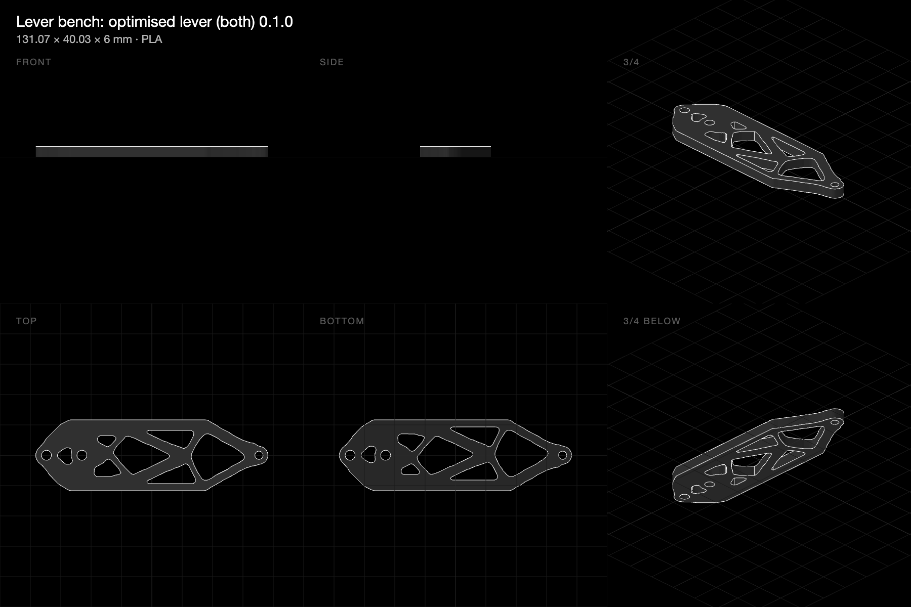](https://jonibach.github.io/rulecad-archive/m/lever-d/)

### Lever bench: lightened plate 0.1.0

2026-10-28 · `bench/lever-plate` in bench: a plate with four windows

[Open in 3D](https://jonibach.github.io/rulecad-archive/m/lever-b/)

[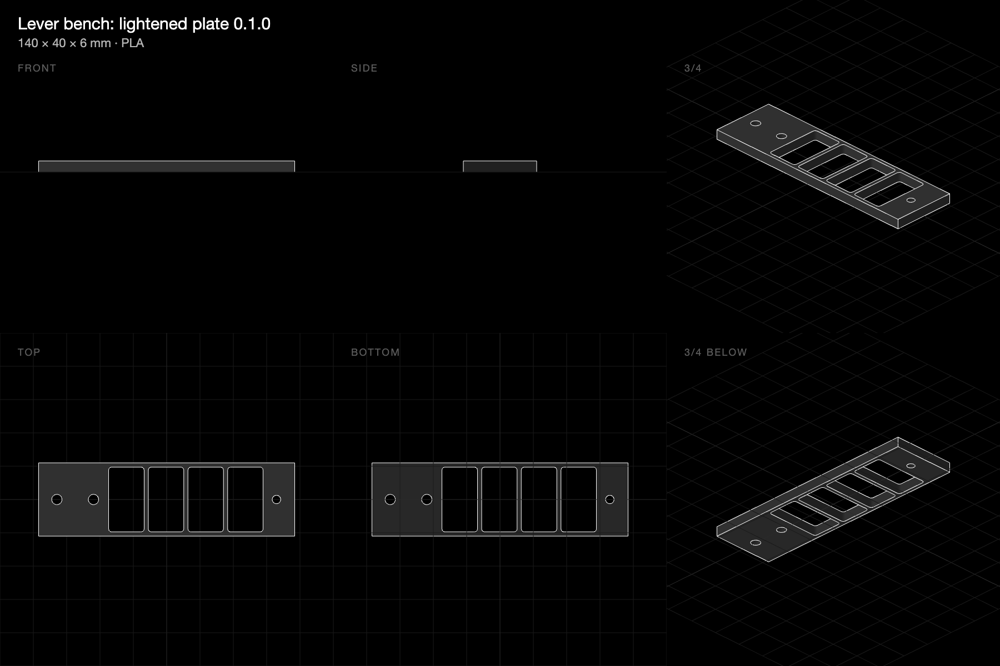](https://jonibach.github.io/rulecad-archive/m/lever-b/)

### Lever bench: plain bar 0.1.0

2026-10-28 · `bench/lever-bar` in bench: a plain bar

[Open in 3D](https://jonibach.github.io/rulecad-archive/m/lever-a/)

[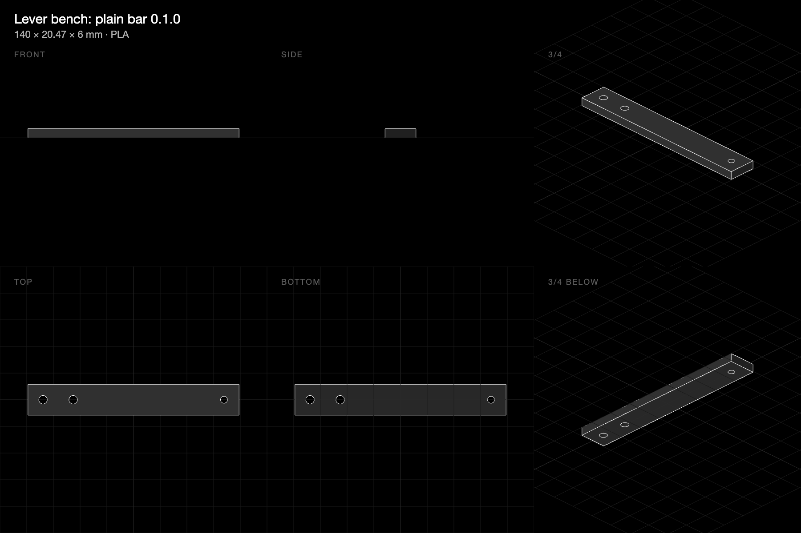](https://jonibach.github.io/rulecad-archive/m/lever-a/)

### Bracket bench: optimised bracket (side-free) 0.1.0

2026-10-28 · `bench/bracket:side-free` in bench: B laid on its side: what it would need supporting

[Open in 3D](https://jonibach.github.io/rulecad-archive/m/bracket-b-side/)

[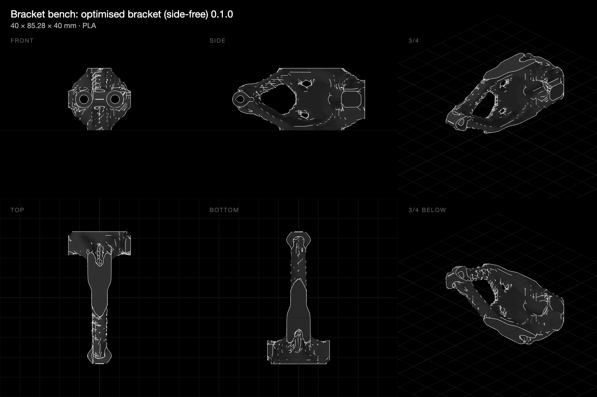](https://jonibach.github.io/rulecad-archive/m/bracket-b-side/)

### Bracket bench: optimised bracket 0.1.0

2026-10-28 · `bench/bracket` in bench: optimised freely

[Open in 3D](https://jonibach.github.io/rulecad-archive/m/bracket-b/)

[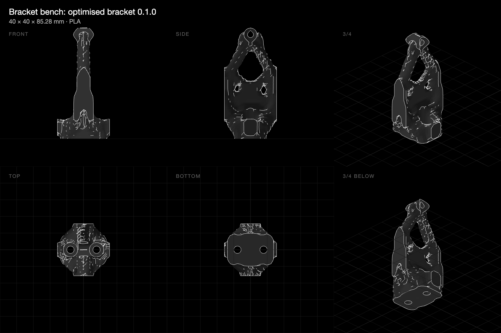](https://jonibach.github.io/rulecad-archive/m/bracket-b/)

### Bracket bench: plain web 0.1.0

2026-10-28 · `bench/bracket-web` in bench: the plain web: the hand-made bracket

[Open in 3D](https://jonibach.github.io/rulecad-archive/m/bracket-a/)

### L-bracket: lightest under 25 MPa

2026-10-28 · `lbracket/stress` in rulecad topopt reference: the lightest under 25 MPa; peak 36.6 MPa as made

[Open in 3D](https://jonibach.github.io/rulecad-archive/m/lbracket-stress/)

[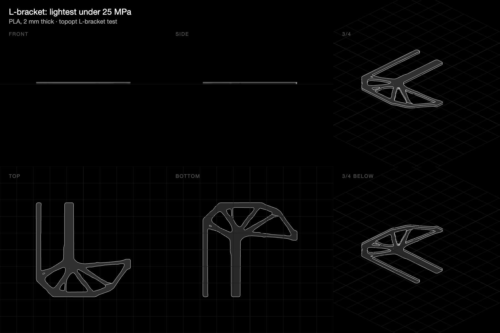](https://jonibach.github.io/rulecad-archive/m/lbracket-stress/)

### L-bracket: stiffest at 40%

2026-10-28 · `lbracket/stiffest` in rulecad topopt reference: the stiffest at 40% of the space; peak 67.2 MPa as made

[Open in 3D](https://jonibach.github.io/rulecad-archive/m/lbracket-stiffest/)

[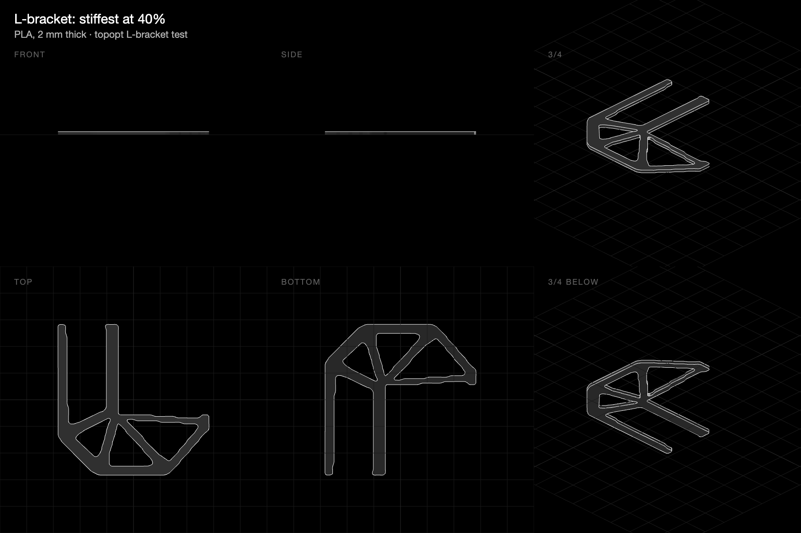](https://jonibach.github.io/rulecad-archive/m/lbracket-stiffest/)

### Bracket bench: optimised bracket

2026-10-28 · `bench/bracket` in rulecad examples: as shared

[Open in 3D](https://jonibach.github.io/rulecad-archive/m/bench-bracket/)

[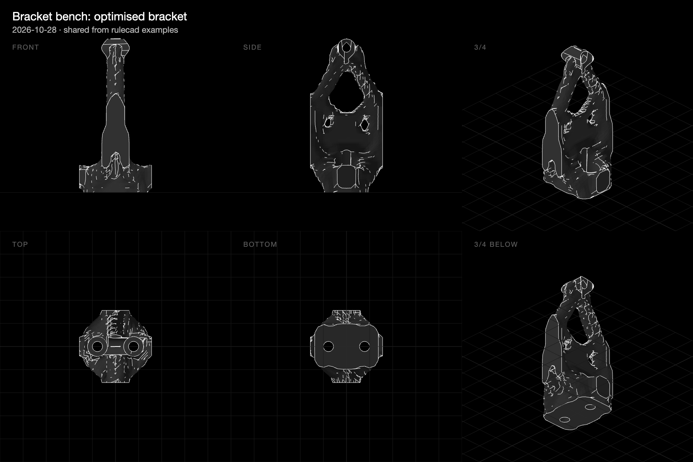](https://jonibach.github.io/rulecad-archive/m/bench-bracket/)

### Bracket bench: plain web

2026-10-28 · `bench/bracket-web` in rulecad examples: as shared

[Open in 3D](https://jonibach.github.io/rulecad-archive/m/bench-bracket-web/)

[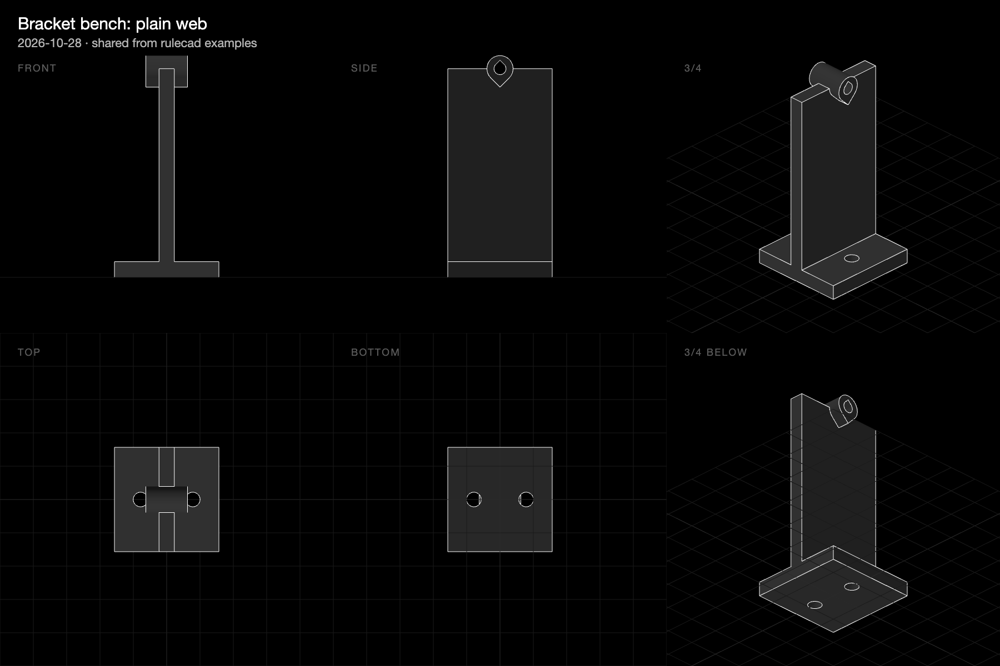](https://jonibach.github.io/rulecad-archive/m/bench-bracket-web/)

### Bracket bench, assembled

2026-10-28 · `bench/bracket-bench` in rulecad examples: as shared

[Open in 3D](https://jonibach.github.io/rulecad-archive/m/bench-bracket-bench/)

[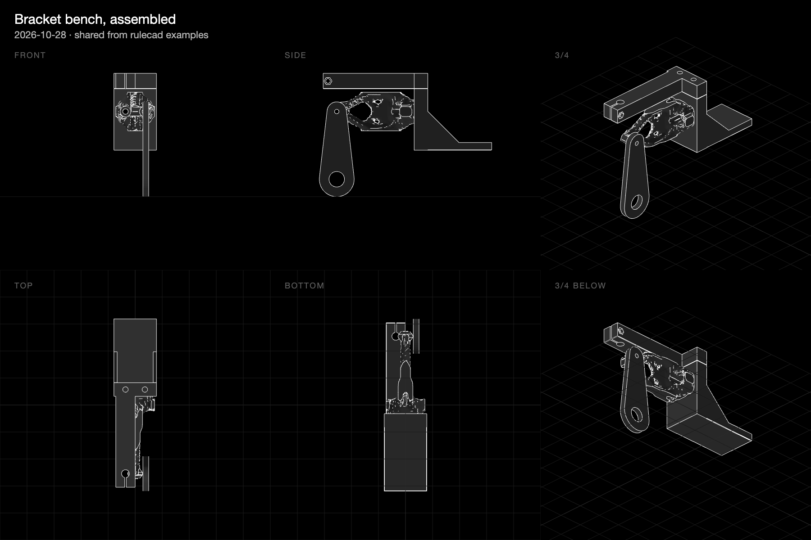](https://jonibach.github.io/rulecad-archive/m/bench-bracket-bench/)

### Lever bench: optimised lever 0.1.0

2026-10-28 · `bench/lever` in bench: the stiffest lever for its load, 2D

[Open in 3D](https://jonibach.github.io/rulecad-archive/m/lever-c/)

[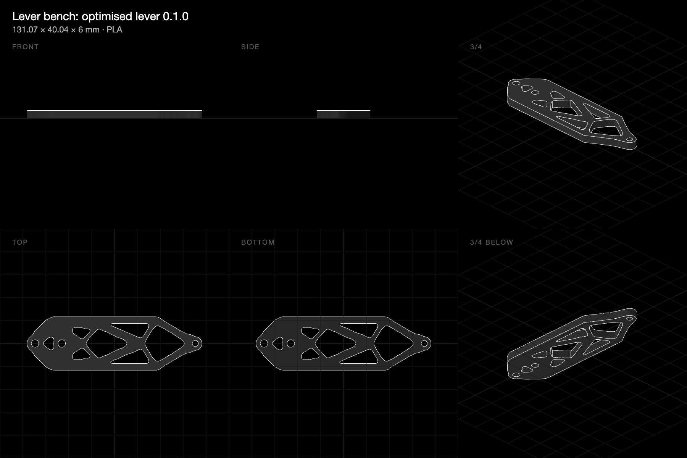](https://jonibach.github.io/rulecad-archive/m/lever-c/)

### Bracket bench: optimised bracket (side) 0.1.0

2026-10-28 · `bench/bracket:side` in bench: optimised to print without supports, lying on its side

[Open in 3D](https://jonibach.github.io/rulecad-archive/m/bracket-d/)

[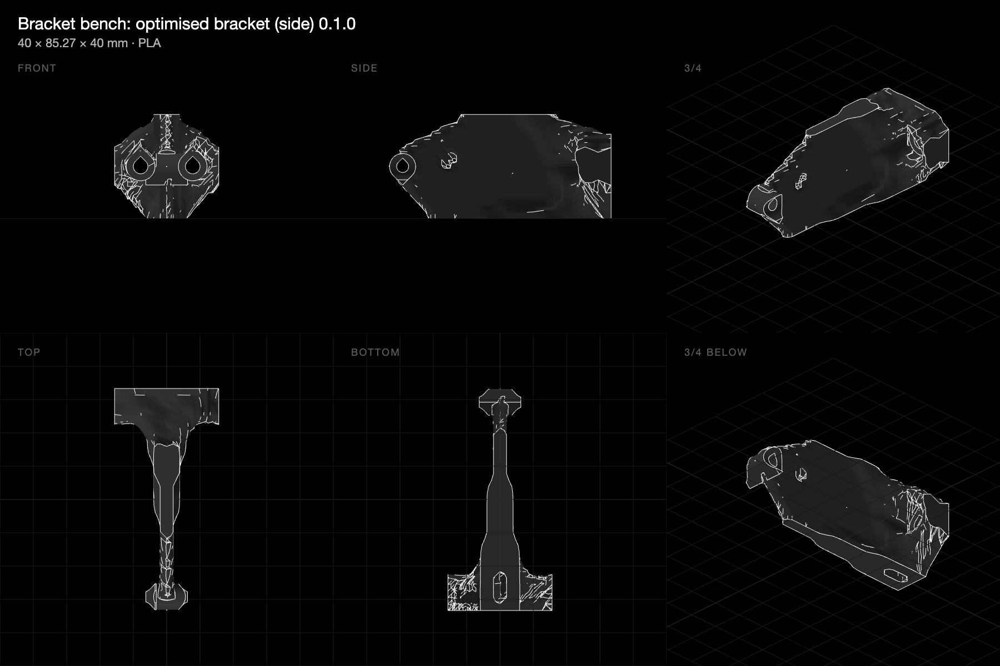](https://jonibach.github.io/rulecad-archive/m/bracket-d/)

### Bracket bench: optimised bracket (printable) 0.1.0

2026-10-28 · `bench/bracket:printable` in bench: optimised to print without supports, standing on its back plate

[Open in 3D](https://jonibach.github.io/rulecad-archive/m/bracket-c/)

[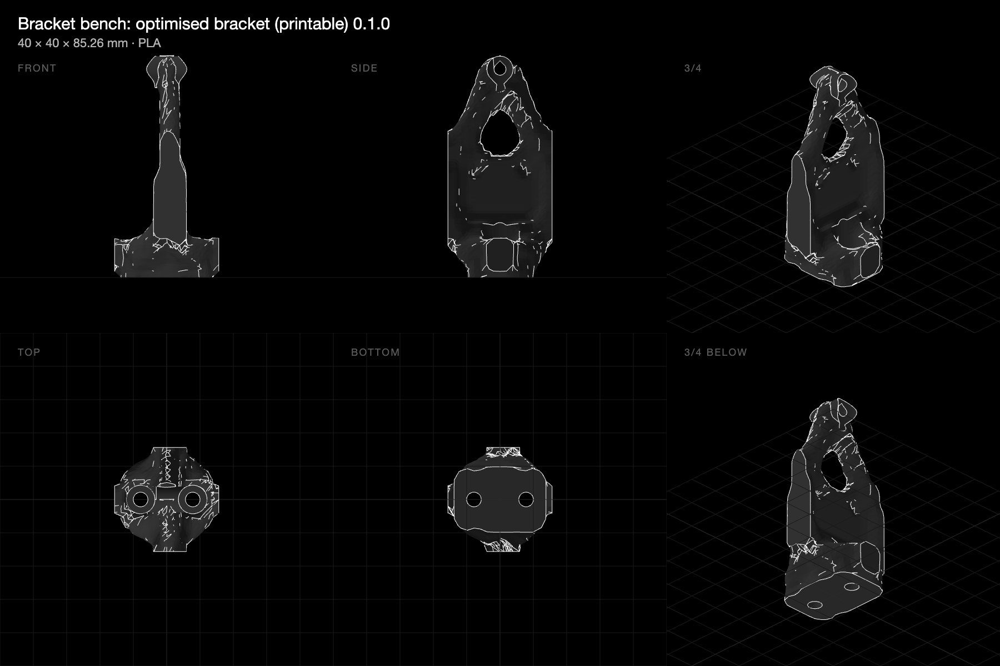](https://jonibach.github.io/rulecad-archive/m/bracket-c/)

### Legion Go folio (Cherry MX)

2026-10-27 · `legion-go-mx/folio` in mirror-cad: as shared

[Open in 3D](https://jonibach.github.io/rulecad-archive/m/legion-go-mx-folio/)

[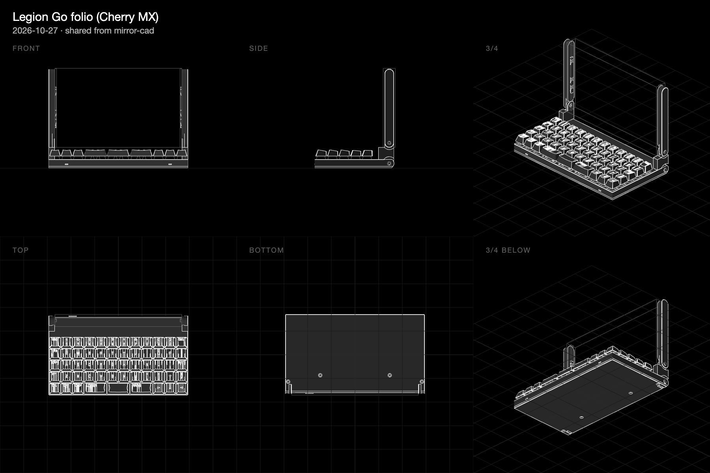](https://jonibach.github.io/rulecad-archive/m/legion-go-mx-folio/)

### Legion Go folio: 57 keycaps

2026-10-27 · `legion-go-mx/keycaps` in mirror-cad: as shared

[Open in 3D](https://jonibach.github.io/rulecad-archive/m/legion-go-mx-keycaps/)

[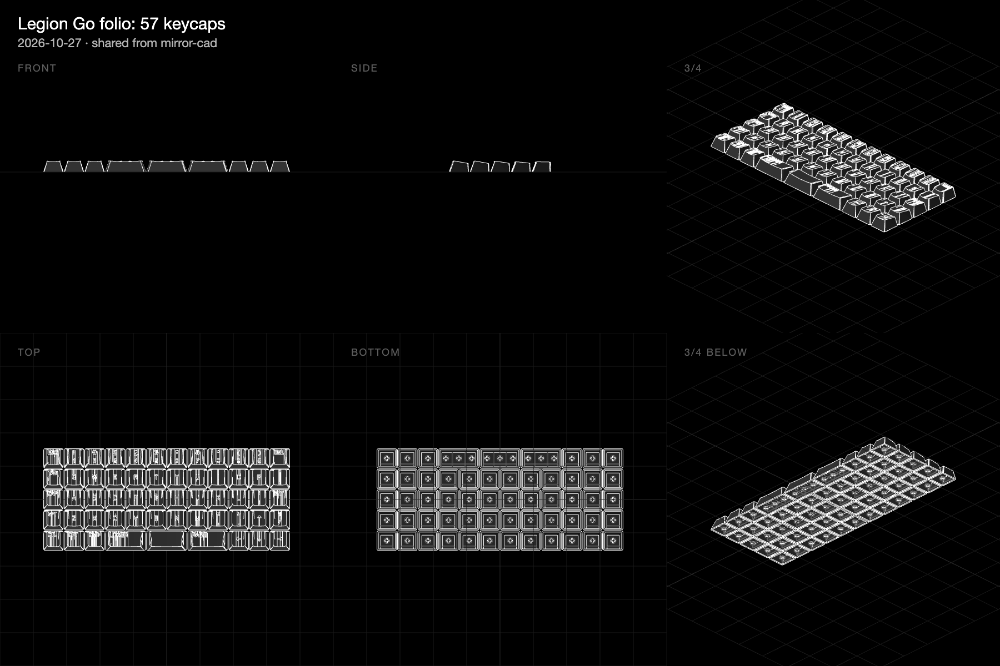](https://jonibach.github.io/rulecad-archive/m/legion-go-mx-keycaps/)

### Lever bench: optimised lever

2026-10-27 · `lever/optimised` in rulecad examples: as shared

[Open in 3D](https://jonibach.github.io/rulecad-archive/m/lever-optimised/)

[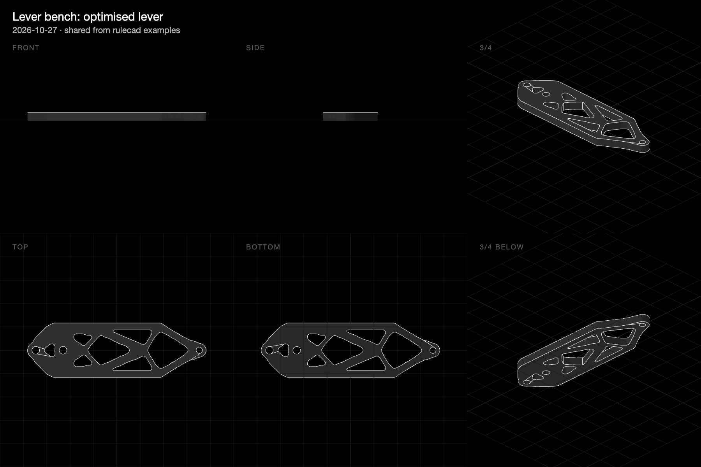](https://jonibach.github.io/rulecad-archive/m/lever-optimised/)

### Lever bench: optimised lever (both)

2026-10-27 · `lever/optimised:both` in rulecad examples: as shared

[Open in 3D](https://jonibach.github.io/rulecad-archive/m/lever-optimised-both/)

### Lever bench, assembled

2026-10-27 · `lever/bench` in rulecad examples: as shared

[Open in 3D](https://jonibach.github.io/rulecad-archive/m/lever-bench/)

[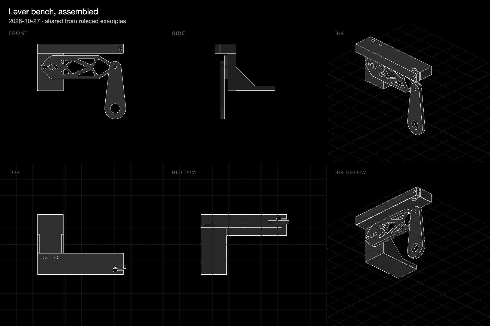](https://jonibach.github.io/rulecad-archive/m/lever-bench/)

### Legion Go folio

2026-10-26 · `legion-go/folio` in mirror-cad: as shared

[Open in 3D](https://jonibach.github.io/rulecad-archive/m/legion-go-folio/)

### Legion Go rail test piece

2026-10-25 · `legion-go/rail-test` in mirror-cad: as shared

[Open in 3D](https://jonibach.github.io/rulecad-archive/m/legion-go-rail-test/)

[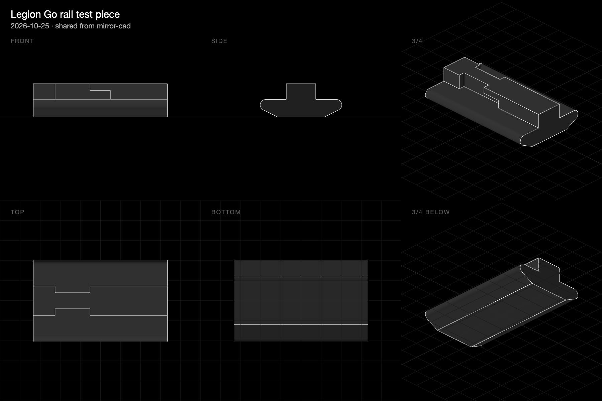](https://jonibach.github.io/rulecad-archive/m/legion-go-rail-test/)

### Legion Go rail test (full)

2026-10-25 · `legion-go/rail-test:full` in mirror-cad: as shared

[Open in 3D](https://jonibach.github.io/rulecad-archive/m/legion-go-rail-test-full/)

[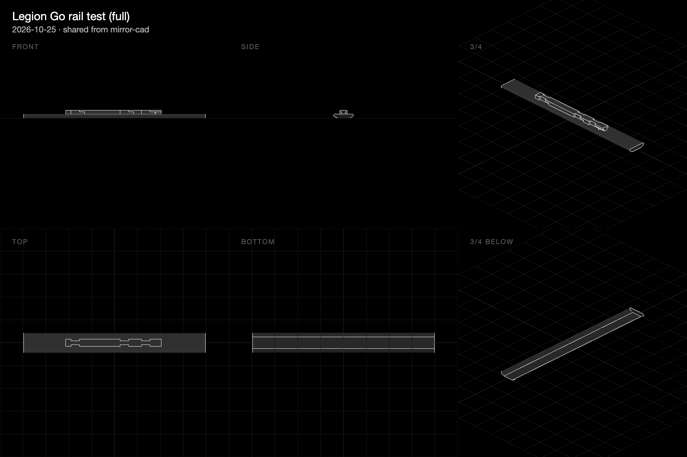](https://jonibach.github.io/rulecad-archive/m/legion-go-rail-test-full/)

### Legion Go rail test (short)

2026-10-25 · `legion-go/rail-test:short` in mirror-cad: as shared

[Open in 3D](https://jonibach.github.io/rulecad-archive/m/legion-go-rail-test-short/)

[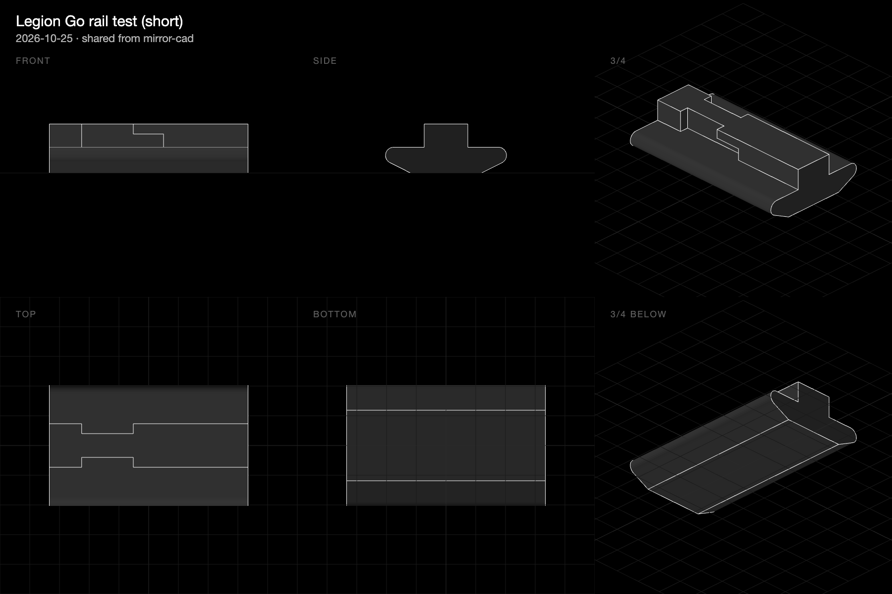](https://jonibach.github.io/rulecad-archive/m/legion-go-rail-test-short/)

### Legion Go hinge foot

2026-10-25 · `legion-go/hinge-foot` in mirror-cad: as shared

[Open in 3D](https://jonibach.github.io/rulecad-archive/m/legion-go-hinge-foot/)

[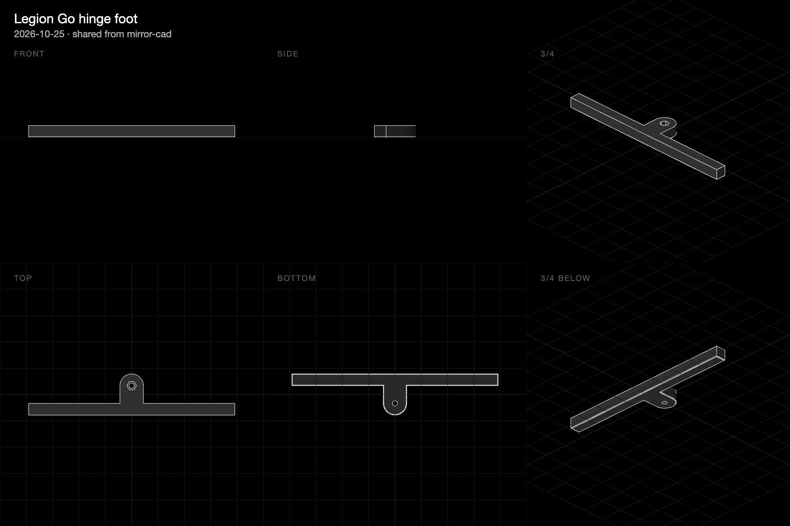](https://jonibach.github.io/rulecad-archive/m/legion-go-hinge-foot/)

### Legion Go keyboard case

2026-10-25 · `legion-go/keyboard` in mirror-cad: as shared

[Open in 3D](https://jonibach.github.io/rulecad-archive/m/legion-go-keyboard/)

[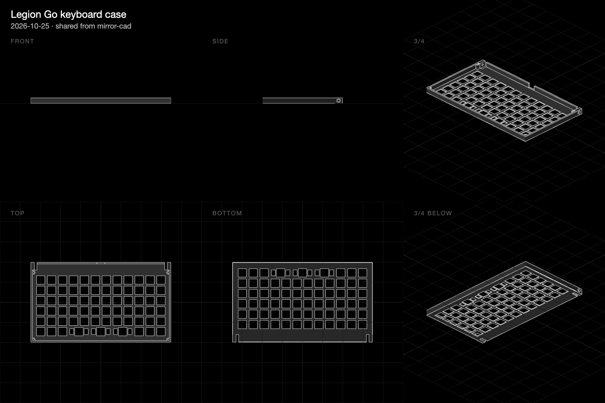](https://jonibach.github.io/rulecad-archive/m/legion-go-keyboard/)

### Legion Go rail test (box-short)

2026-10-25 · `legion-go/rail-test:box-short` in mirror-cad: as shared

[Open in 3D](https://jonibach.github.io/rulecad-archive/m/legion-go-rail-test-box-short/)

[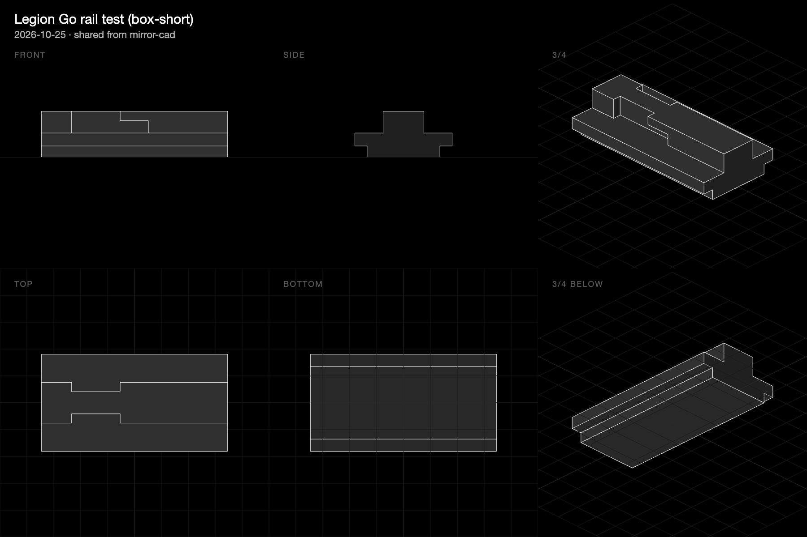](https://jonibach.github.io/rulecad-archive/m/legion-go-rail-test-box-short/)

### Legion Go folio: folded shut

2026-10-25 · `legion-go/folded` in mirror-cad: as shared

[Open in 3D](https://jonibach.github.io/rulecad-archive/m/legion-go-folded/)

### Legion Go folio: open flat

2026-10-25 · `legion-go/flat` in mirror-cad: as shared

[Open in 3D](https://jonibach.github.io/rulecad-archive/m/legion-go-flat/)

### Legion Go folio: tablet mode

2026-10-25 · `legion-go/tablet` in mirror-cad: as shared

[Open in 3D](https://jonibach.github.io/rulecad-archive/m/legion-go-tablet/)

### Legion Go side mount

2026-10-25 · `legion-go/mount` in mirror-cad: as shared

[Open in 3D](https://jonibach.github.io/rulecad-archive/m/legion-go-mount/)

### Legion Go folio: open

2026-10-25 · `legion-go/stand` in mirror-cad: as shared

[Open in 3D](https://jonibach.github.io/rulecad-archive/m/legion-go-stand/)

### Legion Go folio: open

2026-10-25 · `legion-go-mx/stand` in mirror-cad: as shared

[Open in 3D](https://jonibach.github.io/rulecad-archive/m/legion-go-mx-stand/)

### Legion Go folio: folded shut

2026-10-25 · `legion-go-mx/folded` in mirror-cad: as shared

[Open in 3D](https://jonibach.github.io/rulecad-archive/m/legion-go-mx-folded/)

### Legion Go folio: open flat

2026-10-25 · `legion-go-mx/flat` in mirror-cad: as shared

[Open in 3D](https://jonibach.github.io/rulecad-archive/m/legion-go-mx-flat/)

### Legion Go folio: tablet mode

2026-10-25 · `legion-go-mx/tablet` in mirror-cad: as shared

[Open in 3D](https://jonibach.github.io/rulecad-archive/m/legion-go-mx-tablet/)

### Staggered keyboard: 55 keycaps

2026-10-14 · `keyboard/staggered-keycaps` in mirror-cad: as shared

[Open in 3D](https://jonibach.github.io/rulecad-archive/m/keyboard-staggered-keycaps/)

### 9-key macropad PCB

2026-10-14 · `keyboard/macropad-pcb` in mirror-cad: as shared

[Open in 3D](https://jonibach.github.io/rulecad-archive/m/keyboard-macropad-pcb/)

### Staggered keyboard PCB

2026-10-14 · `keyboard/main-pcb` in mirror-cad: as shared

[Open in 3D](https://jonibach.github.io/rulecad-archive/m/keyboard-main-pcb/)

### Staggered PCB keyboard

2026-10-14 · `keyboard/staggered-pcb` in mirror-cad: as shared

[Open in 3D](https://jonibach.github.io/rulecad-archive/m/keyboard-staggered-pcb/)

### MX keycap

2026-10-14 · `keyboard/keycap` in mirror-cad: as shared

[Open in 3D](https://jonibach.github.io/rulecad-archive/m/keyboard-keycap/)

### 9-key macropad

2026-10-14 · `keyboard/macropad-3x3` in mirror-cad: as shared

[Open in 3D](https://jonibach.github.io/rulecad-archive/m/keyboard-macropad-3x3/)

### Staggered keyboard: plate

2026-10-13 · `keyboard/staggered-plate` in mirror-cad: as shared

[Open in 3D](https://jonibach.github.io/rulecad-archive/m/keyboard-staggered-plate/)

### MX keycap (legend-f)

2026-10-13 · `keyboard/keycap:legend-f` in mirror-cad: as shared

[Open in 3D](https://jonibach.github.io/rulecad-archive/m/keyboard-keycap-legend-f/)

### MX keycap (legend-shift)

2026-10-13 · `keyboard/keycap:legend-shift` in mirror-cad: as shared

[Open in 3D](https://jonibach.github.io/rulecad-archive/m/keyboard-keycap-legend-shift/)

### Staggered keyboard: case

2026-10-13 · `keyboard/staggered-case` in mirror-cad: as shared

[Open in 3D](https://jonibach.github.io/rulecad-archive/m/keyboard-staggered-case/)

### Staggered handwired keyboard

2026-10-13 · `keyboard/staggered` in mirror-cad: as shared

[Open in 3D](https://jonibach.github.io/rulecad-archive/m/keyboard-staggered/)

### Handwired 40% keyboard

2026-10-12 · `keyboard/handwired-40` in mirror-cad: as shared

[Open in 3D](https://jonibach.github.io/rulecad-archive/m/keyboard-handwired-40/)

### Handwired 40%: case

2026-10-12 · `keyboard/handwired-40-case` in mirror-cad: as shared

[Open in 3D](https://jonibach.github.io/rulecad-archive/m/keyboard-handwired-40-case/)

### Handwired 40%: plate

2026-10-12 · `keyboard/handwired-40-plate` in mirror-cad: as shared

[Open in 3D](https://jonibach.github.io/rulecad-archive/m/keyboard-handwired-40-plate/)

### Handwired 40%: 48 keycaps

2026-10-12 · `keyboard/handwired-40-keycaps` in mirror-cad: as shared

[Open in 3D](https://jonibach.github.io/rulecad-archive/m/keyboard-handwired-40-keycaps/)

### 9-key macropad, print plate

2026-10-11 · `keyboard/macropad-3x3-print` in mirror-cad: as shared

[Open in 3D](https://jonibach.github.io/rulecad-archive/m/keyboard-macropad-3x3-print/)

