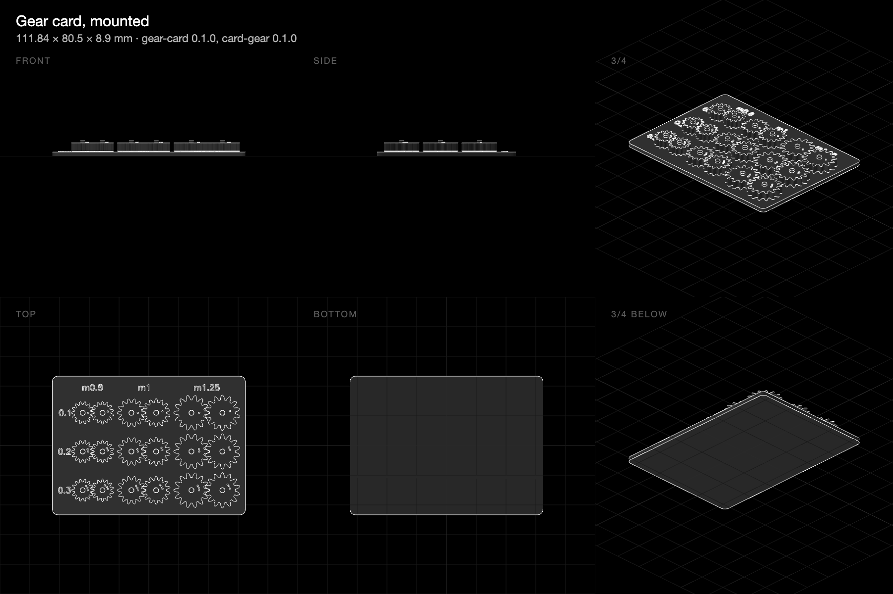

# Benchmarks for a robot joint: every estimate, measured

**9 November 2026 · a 17HS4401 stepper, SG90 servos and an Arduino Uno.**

Everything the kit predicts about a printed robot joint rests on figures nobody has measured on this printer: how much backlash turns freely, how a D-bore fits a real shaft, what a printed mesh passes on, and how much a joint twists. These parts measure them, one test each, in the order that lets each set up the next.

The first attempt at this set saved material by cutting its plates into ladders and spokes, which made hard first layers. These save it by being smaller. Each has one plain outline on the bed, and the kit now warns when a large part's first layer is cut up into too much edge.

## The parts

Nothing here has been printed yet.

| Print | Measures |
|---|---|
| [Fit bar](../../m/bench-fit-bar/) | Hole shrinkage, the 5 mm D-bore, M3 pilots |
| [Gear card](../../m/bench-gear-card/) | Backlash that turns freely, smallest module |
| [Motor stand](../../m/bench-motor-stand/) | Holding, detent and torque at speed, case temperature |
| [Servo stand](../../m/bench-servo-stand/) | An SG90's stall torque and dimensions |
| [Mesh rig](../../m/bench-mesh-rig/) | What one printed mesh passes on |
| [Shoulder](../../m/bench-shoulder/) | Efficiency, holding unpowered, play, twist, repeatability, speed under load |
| [Input lever](../../m/bench-input-lever/) | Turns the shoulder's sun by hand, for its efficiency |

The measuring sheet, wiring and parts list are in [the project's guide](https://github.com/JoniBach/rulecad/blob/main/examples/bench/projects/benchmarks/MEASURE.md).

A table of predicted against measured goes here once the numbers are in.
