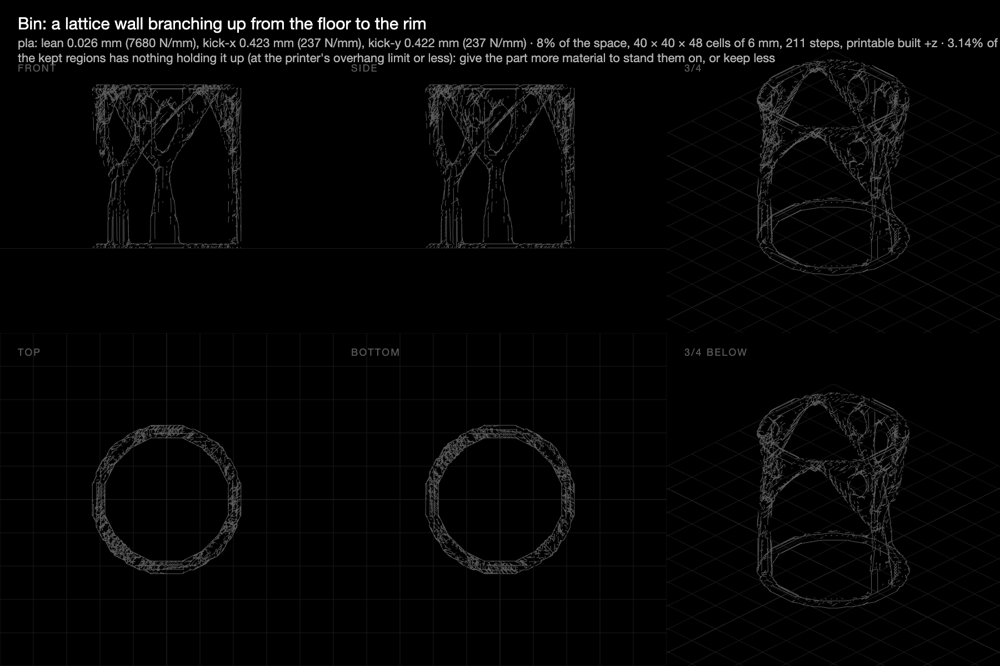

# Bin: a lattice wall for the X1C's whole build volume

**29–30 October 2026 · @rulecad/cad 0.7.12–0.7.15 · `examples/bench/projects/showcase/problems/bin.json`**

A bin 230 mm across and 250 mm tall, most of the X1C's 256 mm cube, printed as it stands. Material may go only in an 18 mm wall: a foot ring on the bed is held, a rim ring at the top is leant on (200 N over eight points) and kicked sideways (100 N, two directions). The design adds a 2 mm floor and a ledge under the rim sloping in a touch steeper than 45°, so the rim prints across the gaps. 6 mm cells (76,800), struts at least 15 mm thick. Use it with a bin liner.

| Attempt | Share of the cylinder | Shape | Leant on / kicked | PLA | Run | Model |
|---|---|---|---|---|---|---|
| 1 | 15% (half the wall) | A wall, mostly solid, with tall pointed-arch windows | 35,700 / 1,380 N/mm | 2 kg | 4 h, 246 steps, settled | [Open in 3D](https://jonibach.github.io/rulecad-archive/m/bin/) |
| 2 | 5% (17% of the wall) | Four legs rising into pointed arches that meet under the rim | 4,240 / 54 N/mm | 664 g | 1 h on the faster solver, 300 steps, not settled | [Open in 3D](https://jonibach.github.io/rulecad-archive/m/bin-2/) |
| 3 | 8% (27% of the wall) | Legs into pointed arches again, now braced by diagonals across the windows; the rim reached nearly everywhere | 7,680 / 237 N/mm | 1.06 kg | 42 min, 211 steps, settled | [Open in 3D](https://jonibach.github.io/rulecad-archive/m/bin-3/) |

## Findings

- **The share is set against the whole cylinder, the empty inside too.** 15% of 10.4 litres filled half the wall; 5% gives a lattice. That's what made the first attempt a solid wall, not the method.
- **The 45° rule draws pointed arches.** Every window's top is self-supporting, so every window is a Gothic arch. The second attempt's crown of arches is the same rule at a lower share.
- **The rim needs more than the arches reach.** 17% of the kept rim had nothing under it at 45°: the stretches between the arch tops. The design's ledge covers them, so the part passes every print check (one piece, nothing in mid-air, no overhang past 45°). A share of 7–8%, or finer cells, would let the optimiser reach the whole rim itself.
- **Bridging needs finer cells.** The optimiser can bridge half the printer's span (2.5 mm), which on 6 mm cells rounds to no cells at all. On 3 mm cells (614,000 of them) it would bridge one.
- **Kicked, it's springy:** 54 N/mm sideways against 4,240 leant on. Four legs with no diagonal bracing between them.
- **8% buys bracing and reaches the rim.** The third attempt keeps the arches and adds diagonals across the windows: 4.4 times stiffer sideways and 1.8 times leant on, for 1.6 times the plastic. Only 3% of the rim is left to the ledge (17% at 5%), and it settled on its own at step 211, in 42 minutes. It passes every print check.

## Next

- Finer cells once a run of 600,000 cells is affordable, so the optimiser can bridge and the struts can thin.
- Print the third attempt, with a liner.
