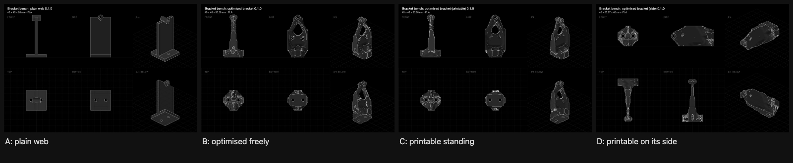

# Bracket bench: four wall brackets of equal mass

**28 October 2026 · rulecad examples/bench · measurements to come**

A wall bracket bolted to a wall by two M5 bolts reaches 80 mm out to a load bolt. Four brackets of the same mass (27,520 mm³, about 35 g of PLA) fill the same 40 × 40 × 86 mm space and are held and loaded the same way. The predictions are verified on 0.8 mm cells.

| Bracket | Straight down | At 45° | Overhang past 45° | Model |
|---|---|---|---|---|
| A, plain web | 95.2 N/mm | 24.4 N/mm | none | [Open in 3D](https://jonibach.github.io/rulecad-archive/m/bracket-a/) |
| B, optimised freely | 141 N/mm | 60.9 N/mm | 103 mm² standing; 1,035 mm² [on its side](https://jonibach.github.io/rulecad-archive/m/bracket-b-side/) | [Open in 3D](https://jonibach.github.io/rulecad-archive/m/bracket-b/) |
| C, printable standing on its back plate | 141 N/mm | 52.6 N/mm | none | [Open in 3D](https://jonibach.github.io/rulecad-archive/m/bracket-c/) |
| D, printable lying on its side | 127 N/mm | 41.0 N/mm | none | [Open in 3D](https://jonibach.github.io/rulecad-archive/m/bracket-d/) |

## Findings

- **Optimised against plain:** about 1.5 times as stiff straight down, and over twice as stiff at 45°, for the same material.
- **What printing without supports costs:** standing up, nothing straight down and 14% at 45°. Lying on its side, 10% straight down and 33% at 45°: every hole's roof must rise at 45°.
- **How sure:** stiffness changes less than 5% between 1 mm and 0.8 mm cells, except D at 45° (5.6%).

## Still to do

Print three of each, load them on the bench's rig and record the measurements against these predictions.
