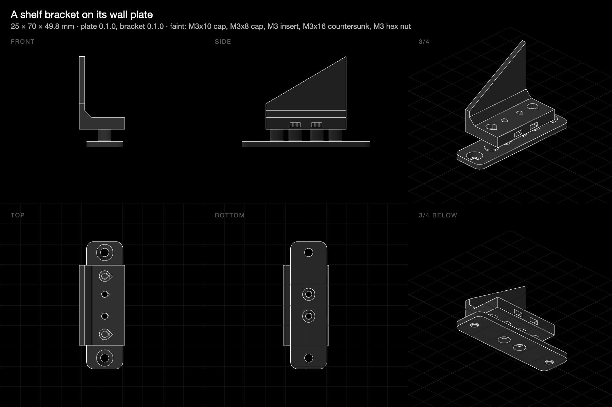
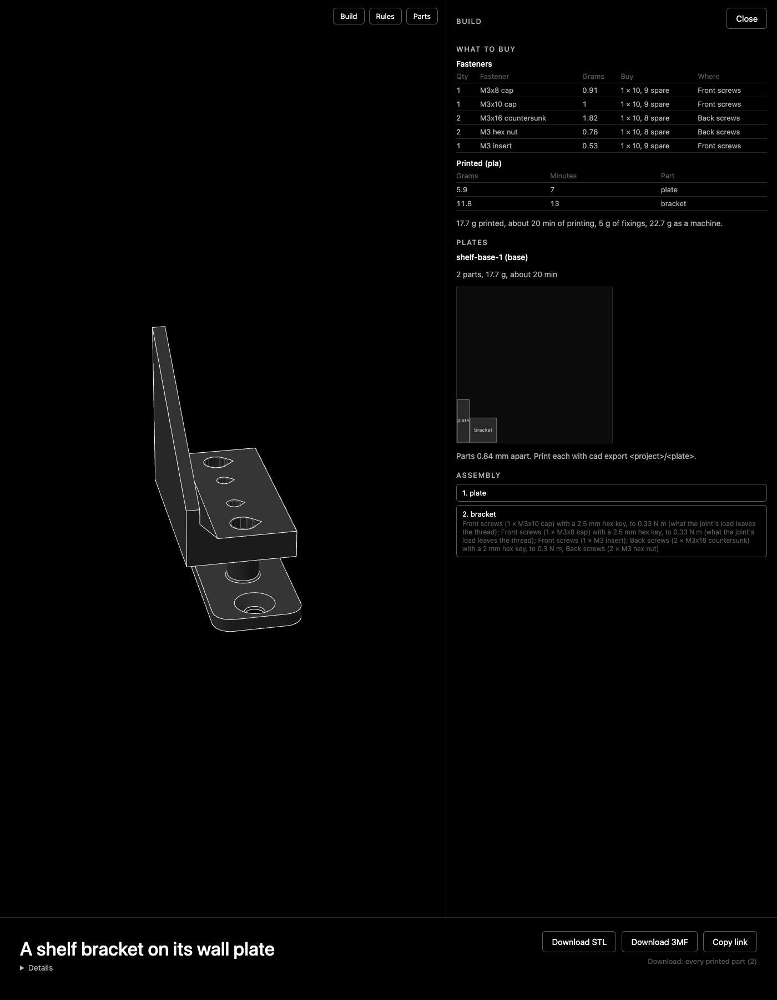
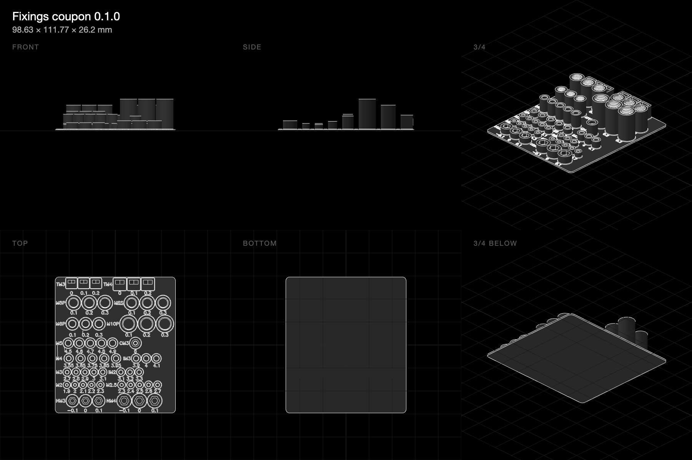

# Fixings from rules: a bracket screwed on, and the coupon that measures it

**15 November 2026 · @rulecad/fixings 0.1.3, cad 0.7.53 · the Fixings 2 milestone of [issue 212](https://github.com/JoniBach/rulecad/issues/212), worked example [issue 230](https://github.com/JoniBach/rulecad/issues/230) · measurements to come**

A printed part is usually held to another by screws, and each screw needs a hole it passes through, a seat for its
head, and something to grip at its far end: a pilot it cuts its own thread in, a heat-set insert, or a nut. Until now a
design typed those diameters by hand, and nothing checked that the screw bought would reach, bite, sit flat or be
reachable with a key. Now every hole and seat is drawn from the thread's rule set, and an assembly says which screw
joins which parts.

Nothing here has been printed yet. Every figure below is predicted, and the Measured column waits for the coupon.

## What rulecad gained for it

- **`v.fixings` in designs.** `hole` (clearance, pilot, insert, tap), `counterbore`, `countersink`, `nutPocket`,
  `nutTrap`, `insertBoss` and the rest, named by thread (`'M3'`, `'M3x12 cap'`), sized from the thread's standard and
  the printer's measured figures, each shaped to print without supports. The check says what each was drawn to and
  the rule it rests on.
- **`fasten` in assemblies.** A screw, the parts it passes through, the part it ends in, and where. The check follows
  each screw along its axis: the holes in line (`fasten.holes`), the clearance (`fasten.clearance`), what holds the far
  end (`fasten.end`), the shortest sold length that fits (`fasten.length`), the thread engaged (`fasten.engagement`),
  the seat under the head (`fasten.seat`), the hex key's way in, in the order it goes together (`fasten.access`), and
  with a load, the margin on the screw and its thread (`fasten.load`).
- **The shopping list and the build page.** Every screw, nut and insert by thread, length and head, its grams and the
  packs to buy; each step of the build with its screws, key and torque.
- **A nut in a slot.** For this example `fasten` learned to find a nut slid into a slot across the screw, partway
  along it (cad 0.7.53); before, it put the nut on the part's far face.

## The model

| Model | What the check says |
|---|---|
| [Shelf bracket on its wall plate](../../m/fixings-shelf-bracket/) | Two M3 cap screws from the front, one into a 2.9 mm pilot and one into a heat-set insert in its boss; two M3 countersunk screws from behind into nuts in slots. Lengths chosen: M3x10, M3x8 and M3x16. With 2 kg on the shelf, the front screws hold 41 times the load and the back ones 33 times. 17.7 g of PLA in two prints, no supports |
| [Fixings coupon](../../m/fixings-coupon/) | Pilots at five sizes, insert holes, nut pockets and slots at three fits, a counterbore and printed threads, each figure printed beside its feature: 54.5 g, about an hour |

The bracket is [Examples chapter 15](https://github.com/JoniBach/rulecad/blob/main/packages/cad/EXAMPLES.md), written
out in full with every command; [choosing a pilot, an insert or a nut](https://github.com/JoniBach/rulecad/blob/main/docs/guides/pilot-insert-nut.md)
is the short guide that goes with it.

Two mistakes the check catches, each by name: front screws named M3x6 engage 2.6 mm of thread where the pilot asks
5 mm and the insert 3 mm ("M3x10 cap would do", "M3x8 cap would do"); and with the plate put on the wall first, the
screws from behind cannot be reached by any key, and the assembly has no order that builds it. So the bracket goes on
its plate at the bench, and then the plate on the wall.

## Predicted against measured

The coupon is print 7 in `examples/bench/projects/benchmarks/MEASURE.md` (rows 22 to 28). Each result goes back with
`cad measured benchmarks/fixings-test <rule>=<figure>`, and every design drawn from `v.fixings` follows it.

| What | Predicted | Rests on | Measured |
|---|---|---|---|
| M2 pilot | 2.1 mm | `m2.pilot`, community | |
| M2.5 pilot | 2.5 mm | `m2_5.pilot`, community | |
| M3 pilot | 2.9 mm | `x1c.pilot_m3`, measured on the fit bar | |
| M4 pilot | 3.75 mm | `m4.pilot`, community | |
| M5 pilot | 4.7 mm | `m5.pilot`, an estimate | |
| M2 insert hole | 3.2 mm | `m2.insert_hole`, CNC Kitchen | |
| M3 insert hole | 4 mm | `m3.insert_hole`, CNC Kitchen | |
| M3 nut pocket, across the flats | 5.6 mm (no clearance once printed) | `m3.nut_flats`, ISO 4032, and `x1c.hole_comp` | |
| M3 nut slot, across the flats | 5.7 mm (slides in by hand) | the same and `x1c.slip`, an estimate | |
| Counterbore for an M3 cap head | 6 mm across, 3 mm deep | `m3.head`, `x1c.fit` | |
| Printed thread gap on the radius | 0.2 mm | `x1c.thread_gap`, an estimate | |
| Printed thread flank, M8 | 45° holds and prints at least as well as 60° | the kit's default | |
| Bracket and plate print with no supports | yes, every print check passes | `cad check` | |
| Bracket, plate | 11.8 g, 5.9 g; about 13 and 7 minutes | `cad list`, from volume and the printer's flow | |
| 2 kg on the shelf | holds: the web 81 times, the plate 5 times, the front screws 41 times, the back screws 33 times | by hand (PLA 39 MPa, community), `fasten.load` (estimates named in the finding) | |
| Nuts in the bracket's slots | drop in by hand, stay in, do not turn as the screw tightens | `nutTrap`, `x1c.slip` | |

## What is not done yet

- The coupon and the bracket are to be printed: the Measured column is empty until then.
- `fasten.load` reckons each `fasten` as if it held the part alone, so where two relations share a joint each figure
  is the worst case. The pressure under a countersunk head is not checked yet, so the bracket's back screws are given
  their torque by hand.
- An insert's pull-out and a nut's thread are not checked under load; the screw's proof load stands for the nut.
