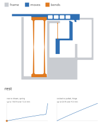

# Flat launcher action: a mechanism printed on its side, checked through its whole cycle

**1 November 2026 · @rulecad/flexures lamina · `examples/bench/projects/launcher/objects/flat`**

The first disc launcher was a set of cartridges pinned into a frame, and it printed as a total failure. Its moving
parts fused to the trays they stood on, the sliding parts bound, and the pins fell out. It was also unlike every printed
blaster that works. The BYU and Mark Rober one-piece blaster, the Unity disc shooter, the spring guns and the Q-tip
shooters are flat drawings printed on their side, with every spring, latch and trigger in that plane.

This is the launcher's action redrawn that way, as one print, and the checks rulecad needed to trust such a design.

In the animation the frame is grey, the parts that move are blue, and the springs, drawn bent, are orange.

## The action

- **The spring:** two leaves standing up the grip, joined at the top by the pusher. That is a parallel guide: the
  pusher moves straight back, and both leaves store the energy. The leaves taper toward their middles, where they
  bend least, and flare into their blocks in rounds.
- **The pusher:** a bar along the top, a tab out of the back to cock it, a tooth underneath.
- **The trigger is its own sear:** a lever hanging on a leaf hinge, its arm reaching forward to a hook. Cocking drags
  the tooth over the hook's ramp and pushes the trigger aside. Drawn a little past, the hook springs up, and the
  pusher settles back onto its catch.
- **A catch with bite:** the catch leans back 15°, so the spring's push presses the hook in. Pulling the trigger
  presses the pusher back a little as the hook comes down.
- **Hard stops:** the back wall stops the pusher, and the grip's front wall stops the trigger, each before its
  flexure's strain limit.
- **No square corners:** the trigger's hinge leaf is rounded into the frame and the blade, and every inside corner of
  the frame, the pusher and the trigger is rounded.

| | Size | At work |
|---|---|---|
| Spring | two leaves 2.52 mm thick at their ends, tapering toward their middles, 14 mm wide, 2.5 mm rounds | 8.75 N and 55 mJ drawn; a peak of 1.06% strain by finite elements, stopped at 13.0 mm |
| Trigger hinge | a leaf 26 × 0.84 mm, 1 mm rounds | lets the pusher go once moved 2.3 mm; a peak of 0.86% at a full pull, stopped at 4.9 mm |
| Catch | 2 mm deep, leaning back 15° | holds at any friction over 0.03 |

The limit is 1.25% strain.

The flexures are PETG. Its strength over its stiffness is 1.9% strain, against PLA's 1.5%: the first launcher sized
its PLA spring at 2%, past where PLA yields.

## What rulecad does now

- **Displacement first.** The spring is sized from its travel, as the BYU blaster paper (PLOS ONE, 2026) argues. The
  stroke and the strain limit set its length and thickness, and the force comes last, from its width. Here the width
  is the print's height.
- **Prints free.** Everything must clear what it isn't joined to by the printer's gap, or it fuses. A flexure must
  touch its two bodies in one place each, and run into them, not just meet them along an edge.
- **The whole cycle.** Each step from rest to cocked, pulled, fired and back is walked a quarter of a millimetre at a
  time. A latch is pushed aside by what drives it, as far as it must.
- **Jams and catches.** A face too steep to push aside jams the driver. A catch must hold even when the plastic is
  slippery, at a friction of 0.1. A ramp must still pass when it is sticky, at 0.5.
- **Hard stops.** Each flexure must meet something before its strain limit.
- **The real peak strain.** Each flexure, with a band of each body it meets, is solved by finite elements at the
  travel it reaches. A peak at a square inside corner fails, because the strain there has no bound.

The first version had square corners wherever a leaf met a block. Beam theory said the spring saw 0.98%. The
finite-element check found 2.37% at the corner, nearly twice the limit, and 1.77% in the hinge: both would have bent
for good on the first cock. Tapered leaves and rounds brought them to 1.06% and 0.86%.

Each check was tested by breaking the design on purpose: a steep ramp, a short trigger pull, a hook that can't
reach, a missing stop, a catch leaning the wrong way, and a block 0.1 mm from a leaf. Each fails with its reason.
The 2D geometry moved to Manifold's Clipper2: JSCAD's 2D booleans returned garbage on that last case and let it pass.

## What the physics says (2 November)

Solved as it would behave, with large-deflection beams, contact and a hand working it:

- **The trigger can't hold the cock.** The hanging leaf hinge is stiff to turn but soft sideways, so the pusher's
  push on the catch, about 8 N, swings the trigger forward until the hook slips off. Expect a print to fire as soon as
  the tab is let go. It needs a pivot that's stiff sideways.
- **The shot.** Drawn back with the trigger pulled and let go, the pusher reaches 2.3 m/s and the disc leaves at
  3.5 m/s with 4.8 mJ: 9% of the 54.5 mJ stored. The animation ends with the shot in slow motion.

More: [Mechanisms solved as they would behave](https://jonibach.github.io/rulecad-archive/experiments/mechanism-physics/)

## Still to do

- The printer's gap for parts printed in place is an estimate, 0.3 mm. The fit test plate measures it.
- The disc's channel, the magazine and a grip shaped for the hand. The frame here is a plain box round the mechanism.
- A print.

Model: [the flat action](https://jonibach.github.io/rulecad-archive/m/launcher-flat/)
