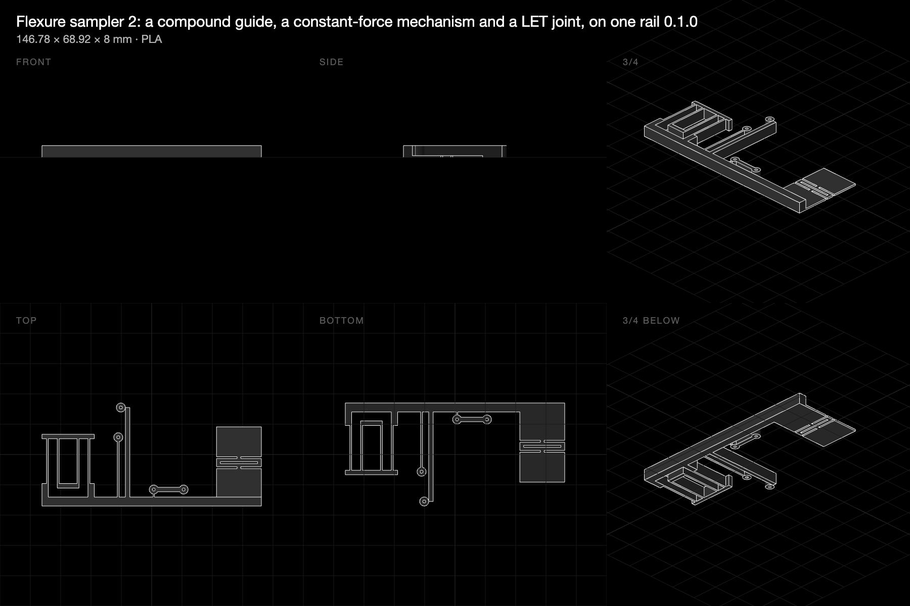

# Flexure samplers: ten flexures and three mechanisms to measure

**30 October 2026 · @rulecad/flexures 0.1.3 · `examples/bench/projects/flexures` · measurements to come**

Two plates, printed flat, with every flexure in `@rulecad/flexures` bending in the plane of the bed (within its
layers), except the LET joint, which folds up out of it. Each has a predicted stiffness and a predicted travel to 2%
strain from beam theory and the pseudo-rigid-body model. Measured, they become the material's strain limit and a
check on the models. One plate of each in PLA and in PETG, 100% infill, 0.2 mm layers, 0.42 mm lines.

| Plate | What's on it | Model |
|---|---|---|
| 1 | Leaf springs at two, three and four lines; a parallel guide; a serpentine spring; two notch hinges; a bistable beam; two living hinges | [Open in 3D](https://jonibach.github.io/rulecad-archive/m/flexure-sampler/) |
| 2 | A compound parallel guide; a constant-force slider-crank with a leaf coupler, pinned with filament; a LET joint six layers thick | [Open in 3D](https://jonibach.github.io/rulecad-archive/m/flexure-sampler-2/) |

## Predictions

Modulus along the layers: PLA 2,680 MPa, PETG 1,810 MPa. Travel is to 2% strain.

| Specimen | PLA | PETG | Travel to 2% |
|---|---|---|---|
| Leaf, 40 mm, two lines (0.84 mm) | 0.050 N/mm | 0.034 N/mm | 25 mm |
| Leaf, three lines (1.26 mm) | 0.168 N/mm | 0.113 N/mm | 17 mm |
| Leaf, four lines (1.68 mm) | 0.397 N/mm | 0.268 N/mm | 13 mm |
| Parallel guide, 30 mm leaves, 12 mm apart | 3.18 N/mm | 2.15 N/mm | 4.8 mm, the shuttle dropping 0.45 mm |
| Serpentine, 5 × 20 mm | 1.07 N/mm | 0.72 N/mm | 11 mm |
| Notch hinge, 3 mm notches, two-line neck | 566 N·mm/rad | 382 N·mm/rad | 4.3° (1.5 mm at the arm's end) |
| Notch hinge, three-line neck | 1,560 N·mm/rad | 1,050 N·mm/rad | 3.5° (1.2 mm) |
| Bistable beam, 60 mm, 3 mm rise | 1.88 N/mm at the start | 1.27 N/mm | snaps 6 mm; 1.4% strain on the way |
| Living hinge, 2 mm strip | 529 N·mm/rad | 358 N·mm/rad | 5.5° |
| Living hinge, 4 mm strip | 265 N·mm/rad | 179 N·mm/rad | 10.9° |
| Compound guide, 30 mm leaves | 1.59 N/mm | 1.07 N/mm | 9.5 mm, no drop |
| Constant-force mechanism, 40 mm leaf of three lines | 1.72 N from 0.8 to 9.7 mm | 1.16 N | 23 mm |
| LET joint, 30 mm, six layers | 65.9 N·mm/rad | 44.5 N·mm/rad | 40° |

## How to measure

Weights at the eyes (coins: a 1p is 3.56 g, a 2p 7.12 g, a £1 8.75 g) or the bench's dial gauge; three readings at
increasing loads, the slope is the stiffness. Push each leaf further until it whitens (PLA) or stays bent (PETG):
that travel, through the model's `strain(travel)`, is the material's strain limit. The notch and living hinges turn:
the angle is the travel at the arm's end over the arm's length. The constant-force mechanism: snap the crank off
its tab, pin it, push the slider block along its line and read the force every 2 mm. The LET joint: fold the outer
panel up, and note where it whitens first (the bridges, the model says). Readings go in `results.json` beside the
project, in the fields the file names.

## Findings

To come, when the plates are printed and measured. Three questions they answer:

- **What strain does PLA take, and PETG?** The rules carry no limit yet on purpose; this is where it comes from.
- **Do the models hold past a few thicknesses of travel?** The leaves go further than beam theory's range; the
  elastica says how much they stiffen and shorten.
- **Does the LET joint survive in PLA?** It is the one flexure that bends across its layers.
