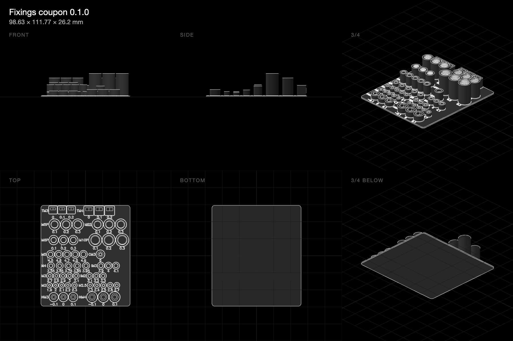

# What to print to test fixings and frames

**21 November 2026.** Screw holes, inserts, printed threads, slot fits, the springiness of a join and the stiffness of a printed beam are all estimates in the kit until they're measured. This page lists the five coupons that measure them (two of them share a plate), in order, and then the frame they lead up to. [Issue 276](https://github.com/JoniBach/rulecad/issues/276) and the frames umbrella, [issue 240](https://github.com/JoniBach/rulecad/issues/240), stay open until that's done.

Each link opens the model in 3D, with its parts to download. Print in PLA at 0.2 mm layers unless it says otherwise. The row numbers refer to the [measuring sheet](https://github.com/JoniBach/rulecad/blob/main/examples/bench/projects/benchmarks/MEASURE.md), which says how to take each measurement and gives the exact command that writes it back.



## The prints

| Order | Print | Mass and time | Measures (rows) | Needed for |
|---|---|---|---|---|
| 1 | [Fixings coupon](../../m/fixings-coupon/) and [holds coupon](../../m/bench-holds-coupon/), side by side on one plate (`npx cad plates benchmarks/fixings-test`): **once in PLA, once in PETG** | 93 g, about 100 minutes each time | 22 to 28: screw pilots M2 to M5, heat-set insert holes, nut pockets and slots, the counterbore, printed threads M6 to M10, and the flank form. 40 to 47: printed M8 and M10 bolts and nuts, snap pins, dowel and filament pin holes, magnet pockets, and a printed bolt pulled until it breaks | Anything screwed, pinned or held by a magnet |
| 2 | [Slot coupon](../../m/bench-slot-coupon/): 26 loose pieces | 40 g, about 45 minutes | 29 to 33: tongues, carriers and printed slots for slot 6 and slot 8 beams, and the slot measured by calipers | Parts that fit into aluminium beams |
| 3 | [Joint rig](../../m/bench-joint-rig/): three hangers, the dial arm, the nut puller and a printed corner bracket, all on one plate | 82 g, about 90 minutes | 34 to 37: the spring of a blind join, a printed bracket and a bought fitting, and how hard a slot nut holds along its slot | Every frame's sag and frequency |
| 4 | [Beam coupon](../../m/bench-beam-coupon/): one printed 1515 beam lying down (`k1`) and one standing up (`k2`), 240 mm long, on one plate. **Once in each plastic** | 79 g, about 90 minutes | 38 and 39: the printed beam's sag under 2 kg, then the load that breaks it | Printed beams (chapter 17's case) |

Together that comes to about 465 g and 8½ hours of printing, counting the fixings plate and the beam coupon twice (PLA and PETG). `npx cad plates benchmarks/joint-test` and `npx cad plates benchmarks/beam-test` write the plates for 3 and 4.

Optional: `npx cad beams benchmarks/joint-test --jigs` gives six jigs for cutting, drilling and tapping the rig's beams (109 g). They're worth printing if you have no drill press or tap guide.

**The holds coupon needs [rulecad pull request 289](https://github.com/JoniBach/rulecad/pull/289)** (Fixings 4) to be merged and published before its results can be written back.

**The fixings coupon decides one open question:** rows M8P and M8S compare the two ways of printing a thread, flanks laid back to 45° (the kit's default) against the standard's 60°. Row 28 says how to judge them.

## What to buy

| For | Parts |
|---|---|
| Fixings coupon | Socket cap screws M2 × 6, M2.5 × 6, M3 × 6, M3 × 8, M4 × 8, M5 × 16. M3 and M4 hex nuts. CNC Kitchen heat-set inserts M2 × 3 and M3 × 5.7, and an insert tip for the soldering iron. Steel bolts M6 × 16, M8 × 20 and M10 × 25 or longer. A spanner |
| Holds coupon | Two 3 × 12 mm steel dowel pins (ISO 8734). A few 12 mm lengths of 1.75 mm filament, cut square. Disc magnets, N35 or stronger: three 6 × 3 mm and four 8 × 3 mm (sold in tens). A steel M8 hex nut and washer for the pull bolt. Two blocks of wood no more than 20 mm thick and a G-clamp. A loop of strong cord, the joint rig's luggage scale, and a vice or two scraps of wood to press the magnets in |
| Slot coupon | A 50 to 100 mm offcut of your beam, cut square at one end. M2.5 nuts and M2.5 × 8 screws (slot 6), M5 nuts and M5 × 10 screws (slot 8). One bought slot nut made for your beam |
| Joint rig | One metre of 2020 beam, MISUMI HFS5 or similar: one 400 mm length and three of 150 mm, cut square, each short one tapped M5 at its outer end. One MISUMI HMJ5 centre joint. M5 slide-in slot nuts: five, and one of each kind you want to test. M5 button-head screws: 12 mm × 2, 16 mm × 3, 25 mm × 2. M5 cap screws 12 mm × 2. An M4 × 16 screw and nut. A dial indicator reading 0.01 mm with an 8 mm stem. A 2 kg hanging mass, such as a 2 litre bottle on an S-hook. A luggage scale reading to 50 kg. Two G-clamps. A 7.1 mm drill |
| Beam coupon | Two round bars about 8 mm across and 60 mm long (M8 bolts will do), a loop of cord, and the joint rig's mass, dial and scale. Safety glasses, because PLA snaps |

The measuring sheet's "What you need" table has the full list, including each beam's drilling.

## Writing the results back

Each measurement goes back with one command, and every prediction that rests on it moves. For example:

```sh
npx cad measured benchmarks/fixings-test x1c.pilot_m3=2.9 --source "fixings coupon, PLA"
npx cad measured benchmarks/joint-test c1.drop=0.35
npx cad measured benchmarks/beam-test k1.sag=0.6
```

(These figures are examples. Use what you measure.)

## Then: build and measure a frame (issue 276)

With the coupons written back, build [chapter 16's frame](../frames/), a box of 2020 with a moving axis. Its 17 printed parts fit one plate (124 g, about 2¼ hours), and `npx cad beams` gives the cut list, the drilling sheets and eight jigs. Measure the two diagonals, the sag at mid-span under a known mass, the lowest frequency (tap it and record the sound on a phone), the axis's travel, and the printed parts' mass. Write each one back with `npx cad measured`. The table of predicted against measured then goes on this archive.

[Chapter 17's printed case](../printed-case/) is the frame to build if you want to test printed beams in a real build rather than the coupon. It needs no aluminium.
