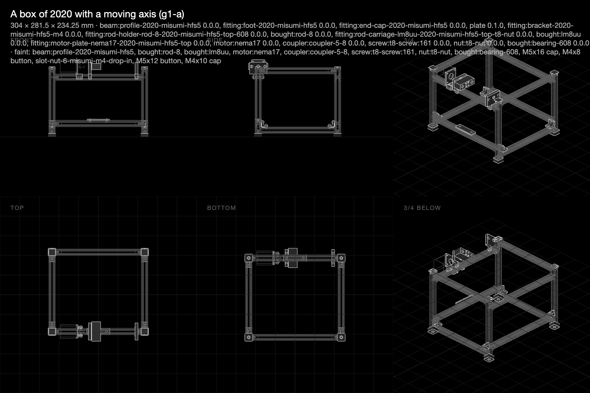
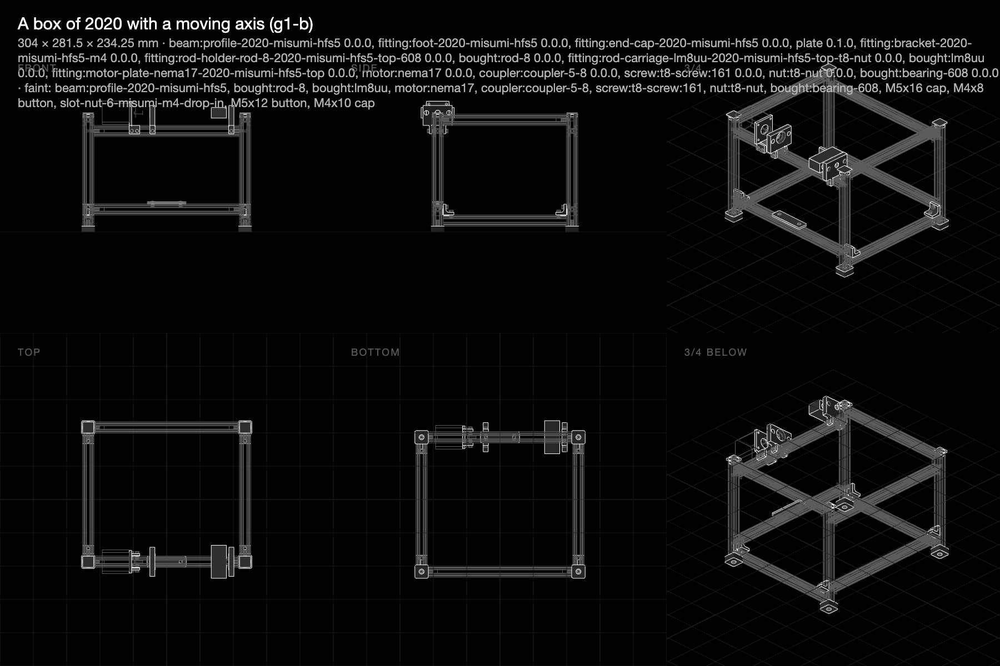
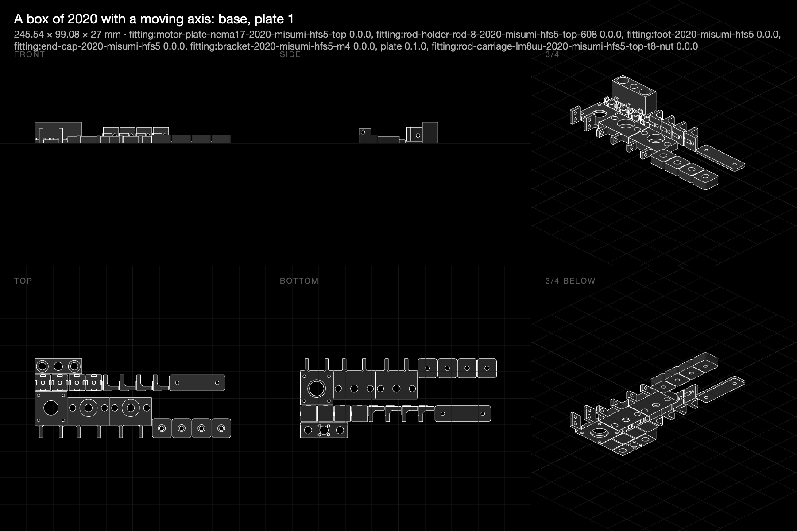

# A frame of beams with a moving axis: cut, drilled, printed and built from one assembly

**17 November 2026 · @rulecad/frames and cad, branch frames-2 of rulecad (issue [263](https://github.com/JoniBach/rulecad/issues/263), plan [240](https://github.com/JoniBach/rulecad/issues/240)) · EXAMPLES chapter 16**

A box of aluminium extrusion is the start of many machines: a camera slider, a plotter, a test rig. Drawing one is the
easy part. The hard parts are the ones people meet at the bench: which beams to cut to what length, where to drill
the access holes, which slot nuts have to be in a slot before a corner closes it, how long each screw is, and what to
print. This experiment builds one small frame entirely from a single assembly file and lets the kit work all of that
out.

Nothing here has been cut or printed yet. Every figure below is a prediction, and a table of predicted against
measured will go here once there is one.

## The model

- [A box of 2020 with a moving axis](../../m/2026-11-17-frame-box/): open it and drag the carriage's slider to sweep
  it along its axis, 0 to 99.5 mm.

## What it is

- Twelve beams of one profile, MISUMI's 2020 (HFS5-2020), each placed by its two ends: four 200 mm posts, four 260 mm
  rails along x and four 220 mm rails along y.
- Twelve blind joins (a tapped rail end, a button-head screw hidden in the post's slot, an access hole for the key)
  and four printed corner brackets on the bottom rails along y.
- A printed foot screwed into each post's tapped end, and a printed end cap pushed onto each top end.
- An axis on the top front rail: two 8 mm rods in printed holders, a printed carriage on two LM8UU bearings, a T8 lead
  screw driven by a NEMA 17 on a printed motor plate. Every part of it is placed by the guide from the beam's
  addresses.
- A printed board plate screwed into the bottom front rail's slot on drop-in nuts.

## What the checks predict

| Check | Prediction | Rests on |
|---|---|---|
| Joins | all 16 meet their faces square and flush; all 24 beam ends joined or capped | geometry |
| Blind join screws | M5x12 button, 10 mm into the rail's own thread, 3.68 N m at most on the post's lips | MISUMI's section; the lips' bearing only (an estimate) |
| Carriage travel | 99.5 mm, swept in 12 steps with nothing colliding | geometry |
| Motor | 127 N at the carriage against 20 N asked, 6.36 times over; 80 mm/s | the motor's and the screw's sets; the nut's friction (an estimate) |
| Motor heat | case at most 53.8 °C at 1.2 A, under PLA's 57 °C | the maker's temperature rise, scaled by the current squared |
| Bearings | the worse LM8UU takes 2.7 N against its 400 N rating | the bearing's set |
| Brackets | 4.8 mm thick, 4.1 g, 2.86 times under PLA's strength at 100 N | coarse finite elements, PLA's strength (community figure) |
| Squareness | each side's diagonals 286.36 mm, accept up to 0.91 mm between them | MISUMI's ±0.5 mm cut tolerance |
| Joint stiffness | blind 1.5 N·m/mrad in bending; bracket 0.095 by finite elements | estimates until the joint rig (issue 264) measures one |

## From the assembly to the bench

- **Cut list.** Seven marks, all twelve beams from one 4000 mm bar with a 1234 mm offcut; a cut-and-drill sheet for
  each mark.
- **Jigs.** Eight printed jigs: a tap guide for the M5 ends, a cut-length stop for each length, two drill guides for
  the posts' access holes and a squaring corner of each hand.
- **Fasteners.** 12 × M5x12 button, 16 × M4x10 cap, 18 drop-in slot nuts, 4 × M5x16 cap, 2 × M4x8 button, and the
  motor's and the lead nut's screws, with the packs to buy.
- **One plate.** All 17 printed parts, 124 g and about 134 minutes, fit one plate of the X1C's 256 mm bed, laid as each
  prints and checked as one print.
- **Build order.** 37 steps from bars to a square frame: the front and back sides built flat and squared by their
  diagonals, the rails along y, the back side on as one, the frame squared, then everything else mounted.

## Two mistakes, caught

- **A trapped nut.** The board plate on slide-in nuts, in a slot both of whose ends are closed by joins. The check
  fails (`frame.nut`) and names the drop-in nut that goes in through the opening; the build order is refused, because
  whichever join is made second shuts the nuts in.
- **The wrong slot spacing.** The same plate drawn with its holes 30 mm apart, as a 30 series beam's slots are, on a
  2040 whose slots are 20 mm apart. Each screw fails `fasten.slot`: 5 mm off its slot's centre line, where its hole
  lets it move 0.3 mm.

## What building it found in the kit

Writing the chapter turned up six gaps, each fixed with a test:

- A printed end cap's pegs were counted as overlapping the beam they push into.
- A NEMA 17's 24 mm shaft reached past the coupler's middle into the lead screw.
- The slot nut checks were silent on any frame with a moving axis, because each pose was checked without its screws.
- A rods guide had no way to choose its slot nuts, so on a rail closed at both ends its nuts were shut in.
- `cad plates` could not lay out a frame's printed fittings; now each goes on the plate as it prints.
- The motor's heat check ignored the driver current it advises setting.

## Still to do

- The frame's own sag, sway and lowest frequency under the carriage come with the frame checks (issues 265 to 267).
- Each join's stiffness is an estimate until the joint rig (issue 264) measures one.
- The build order mounts the axis's parts in an order to tidy: the carriage before its rods and bearings, and the feet
  and caps scattered through the last steps.
