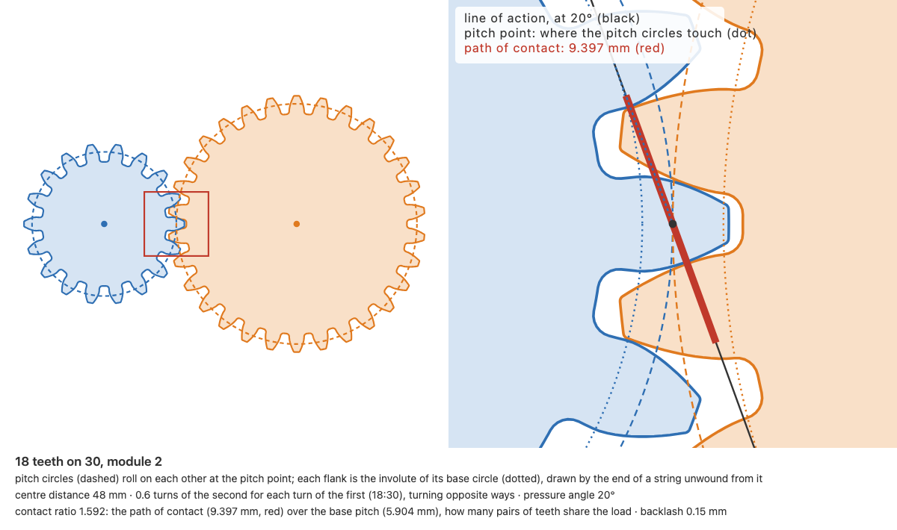
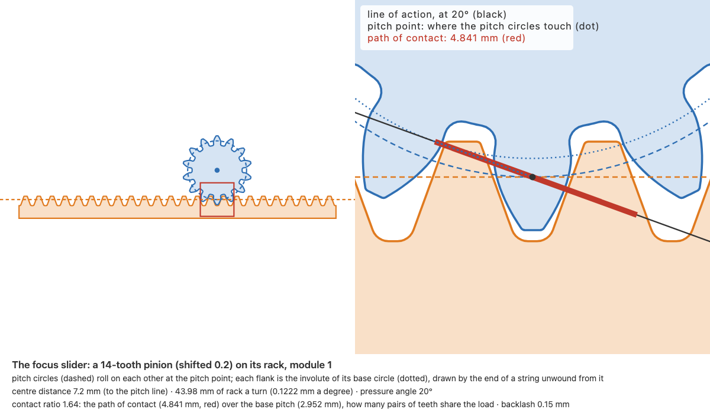
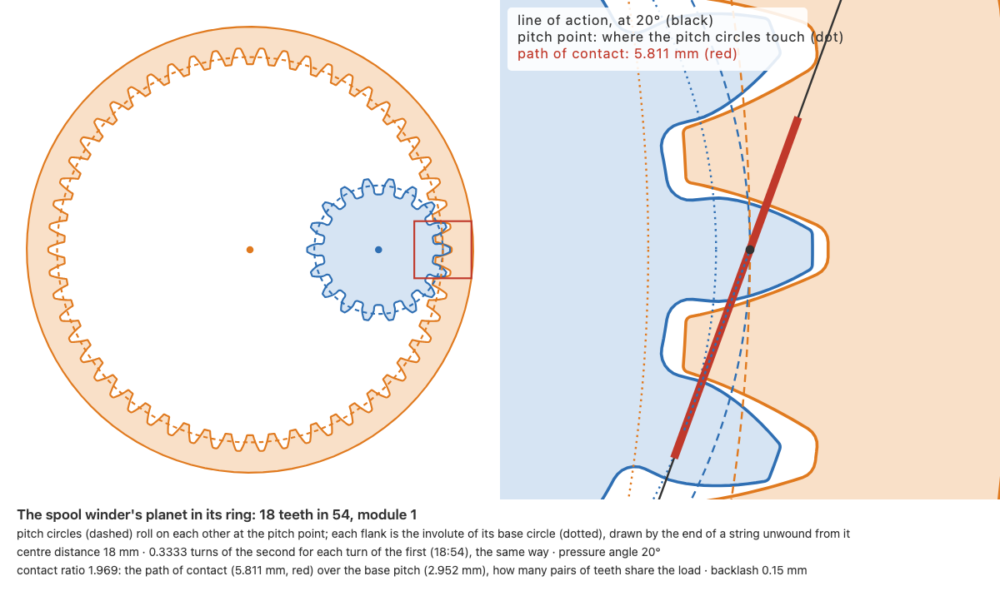

# Gears from rules: spur to bevel, checked before they're printed

**8 November 2026 · @rulecad/gears 0.3.0, cad 0.7.36 · pull requests [140](https://github.com/JoniBach/rulecad/pull/140) to [143](https://github.com/JoniBach/rulecad/pull/143) · measurements to come**

The kit could make parts that bend (flexures) and parts that turn on joints (assemblies), but not carry a turn from one
place to another with a ratio. Gears are what printers do best: a spur gear prints flat on the bed, its teeth in the
layers, with no supports. This is the first night's work, every number drawn from the module, the teeth and the
pressure angle, and each one checked against something it doesn't assume.

## What rulecad gained for it

- **`@rulecad/gears`.** Spur gears, racks and ring gears from the involute, each tooth's root rounded (0.38 module,
  ISO 53) and its tip rounded, the bed face chamfered against elephant's foot. Helical and herringbone gears, worms and
  their wheels, and straight bevel gears by Tredgold's construction. Bad input refused by name; an undercut pinion
  refused with the profile shift that fixes it.
- **How a pair meshes.** Centre distance, ratio, contact ratio, and the phase that puts a tooth in a gap.
  `planetary()` finds teeth for a ratio that also put together.
- **Gears in assemblies.** A joint's `mesh` follows its mate in phase, read from where the two gears really are; a
  `planetary` turns a whole gearbox from its driver. `--sweep` turns the train and looks for teeth that touch.
- **The mesh measured, not just reckoned.** The drawn teeth turned through a pitch, the driven gear turned each way
  until the outlines meet: the play, the transmission error, and any interference.
- **Tooth strength.** The Lewis equation for a first number, and one tooth analysed by finite elements for the
  fillet's concentration Lewis leaves out.

## The geometry, drawn

Each picture is `diagram()`: the pair in phase on the left; on the right, the mesh close up with the pitch circles
(dashed, rolling on each other at the pitch point), the base circles each flank unwinds from (dotted), the line of
action, and the stretch of it where the teeth touch (red). That stretch over the base pitch is the contact ratio.

## Predicted

| What | Predicted | How |
|---|---|---|
| Play between 18 and 30 teeth, module 1 | 0.150 to 0.152 mm (0.15 drawn) | measured from the drawn teeth |
| The same, axes 0.2 mm apart | 0.30 mm | measured (reckoned 2 Δa tan α more: 0.296) |
| The same, axes 0.2 mm closer | 9 µm: tight; 0.3 mm closer, they jam | measured |
| Transmission error, 18 on 30 | 1 µm across a tooth | measured |
| Root stress, 18 teeth at 0.4 N·m, 6 mm wide | 1.33 × Lewis (40 teeth: 1.25 ×) | finite elements, settled within 2% |
| Focus slider | 43.98 mm a turn of the knob | π × 14 teeth × module 1 |
| Spool winder | 4 turns of the spool a turn of the crank | sun 18, planets 18 × 3, ring 54 |
| A single-start worm, module 1, 10 mm | locks (5.71° lead under 14° of friction at μ 0.25); 27% efficient | Dudley, Shigley |

## Measured

To come. The [sampler plate](https://jonibach.github.io/rulecad-archive/m/gears-sampler-plate/) and
[its gears](https://jonibach.github.io/rulecad-archive/m/gears-sampler-gears/) answer the first question: what backlash
turns freely at each module on the X1C, and the smallest module whose teeth print whole. Those become the kit's
defaults, with the plate as their source. Then the [focus slider](https://jonibach.github.io/rulecad-archive/m/gears-focus-slider/)
(travel a turn, play) and the [spool winder](https://jonibach.github.io/rulecad-archive/m/gears-spool-winder/) (does it
turn freely, what does it take to turn).

## What went wrong on the way

- **False clashes.** JSCAD's 3D intersection read a sun gear 2.7 mm³ into a planet 0.07 mm away (its backlash), and a
  planet 0.4 mm above a case as 1.3 mm³ into it. Overlaps are now measured with Manifold, and a JSCAD volume is kept
  only if an exact test says the surfaces cross. This touches every assembly check, not just gears.
- **A rule that failed what was fine.** The centre-distance check called axes 0.01 mm too close jammed. The
  measurement showed 0.2 mm closer still leaves play with 0.15 mm of backlash; the rule now follows the backlash.
- **Bevels.** Scaling the spur profile toward the apex left a pair 0.5 mm³ into each other even at the best phase. A
  scan of phases showed the phase was right and the shape wasn't; drawn on the back cone by Tredgold's construction,
  they clear.
- **A slider that would run off its rack.** The first layout put the rack's end near the pinion at rest; the sweep
  looks for collisions, not for teeth leaving each other, so it passed. The rack is now centred under the knob.

## Still to do

Print-in-place gearboxes (a carrier can't print over the planets; a compound planetary with two rings and no carrier
is the likely answer), and a two-stage herringbone reduction into the flexures ratchet.
