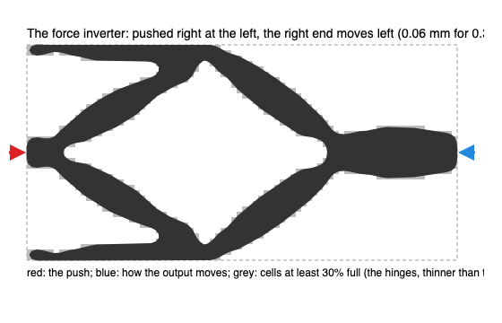
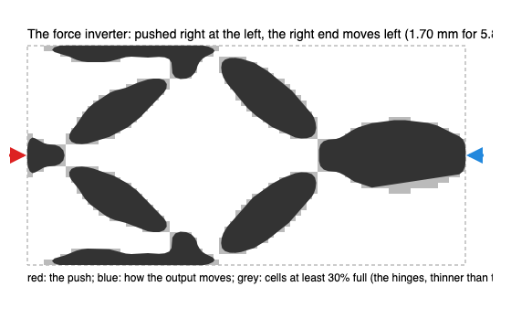

# The force inverter: a mechanism grown from a block

**30 October 2026 · @rulecad/topopt 0.2.8 · `packages/topopt/reference/inverter.mjs`**

The classic first test of compliant-mechanism synthesis (Sigmund 1997). A 40 × 20 mm block of PLA, 4 mm thick, is
held at its two left corners and pushed to the right at the middle of its left edge with 10 N, against a spring of
2.7 N/mm. The right edge's middle should move to the left, against a spring of its own. The optimiser is given 30%
of the block and asked for the layout that moves the output furthest.

It makes the X: two arms from the input to the corners, two from the corners to the output, and two more across,
every arm a real member. Pushed 0.31 mm to the right at the input, the output moves 0.06 mm to the left: an advantage
of 0.2. An even block moves its right edge the way it is pushed; the optimiser reverses it in about 25 steps and
spends the rest sharpening. 223 steps on 0.5 mm cells (3,200 of them), 29 seconds.

## The point hinges, and what was done about them

The first attempt (above) moved its output 1.7 mm, eight times as far, and it's a fraud: the grey cells show the arms
meeting at hinges a single cell wide and about 30% full. That's what mechanism synthesis does when nothing stops it: a
point hinge is the most compliant joint there is, so the optimiser makes them, and the drawn outline (smoothed, at
half density) drops them, leaving blobs. Printed as drawn, that part is six pieces.

So a mechanism is now optimised robustly (after Wang, Lazarov and Sigmund 2011): its travel is taken on an eroded copy
of the design, its volume on a dilated one, and the design as made lies between. A hinge that survives erosion has
real width, and the result is one piece, cell to cell. The price shows in the numbers: the design as made is stiffer
than the eroded copy it was optimised on by a hinge width's worth of stiffness, which goes as the width cubed, so it
moves 0.06 mm where the eroded copy moved 1.6. A worst-of-three objective (all three copies must flex) would close
that gap; a first try at it with a smooth maximum went wrong (the eroded copy fell apart and its zero travel pinned
the objective), so it's left for a proper bound formulation.

## Settings

| | |
|---|---|
| Space | 40 × 20 mm, 4 mm thick, PLA (E 2,680 MPa) |
| Held | the two left corners, 1 mm squares |
| Input | 10 N to the right at the left edge's middle (a 1 × 2 mm patch), against 2.7 N/mm |
| Output | the right edge's middle, to the left, against 2.7 N/mm |
| Material | 30% of the space, members at least 1.5 mm (a filter of three cells) |
| Result | 0.06 mm out for 0.31 mm in (robust); 29.9% of the space; 223 steps, settled |
