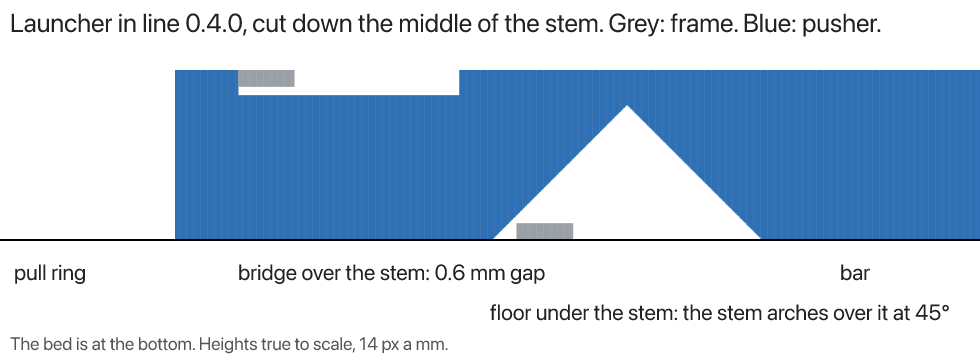

# In-line launcher: a cut through the stem's bridge and floor

The [in-line action](../../m/launcher-inline/) cut lengthwise down the middle of its stem (y = 0), version 0.4.0. Grey is
the frame, blue is the pusher (the ring, the stem and the bar), heights true to scale with the bed at the bottom.

- **The bridge** is the frame printed over the stem on the top six layers (10.96 to 12.16 mm). The stem is cut down to
  10.36 mm along all of it that ever passes under, so a 0.6 mm gap (three layers) separates them. From above it looks
  joined, because the bridge runs straight over the stem.
- **The floor** is the frame on the bottom six layers (0 to 1.2 mm), on the bed. The stem's underside arches over it at
  45°, 1.8 mm clear of it all along the stretch that passes over, up to 9.7 mm at its peak, so it prints with no
  support. It's on the underside, so a view from above can't show it.

A worry the model doesn't answer: a bridge's first layer sags as it's laid over air. Over a 0.6 mm gap it could reach
the stem. A wider gap (five layers, 1.0 mm) would be safer.

