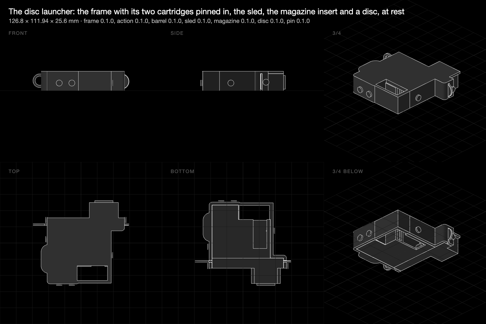

# Disc launcher: a toy pistol whose springs, sear, trigger and feeder are printed flexures

**31 October 2026 · @rulecad/cad 0.7.17, @rulecad/flexures 0.1.7 · `examples/bench/projects/launcher/`**

The first mechanism built from the flexure library rather than for it: a pistol that throws 30 mm printed discs.
Everything that moves is a flexure from `@rulecad/flexures`, sized from one rule set (`rules/launcher.json`) by the
library's sizing functions, printed in place in a body whose frame the optimiser laid out round the pockets the
mechanism needs. Five printed parts: the body, the sled, the magazine insert, the lid, and discs. Built overnight
from the plan agreed the evening before; the decisions taken on the way are in the project's README.

## The mechanism

| Part | Flexure | Sized by | Result |
|---|---|---|---|
| Bow | one leaf standing in the grip, a bead on its tip | `size.leaf` for 16 N at 25 mm, 28 mm wide | 77 × 2.52 × 28 mm, 1.57% strain at full draw |
| Sear | a leaf under the barrel's floor with a tooth into the slot | `snapHookModel`, 25 × 1.26 × 11.3 mm, 1.5 mm undercut | 1.2 N to deflect, square back holds the draw; 1.3% strain at the trigger's lift |
| Trigger pivot | a living hinge | `size.livingHinge` for 6 mm over a 50 mm arm | 3.15 × 0.84 mm strip; about 3 N of the pull |
| Magazine feeder | a serpentine | `serpentineModel`, 30 × 0.84 × 14 mm, 7 turns | 0.9 N on the last disc, 2 N on six |
| Magazine cap | two snap hooks into notches in the column walls | `snapHookModel`, 20 × 1.26 × 14 mm, 2.4 mm barb, 30° faces | 12 N to seat or lift; 1.1% strain |
| Lid | four snap pins into bosses | `snapPin` | sockets with a 45° cavity roof the barbs seat on |

The energy sets the bow: 0.2 J stored over a 25 mm draw is 16 N at full draw, and a PLA leaf stores about 38 mJ per
cm³ at 1.6% strain whatever its shape, so the stored energy sets the leaf's volume and the travel its length. With a
guessed 30% reaching the disc (the sled and the leaf's moving share weigh three times the disc) it leaves under the
0.08 J a hard projectile may carry in the toy standards. The disc is pushed off its centre line and rolls along the
lid, so it leaves spinning and flies flat.

Models: [the action rig, cocked](https://jonibach.github.io/rulecad-archive/m/launcher-rig/) ·
[the sled](https://jonibach.github.io/rulecad-archive/m/launcher-sled/) ·
[the magazine insert](https://jonibach.github.io/rulecad-archive/m/launcher-magazine/) ·
[the disc](https://jonibach.github.io/rulecad-archive/m/launcher-disc/) · the body and the whole launcher below.

## The frame

`problems/frame.json` takes the body's outline as its space, keeps the bed wall and every mount (the leaf's root
block, the slot's walls, the posts the sear and the hinge grow from, the stops, the column walls, the back wall,
the lid's bosses), and leaves the flexures' sweeps, the slot, the column and the trigger's room empty: all three
are named parts of the body's `regions` variant, built without the problem it feeds (a problem variable set to
`none`, new in cad). Held at the grip's straps; loaded by the bow at full draw, a knock on the muzzle sideways and
printable in +z, 3 mm cells (52 × 44 × 12), 30% of the space, 120 steps. A first run at 2.5 mm with four cases
(a downward knock and one on the magazine as well) took three minutes a step: the conjugate gradients needed about
400 iterations a solve, ten times the guitar's, with a one-cell-thick kept bed wall under big empty pockets; two
cases at 3 mm run at 40 seconds a step.

| Case | Load | Result |
|---|---|---|
| cocked | the bow's 16 N pulling the leaf's root back, the sled pushing the sear's post forward | turns 0.004° under the couple: 336 N·m a degree |
| knocked | 50 N sideways on the muzzle | moves 1.36 mm: 36.9 N/mm |

130 cm³, 164 g of PLA at 30% of the space, in 57 minutes; stopped at 120 steps before it settled. Drawn at print
resolution and sliced, the body passes every check: one piece, no islands in 166 layers, the three bridges under
3 mm. Most of the 30% is what was kept (the bed wall alone is a tenth of the space); the optimiser's own material is
a shell round the pockets and the barrel, thin where the loads are small. The muzzle's 1.4 mm under a 50 N knock is
the barrel being 16 mm tall past the column: a taller barrel or a lower volume fraction with more steps is the next
run.

Models: [the body](https://jonibach.github.io/rulecad-archive/m/launcher-body/) ·
[the whole launcher, cocked](https://jonibach.github.io/rulecad-archive/m/launcher/).

## Second design: cartridges in a frame

The morning's review found the body wanting: it relied on being pinned to flat plates, its grip was a box, the
cocking rod could not be fitted through a closed hole, and the lid covered the trigger guard. Real pistols are
modules pinned into a frame, so the launcher became one: an **action cartridge** (a tray with the bow, sear and
trigger printed in place, a window in its floor and a gap in its bottom wall for the finger), a **barrel cartridge**
(the slot, a hollow for the pins' barbs, the magazine column with the cap's notches), and a **frame** (the trays'
outlines grown by a 6 mm rounded skin, a cavity for each, a palm swell behind the grip, the trigger guard, a notch
for the rod), all held by six library snap pins pushed in from the frame's edges through its skin and a tray's wall,
their barbs clicking out inside the trays where nothing moves. Every part prints flat without supports; the frame
prints on its back plate, and hilt-down as well, since no roof spans a cavity.

`cad check launcher/launcher` passes in both poses with twelve parts: no overlaps, each cartridge a fit in its
cavity, the sled a fit in its slot and off the back plate it rolls along, every pin within its press fit.
Models: [the frame](https://jonibach.github.io/rulecad-archive/m/launcher-frame/) ·
[the action cartridge, cocked](https://jonibach.github.io/rulecad-archive/m/launcher-action/) ·
[the barrel cartridge](https://jonibach.github.io/rulecad-archive/m/launcher-barrel/) ·
[the whole launcher](https://jonibach.github.io/rulecad-archive/m/launcher-2/).

## Findings

- **A slit's roof is a bridge.** The sled's tab had to hang through the barrel's floor along its whole run, and the
  floor above a 37 mm slit is a 37 mm bridge. The floor is left out over the run; the sled rides the ceiling, its
  rod the floor either side of the gap. The lid closes the top of every pocket, so nothing else needed a roof.
- **A leaning leaf touches below its tip.** At full draw the leaf leans 30°, so a vertical tab met it below the tip
  and the draw was more than the tip's travel. A bead along the tip makes the contact the tip's whatever the lean.
- **The leaf belongs in the grip.** In front of the trigger it clashed with the guard at full draw and hung a deep
  block under the barrel; behind it, bending away, it is the grip's spine and the guard is free.
- **Notch hinges can't turn a trigger.** At the 7° the finger's travel needs, every notch hinge was over 4% strain;
  the living hinge turns it at 1.6%.
- **Printed-in-place springs can't be preloaded.** A feeder printed in the column can't press the last disc, since
  its rest shape would lie where the discs go. The feeder is a separate insert, squeezed in after the discs, with a
  snap-in cap that a firm pull lifts out to reload.
- **Anchors' refs are directions.** The assembly placed the sled rotated wrong until its anchor's `ref` was a
  direction rather than a point; the overlap check found it, and a quick intersection said where.
- **Check the projectile's way out.** The first cartridge design passed every check with a solid wall across the
  muzzle: nothing checked the disc's exit. The assembly now holds a disc half out of the muzzle, which must overlap
  nothing; re-closing the muzzle makes it fail.
- **A late change can bury a pin.** The palm swell, added after the pins, covered the back strap's pin head; a
  1 mm press-fit allowance hid it. The allowance is now 0.3 mm, what a barb needs.
- **Pins go through walls, not floors.** A tray's floor faces outward, so a pin through it points into air; a
  pistol's pins cross its frame, and so do these.
- **A part as a load needs a centre.** Loads and supports given as parts of another object (new for this problem)
  lacked the point the solver's resultant wants; cad now gives them their box's centre.

## Next

- Print the rig first: the bow's draw, the sear's click and the trigger's pull are the numbers to measure, against
  the 16 N, 1.2 N and 8 N the rules say.
- Time a disc: the 30% is a guess, and the spin from the off-centre push is unmeasured.
- The sled weighs about twice the disc; a lighter rod (a lattice, or a thinner section with ribs) would send more of
  the energy down the barrel.
- A safety: a second leaf across the trigger's swing, pushed aside by the thumb.
