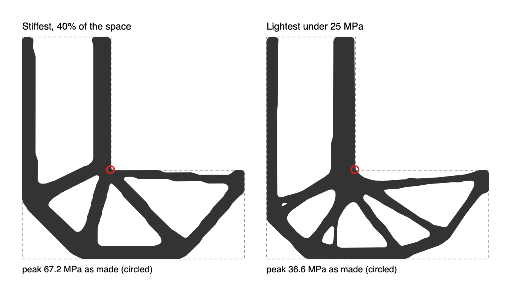

# L-bracket: stiffest against stress-limited

**28 October 2026 · @rulecad/topopt 0.2.2 · `packages/topopt/reference/lbracket.mjs`**

The L-bracket is the usual test of stress-limited topology optimisation. A 100 mm square, less its top-right 60 mm, is held along the top of its upright arm and pushed down with 100 N at the end of its lower arm. It's PLA, 2 mm thick, on 1 mm cells. Stress gathers at the inside corner where the arms meet.

| | Space used | Compliance | Peak stress, on its cells | Peak stress, as made | Model |
|---|---|---|---|---|---|
| Stiffest at 40% | 40.0% | 373 N·mm | – | 67.2 MPa | [Open in 3D](https://jonibach.github.io/rulecad-archive/m/lbracket-stiffest/) |
| Lightest under 25 MPa | 39.4% | 426 N·mm | 26.2 MPa | 36.6 MPa | [Open in 3D](https://jonibach.github.io/rulecad-archive/m/lbracket-stress/) |

"As made" is the smoothed outline, analysed again on 0.5 mm cells: the part as it would be cut or printed.

## Findings

- **Peak stress falls by 46% for the same material.** The stress-limited bracket gathers its members into one joint with fillets either side, and its compliance rises by 14%.
- **The corner point keeps its stress.** Both designs keep material at the space's own sharp corner. On finer cells the stress there keeps rising, so the limit holds to within 5% only on the optimiser's cells.
- **The method that worked:** stress limits on every cell, kept by an augmented Lagrangian (Senhora et al. 2020) and stepped by the method of moving asymptotes (Svanberg 1987). The first attempt, one aggregated p-norm limit (Le et al. 2010), kept the corner packed with material and missed its limit.

## Glossary

- **Compliance:** the load times how far it moves; lower is stiffer.
- **Von Mises stress:** one number for how hard a point of material is worked, compared with the material's strength (PLA: about 39 MPa).
