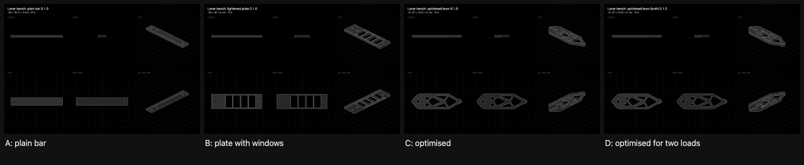

# Lever bench: four levers of equal mass

**28 October 2026 · rulecad examples/bench · measurements to come**

A lever 140 mm long, bolted at one end and loaded at the other, is cut from a 6 mm PLA plate. Four levers of the same mass (16,800 mm³) are held and loaded the same way. The predictions are verified on 0.5 mm cells.

| Lever | Straight down | At 45° | Peak stress at 20 N | Model |
|---|---|---|---|---|
| A, plain bar | 28.2 N/mm | 55.8 N/mm | 6.06 MPa | [Open in 3D](https://jonibach.github.io/rulecad-archive/m/lever-a/) |
| B, plate with four windows | 3.72 N/mm | 7.4 N/mm | 25.3 MPa | [Open in 3D](https://jonibach.github.io/rulecad-archive/m/lever-b/) |
| C, optimised for the load | 100 N/mm | 185 N/mm | 3.0 MPa | [Open in 3D](https://jonibach.github.io/rulecad-archive/m/lever-c/) |
| D, optimised for two loads | 99.3 N/mm | 191 N/mm | 3.05 MPa | [Open in 3D](https://jonibach.github.io/rulecad-archive/m/lever-d/) |

## Findings

- **Optimised against the usual lightening:** C is 27 times as stiff as B for the same material, and 3.5 times as stiff as the plain bar.
- **B is fragile.** Its peak stress at 20 N is 1.5 times under PLA's strength, at a window's corner: it may crack at about 2 kg.
- **A calibrates the rest.** The bar's prediction is the surest, so its measured stiffness corrects the material's modulus for the other three.

## Still to do

Print three of each, load them in steps and record the measurements against these predictions.
