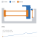

# Mechanisms solved as they would behave

**2 November 2026 · @rulecad/flexures lamina · `examples/bench/projects/mechanisms/`**

Until now rulecad checked a mechanism by moving each joint the way a simple model says and looking for collisions. That
missed what matters most in a printed compliant mechanism: how far its springs really bend, how hard it is to work,
and whether a latch really holds. This adds the physics.

## What it does

- **Beams that bend as far as they bend.** Each flexure becomes a chain of short beam elements along its centreline,
  solved for equilibrium on its total energy. It agrees with beam theory at small deflections, with the exact bent
  shape of a leaf to 0.1% at large ones, and buckles a column at the Euler load.
- **Parts that touch.** Every part touches what it meets, flexures themselves included: a wave spring's legs meet as
  it stacks solid. The walls each part sees are worked out once as a distance grid, which made a latch's check go
  from 7 minutes to 12 seconds.
- **A hand.** It drives the joints a step changes, holds what it had, and lets go gradually of the rest, so a latch
  catching or a spring firing comes out of the physics. The hand's force along a step is the force curve.
- **Requirements on the curve.** A key can ask for its peak force and its click, the share the force falls after it.
- **A shot.** Let go and stepped through time, every body and beam with its mass: the speeds, and the disc's exit
  speed and energy.
- **A wave spring and a pivot pair.** Legs joined by round bends; two leaves whose lines meet at a point the part
  turns about.

## The test pieces

| | What it is | What the physics says |
|---|---|---|
| [Key](https://jonibach.github.io/rulecad-archive/m/mechanisms-key/) | A stem on a tapered guide, a bump riding past a bump on a click leaf | Peaks at 1.48 N, then falls 29%: a click. Every flexure within its limit and stopped by the frame |
| [Wave spring](https://jonibach.github.io/rulecad-archive/m/mechanisms-wave/) | A plunger on legs joined by round bends, in a channel | 0.49 N over 8 mm; its real peak strain is at the bends, 1.7 times beam theory; past solid its force climbs steeply |

A push-push latch (press, it stays; press again, it comes back) is started but doesn't work yet. A heart-shaped track
is a loop the pin runs round, so the heart in its middle can't join the frame anywhere in the plane: printed flat in
one layer, it comes loose. It needs a floor under the track, with parts at different heights.

## What it found in the launcher

- **The trigger can't hold the cock.** Its hanging leaf hinge is soft sideways, and the pusher's push on the catch
  swings the trigger forward until the hook slips off. The old check missed it by treating the hinge as a fixed pivot.
- **The shot.** Drawn back, trigger pulled, let go: the pusher reaches 2.3 m/s and the disc leaves at 3.5 m/s with
  4.8 mJ, 9% of the 54.5 mJ stored. Most of the energy stays in the pusher and the springs.

Write-up of the launcher's flat action: [Flat launcher action](https://jonibach.github.io/rulecad-archive/experiments/flat-launcher/)
