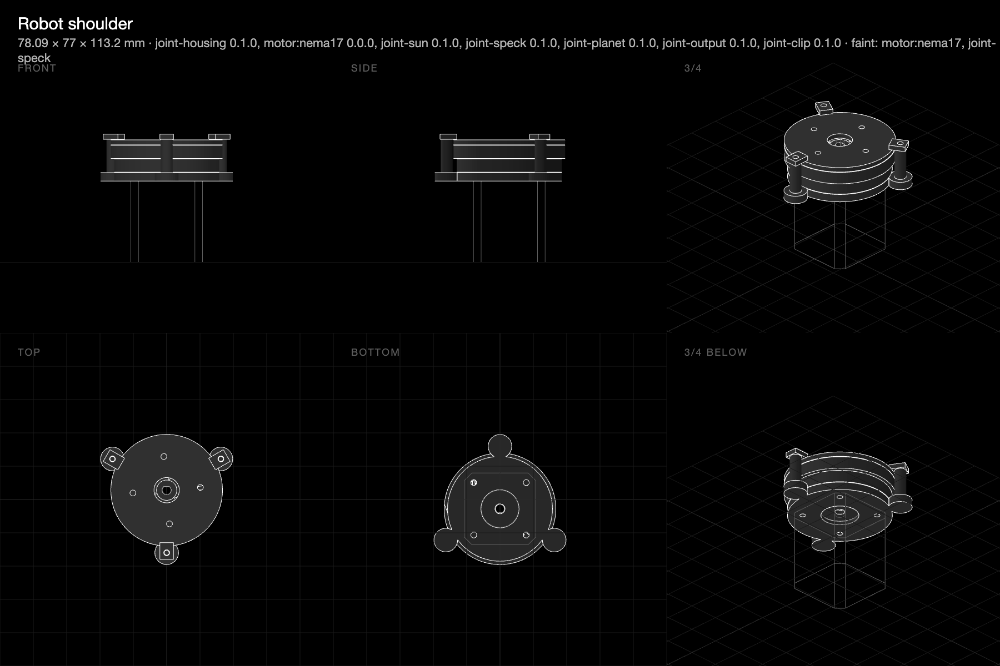
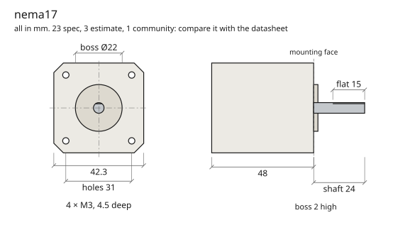
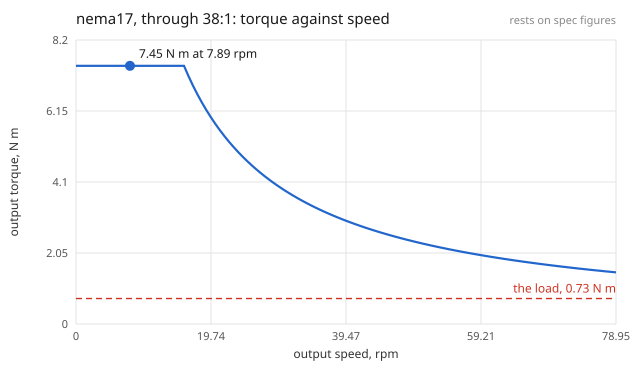

# Motors from rules: mounted, driven, and checked before they're bought

**9 November 2026 · @rulecad/motors 0.1.2, cad 0.7.40 · pull requests [166](https://github.com/JoniBach/rulecad/pull/166), [167](https://github.com/JoniBach/rulecad/pull/167) and [168](https://github.com/JoniBach/rulecad/pull/168).**

Gears gave the kit a way to carry a turn from one place to another. Motors give it somewhere for the turn to come from, and the question a machine actually asks: will this motor move this load, and will it stay put when the power goes off?

Nothing here has been printed yet. Every figure below is predicted, and a table of predicted against measured will go here once it has.

## What rulecad gained for it

- **Seven motors as open data** in `@rulecad/rules`: NEMA 17 and 14 steppers, the 28BYJ-48, an N20 gear motor, SG90 and MG90S servos, and a 2204 gimbal motor. Each figure says how far to trust it and where it comes from, and hobby motors that vary between makers are marked `community` or `estimate`.
- **A shared vocabulary**, `cad rules check` to hold every rule set to it, and `cad rules draw` for a dimension drawing to compare with the datasheet by eye.
- **`@rulecad/motors`**: the solid, the mount a part subtracts, a D-bore that's only flat where the shaft is, and `performance()`: the torque and speed at the output, through a ratio and an efficiency, and what the answer rests on.
- **A motor as an assembly item**: it drives a joint, and whatever meshes with that joint moves with it. In the viewer a stepper's slider moves in its own steps.
- **Loads, and checks against them**: a torque, a force or a mass carried at an anchor, whose torque follows the pose. Torque, speed, holding with the power on and off, the case against the plastic's softening point, the plate at the screws, and a shaft read from the bore as drawn.
- **`compoundPlanetary`**: two rings a few teeth apart, 30 to 200:1 in one stage.

## The models

| Model | What the check says |
|---|---|
| [Motorised focus slider](../../m/motors-focus-slider/) | A 28BYJ-48 on the pinion: 4.7 N at the slide against the 1 N it pushes, 6.4 mm/s, held by the gearbox's own friction with the power off |
| [Robot shoulder](../../m/motors-robot-shoulder/) | A NEMA 17 through 38:1: 7.4 N m at the output, ten times what 500 g at 150 mm needs, a turn in 7.6 s at 300 rpm of motor, held with the power off by gears under 50% efficient |

## What went wrong

- **Profile shift couldn't make a split ring.** The plan was one set of planets on two rings with the odd one cut with a shift. Moving a ring three teeth at these sizes needs a shift of nearly two modules, far past what a tooth takes. Stepped planets, whose two steps differ by as many teeth as the rings do, keep one centre distance with no shift at all, and every tooth count a multiple of the planets keeps them in phase.
- **The first press fit split every hub.** A 0.05 mm press on a 5 mm shaft is 2% strain, past what PLA takes, and the hoop-stress check said so even on a wall 8 mm thick. It's 0.02 mm now.
- **A motor's shaft rotated into the bore.** A D-bore drawn at the pose it was assembled in overlaps a shaft that hasn't turned to meet it, so the check reads the flat from the bore instead of requiring the two to line up.

## Not done yet

How far a whole part bends under the motor isn't checked (it needs to know what holds the part), the print-in-place version of the joint isn't drawn, and nothing has been measured.
