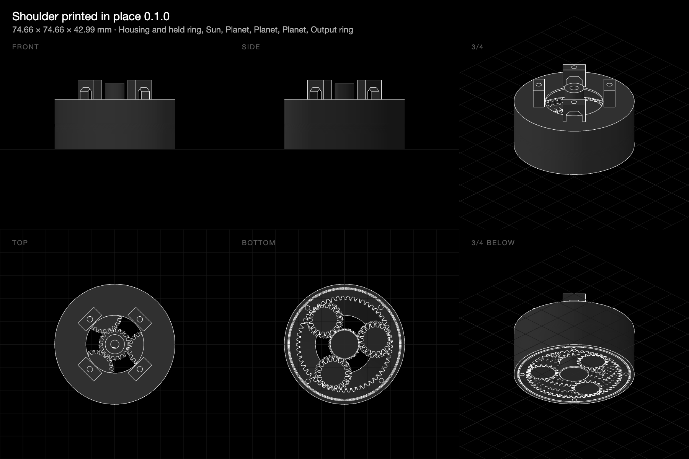

# The robot shoulder printed in place

**23 November 2026 · a 17HS4401 stepper, the X1C, PLA.** Predictions only so far: nothing has been printed.

The [bench shoulder](../../m/bench-shoulder/) is a compound planetary put together from six printed parts, three clips and three screws. This one is the same kind of gearbox drawn to come off the bed as one print: housing and held ring, sun, three stepped planets and the output ring, each standing on the bed, each 0.3 mm from the next. Turn it by hand to break it free, set the motor on its four posts, and it is done. [Issue 162](https://github.com/JoniBach/rulecad/issues/162) asked for it; [issue 133](https://github.com/JoniBach/rulecad/issues/133) asked for the checks that say whether such a print can work.

Open it in 3D: [Shoulder printed in place](../../m/bench-shoulder-pip/). The assembled one: [Robot shoulder on the test stand](../../m/bench-shoulder/).

## Side by side

| | Assembled ([shoulder-test](../../m/bench-shoulder/)) | Printed in place (shoulder-pip) |
|---|---|---|
| Teeth | sun 18, planets 18/21, rings 54 and 57 | sun 18, planets 21/18, rings 60 and 57 |
| Ratio | 38:1, the output the other way | 44.3:1, the output the same way |
| Teeth | spur | herringbone, 30° |
| Backlash each mesh | 0.15 mm (the kit's default, an estimate) | 0.799 mm, from the 0.3 mm print gap |
| **Play at the output** | **0.65°**, 0.33 mm at the output ring's pitch circle, 1.7 mm at a 150 mm arm's end | **3.21°**, 1.60 mm at the pitch circle, 8.4 mm at a 150 mm arm's end |
| Torque at the output at 300 rpm (24 V: neither assembly names a supply) | 5.05 N m, 6.9 times the 0.735 N m of 500 g at 150 mm | 6.27 N m, 8.5 times |
| Holds with the power off | yes (under 50% efficient) | yes (50%, just under) |
| Printed | 6 parts and 3 clips, put together with 3 screws | 1 print of 6 parts, 105 g: housing 72 g, output 8.6 g, sun 7.9 g, planets 5.4 g each |
| Motor | 4 M3 cap screws through the housing's base | 4 M3x8 hex-head screws up through four posts on the roof |

Both turn the same 17HS4401 at the same 300 rpm; the torque figures rest on the motor's community figures until it is measured.

The play is the price of printing in place, about five times the assembled one's. It is play only, the gearbox turned freely one way and then the other with the motor still: the teeth bending under a load add to it. Where the error budget asks for a tighter joint, bias it with a spring or rubber band as the drawing arm does, or assemble the gearbox.

## How the play is predicted

With the sun held by the motor and the held ring in the housing, the planets float on their three meshes, since nothing else holds them. Taking each mesh's backlash up the same way, the output ring moves j_sun |1 − r2/r1| / 2 + j_ring (1 + r2/r1) / 2 + j_output at its pitch circle, r1 being the planets' pitch radius on the sun and the held ring and r2 on the output ring (`compoundPlay` in @rulecad/gears).

- Printed in place: every mesh 0.799 mm, r1 = 10.5 mm, r2 = 9 mm. 0.799 × (0.071 + 0.929 + 1) = 1.598 mm; over the output ring's 28.5 mm pitch radius, 0.0561 rad, 3.21°.
- Assembled: every mesh 0.15 mm, r1 = 9 mm, r2 = 10.5 mm. 0.15 × (0.083 + 1.083 + 1) = 0.325 mm; 0.0114 rad, 0.65°.

The printed-in-place backlash leaves the print gap normal to every flank: 2 g / (cos α cos β_b), α the 20° pressure angle and β_b the base helix angle, 28.48° for a 30° herringbone (ISO/TR 10064-2). At the drawn gap of 0.33 mm (0.3 mm and 0.03 mm for the facets of rounds drawn in straight pieces) that is 0.799 mm.

## What makes it print

- **Every part on the bed.** It prints the other way up from the assembled one: the output ring, the planets' smaller steps and the sun's hub stand on the bed, the held ring above the output ring, and the housing reaches the bed round the outside with a skirt. A part that started on another would be printed onto it.
- **Everything above another part rises at 45°**: the housing's underside over the output ring, the planets' larger steps from their smaller ones, the sun's teeth from its hub, the roof's cone over the planets. The first 1.2 mm of the held stage is cut straight, so where those cones widen the teeth don't twist as well.
- **The first layer** spreads 0.15 mm each side as it is squashed on, so the teeth on the bed have a first layer of their own, cut straight with a 0.63 mm gap and shorter tips.
- **The motor** sits face down on four posts on the roof. Each post has a window through it, its top rising at 45° to the 5 mm the printer bridges, for an M3 hex head turned by a spanner from outside. (Countersunk screws from below, between the planets, were tried first: where their seats cut the roof's sloping underside, layers lay out past what prints.)
- **No carrier, nothing to put together**: herringbone teeth hold the rings on the planets, and the planets on the rings.
- **The sun's bore** takes the motor's shaft from above, a slide fit as printed (0.042 mm a side), since a part held only by its teeth can't be pressed on to a shaft.

## The checks

`npx cad check benchmarks/shoulder-pip` (one object with `"printInPlace": true`):

| Check | Result |
|---|---|
| Each part on the bed (`inplace.bed`) | all six: housing 478 mm², output 965 mm², sun 241 mm², each planet 218 mm² |
| Every two parts apart (`inplace.gap`, Manifold) | 0.322 mm at the nearest (housing and output ring), against the 0.3 mm print gap |
| On the first layer (`inplace.first-layer`) | 0.63 mm at the nearest (a planet and the output ring), against 0.6 mm |
| Nothing needing a support (`inplace.support`) | every bridge within 5 mm, nothing in mid-air, no ledge, no island in 212 layers |

`npx cad check benchmarks/shoulder-pip-drive` turns the same parts as an assembly: the shaft's slide fit, 6.27 N m at the output, holding powered and unpowered, the motor's mount and heat, and a sweep of the sun through a turn with nothing colliding. It warns that 0.8 mm of backlash is loose enough to knock: that is the play above.

## To print and measure

1. Print `shoulder-pip` as drawn, in PLA at 0.2 mm layers, no supports: 105 g, about two hours (an estimate from the kit's 12 mm³/s).
2. Free it: hold the housing and turn the sun's hub, through the roof, with a 5 mm rod or the motor's shaft, until everything turns.
3. Fit the motor: four M3x8 hex-head screws up through the posts' windows into its face, turned by a 5.5 mm spanner.
4. Measure its play as the measuring sheet's row 14 does the assembled shoulder's, and write it back with `npx cad measured`. The prediction to hold it against is 3.21° (1.60 mm at the pitch circle); the assembled shoulder's is 0.65°.

The print gap is an estimate (`x1c.print_gap`, 0.3 mm) until the fit test plate measures it. If the parts come out fused, that is the figure to measure first.
