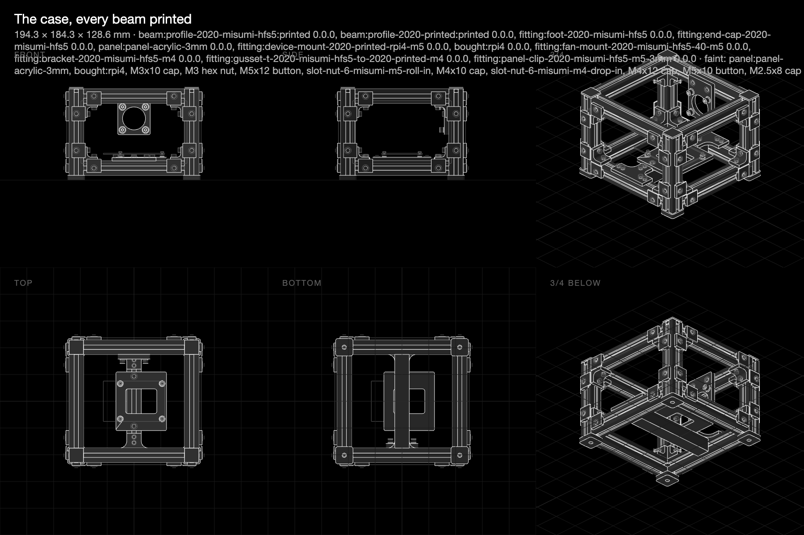
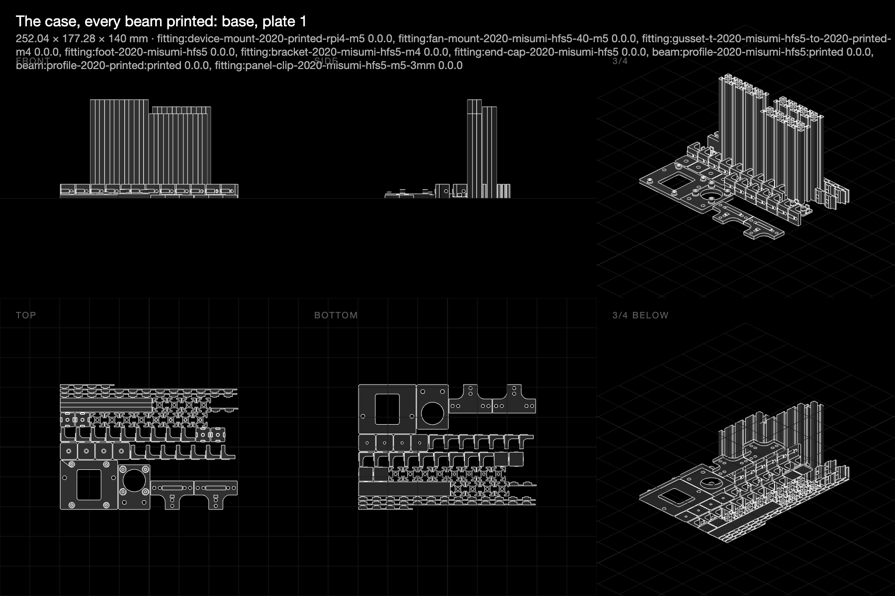

# A case of printed beams: a Raspberry Pi 4 case with no bar to buy

**20 November 2026 · @rulecad/frames and cad, branch frames-3 of rulecad (issue [274](https://github.com/JoniBach/rulecad/issues/274), plan [240](https://github.com/JoniBach/rulecad/issues/240)) · EXAMPLES chapter 17**

A frame of aluminium extrusion needs a saw, a drill and a tap, and bars to buy. For something small and lightly
loaded, a case round a computer board, every beam could be printed instead. This experiment draws a small case in
MISUMI's 2020, asks the kit which of its beams could be printed in PETG, then draws it again with every beam printed,
and lets the kit work out the rest: how each beam prints, what holds it, what it sags, and one plate to print.

Nothing here has been printed yet. Every figure below is a prediction, and a table of predicted against measured will
go here once there is one.

## The models

- [The case, every beam printed](../../m/2026-11-20-printed-case/): the assembly, the board on its mount and the
  panels shown faint.
- [Its one plate](../../m/2026-11-20-printed-case-plate/): every printed part laid as it prints.

## What it is

- A Raspberry Pi 4 (its size and four mounting holes from the maker's product brief) on a printed mount in the middle
  of a cross beam, a 40 mm fan's printed mount on the back top rail, and a 3 mm acrylic panel in each side.
- Four posts 120 mm tall and eight rails, 180 by 170 mm outside, held by 16 printed corner brackets; the cross beam
  held by two printed T gussets; printed feet and end caps on the posts.
- Every beam printed in PETG. The posts and rails need three or four slotted faces (for the brackets and the panels'
  clips), so they print standing up from MISUMI's own section. The cross beam needs only its top slot, so it lies
  down, the kit's printable 2020 with its lips sloped at 45°.
- A printed post's tapped end becomes a captive M3 nut in its bore's place (an M4 insert has no room), and each foot
  takes an M3 screw into it.

## What the checks predict

| Check | Aluminium | Printed in PETG | Rests on |
|---|---|---|---|
| Sag under the board (`m1.top@50%`), joins' springs | 0.000352 mm | 0.009 mm | the joins' springs (printed fittings by finite elements); PETG's figures |
| The same, joins rigid | 0.000223 mm | 0.007 mm | the beams' sections |
| Allowed (130 mm span over 360) | 0.361 mm | 0.361 mm | the kit's default |
| Sway under 20 N at the top | | 0.072 mm along x, 0.074 along y, against 0.275 | the 20 N push, an estimate; the panels as shear webs |
| Lowest mode | | 139.7 Hz | the joins' springs |
| Could each beam be printed? | all 13, least margin 26.6 printed together | printed | creep shares and the printed section, estimates |
| Build | | 47 steps, nothing trapped | geometry |

The printed case sags about 26 times as much as the aluminium one: PETG along its layers is 1810 MPa, standing 1540,
against the aluminium's 69972, so each beam is 38 to 48 times as soft, and the brackets' springs are the same in both.
Both sit far inside the limit. By hand, the cross beam alone, pinned at its ends under the board and its mount and its
own weight, sags 0.0032 mm in PETG; the frame's 0.009 mm adds the rails bending under its ends and the joins giving.

## The printed parts

| Part | Grams | Sized for | Margin |
|---|---|---|---|
| Post, standing (× 4) | 26.8 | 50 N pulling a nut out of a slot | 3.07 |
| Rail, standing (× 8) | 31.3 or 29.1 | 50 N pulling a nut out of a slot | 3.07 |
| Cross beam, lying | 33.8 | 100 N pulling a nut out of its slot | 4.2 |
| Corner bracket (× 16) | 4.5 | 100 N at its screw | 3.09, finite elements |
| T gusset (× 2) | 9.4 | 100 N at its farthest screw | 5.97, finite elements |
| Board mount | 27.1 | 50 N on the board | 4.62 |
| Fan mount | 17.5 | 50 N on the fan | 5.65 |
| Panel clip (× 32) | 1.6 | 30 N pushing the panel out | 2.12 |
| Foot (× 4) | 4.6 | 250 N down the post | 73.8 |
| End cap (× 4) | 1.3 | pushed on | |

73 parts, 593 g, about 654 minutes, on one plate of the X1C that prints clean: no overhang past 45°, nothing in
mid-air. A standing slot's lips at the kit's 100 N pull hold only 1.56 times, so the standing beams are sized for
50 N, a hand pressing on a closed case.

The cross beam's printable slot has lips that slope underneath, so a drop-in nut seats 3.95 mm under the face, not
2 mm as in MISUMI's slot, and its thread starts lower. Each gusset has MISUMI's slot under one arm and the printable
slot under the other, so it is 4.6 mm thick, the least at which a length sold fits both: M4x10 into the rails and
M4x12 into the cross beam, each with the 3.2 mm of thread a hex nut's height asks. (A first version counted the thread
from under the lips, and passed an M4x10 into the cross beam with 2.45 mm of thread engaged.)

## Two mistakes the checks catch

- A 300 mm rail printed lying down is longer than the X1C's 256 mm bed: `beam.printable` fails and says to splice it.
  Two 150 mm halves held by a printed splice plate (4.6 mm thick for its M4x12 screws, 3.7 g, 4.88 times under PETG's
  strength at 100 N) pass.
- A foot drawn for the aluminium post, an M5 screw for its tap: `fasten.end` fails, saying the printed post's end is an
  M3 captive nut and the screw should be an M3.

## What it rests on, and what is next

Every printed beam's stiffness and strength rest on its walls and infill (three walls, 40%) and PETG's data sheet,
across its layers 0.6 of its strength along them, until the beam coupon on the bench measures them. The joins'
springs are the printed fittings' own by finite elements, the slot nuts and lips left out. A slot's hold in plastic
and the 50 N pull are estimates. The board's mass is a shop's figure, 50 g. To do: print the plate, build the case,
weigh the board, and measure the sag under a known mass at the cross beam's middle against the prediction.
