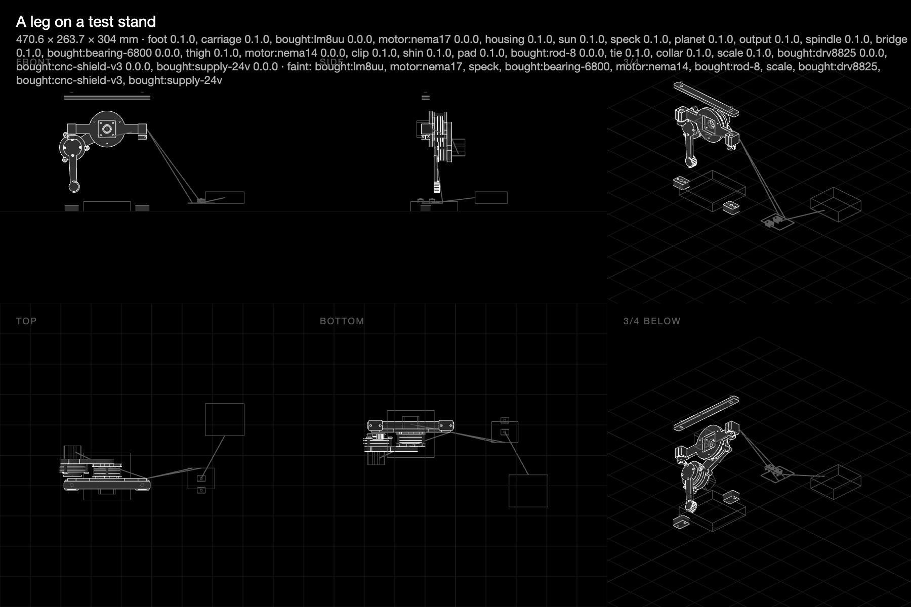

# What to print to test the robots

**10 November 2026.** Everything the kit says about these machines is a prediction until it has been measured. This is the list of what to print, in order, and what each print settles. Three GitHub issues stay open until it's done: [the arm draws (190)](https://github.com/JoniBach/rulecad/issues/190), [the arm lifts (197)](https://github.com/JoniBach/rulecad/issues/197) and [the leg stands and steps (202)](https://github.com/JoniBach/rulecad/issues/202).

Each link below opens the model, with its parts to download. Print in PLA at 0.2 mm layers, four walls and 25% infill unless it says otherwise, and keep to one spool. Masses are solid figures, so a slicer's infill makes them lighter.



## Stage 1: the benchmarks (about 320 g)

Print these before any machine. The numbers are the rows of the [measuring sheet](https://github.com/JoniBach/rulecad/blob/main/examples/bench/projects/benchmarks/MEASURE.md), which says how to take each one.

| Order | Print | Mass | Measures | Needed for |
|---|---|---|---|---|
| 1 | [Fit bar](../../m/bench-fit-bar/) | 31 g | 3, 4, 5: D-bore, hole shrinkage, M3 pilots | Every machine |
| 2 | [Seats coupon](../../m/bench-seats-coupon/), with a 608 bearing | about 38 g | 21: bearing press and slip | Every machine |
| 3 | [Motor stand](../../m/bench-motor-stand/) | 74 g | 6 to 11: holding, detent, torque at speed, heat | Every machine |
| 4 | [Shoulder](../../m/bench-shoulder/) and [input lever](../../m/bench-input-lever/) | 117 g | 12 to 18: efficiency, holding, play, twist, repeatability, speed | Every machine |
| 5 | [Mesh rig](../../m/bench-mesh-rig/) | 42 g | 12, one mesh on its own | Useful, not essential |
| 6 | [Servo stand](../../m/bench-servo-stand/) | 18 g | 19, 20: servo stall torque and size | Pen lift and gripper |

The [gear card](../../m/bench-gear-card/) is only needed if the printer hasn't been tested for backlash yet (measurements 1 and 2).

**The measurements that matter most are 14 (play), 15 (twist) and 17 (repeatability).** The arm's predicted 0.244 mm at the pen assumes 0.02° of play. With no bias on the gears, the drawn backlash alone is about 1.2 mm at the far corner. If the shoulder measures badly, stop here and fix the gearbox before printing the arm.

Write each result back, and the predictions move:

```sh
npx cad measured arm/arm arm.play_shoulder=0.05 --source "bench test 14"
npx cad measured arm/arm arm.twist_shoulder=0.02 --source "bench test 15"
```

(Those two numbers are examples: use what you measure.)

## Stage 2: the arm draws (issue 190)

| Print | Mass | Notes |
|---|---|---|
| [The drawing arm](../../m/2026-11-09-arm-arm/), bed one: base, housing, upper arm, bridge, both outputs and the rest of its plate | 331 g | About 6 hours |
| Bed two: forearm, spindle, the suns and the remaining planets | about 76 g | |
| Holder | 32 g | **In PETG, on its own:** it's a flexure |

`npx cad plates arm/arm` writes the two beds. The total is about 439 g and 8 hours.

**Buy:** NEMA 17 (17HS4401), NEMA 14, SG90, one 6800 bearing, two 10T85 endstops, two DRV8825 drivers, CNC Shield V3, Uno, a 24 V supply of 2.2 A or more, rubber bands, a pen, AWG 24 and AWG 26 wire. M3 screws aren't counted by the list yet, so keep an assortment to hand.

**Set both drivers to 0.5 A,** which is 0.25 V on a DRV8825's trimmer. Read the sense resistor on yours first.

**Test:** home it, then run the calibration drawing from `npx cad plot arm/arm --calibrate`. Measure the 100 mm square's sides and diagonals and each circle's roundness, and draw the square five times for repeatability. Weigh the printed parts too: the list's grams should be within 10%.

## Stage 3: the arm lifts (issue 197)

The same parts, on the same base, bolted upright: [the upright arm](../../m/2026-11-10-arm-arm-upright/).

| Print | Mass | Notes |
|---|---|---|
| [Gripper](../../m/2026-11-10-arm-gripper-check/) | 37 g | **In PETG.** Rated for 50 g at 2× |
| Spindle, again | 7 g | **In PETG, or use steel:** a stall at 0.8 A is 19 MPa against PLA's 22 |

**Buy:** a second SG90, and a dial indicator.

**Before running it:** set both drivers to 0.8 A (0.4 V on a DRV8825). With the gripper on, the elbow is limited to 140°. Its home switch sits at 160°, so move the switch and its flag first, or the elbow can't home.

| Test | Against |
|---|---|
| Add payload at the tool until a motor skips | `motor.torque`: 2.65 times over at 100 g |
| Power off, add payload until it drops | `motor.holds` |
| Drop at the tool under 100 g at full stretch, by dial indicator | `link.deflection`: 1.83 mm from coarse cells, about 0.6 mm by hand |
| Push sideways at the shoulder and watch the wobble | `joint.moment` |
| Time a move across the volume | `task.time` |

The Z axis in the examples isn't needed for this test.

## Stage 4: the leg stands and steps (issue 202)

[A leg on a test stand](../../m/2026-11-10-leg-stand/): 471 g, about 9 hours. Its gearbox parts print the same as the arm's. The motors, drivers, shield and supply can move across from the arm.

**Buy:** two LM8UU bearings, two 8 mm rods, a kitchen scale, and a second 6800 bearing unless you move the arm's across.

| Test | Against |
|---|---|
| Weight on the foot until a motor skips | `motor.torque`: 0.45 N m at the knee for a 1.5 kg robot's half share |
| Power off, weight until it gives | `motor.holds` |
| The foot's path by camera or pointer | the planned swing, 15 mm of clearance |
| The step's time | the gait's period |

The quadruped in the examples is a design only, and isn't part of these tests.

## In total

About 320 g of benchmarks, 483 g for the arm, gripper and spare spindle, and 471 g for the leg: **around 1.3 kg of filament and about 23 hours of printing**, mostly PLA with a small amount of PETG. The print times are estimates from each part's volume.

Each result goes back with `npx cad measured`, and `npx cad history arm/arm` shows predicted against measured.
