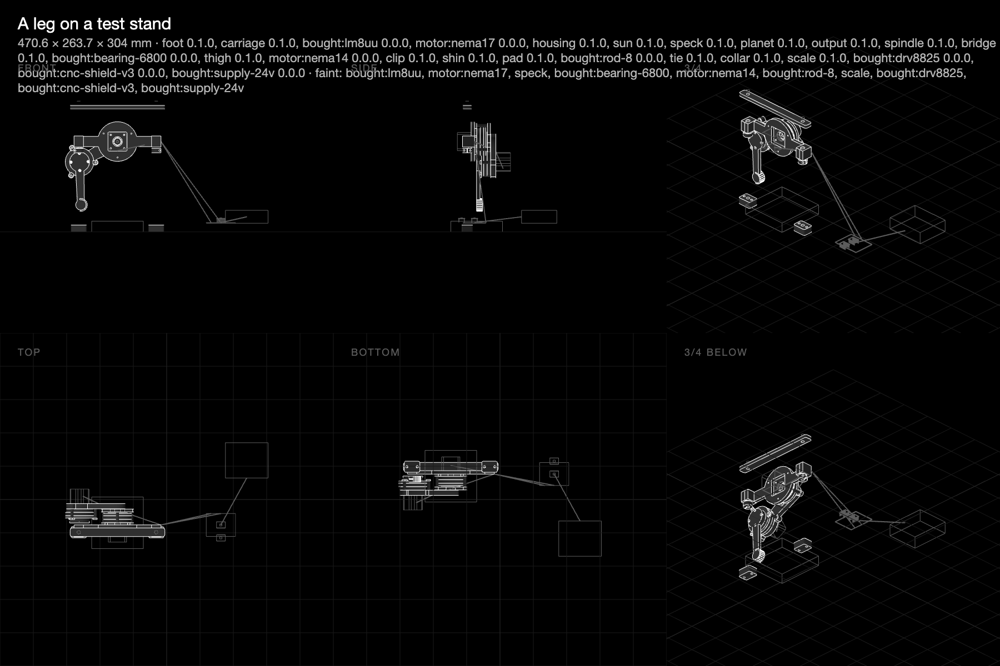

# What to print to test the robots

**10 November 2026.** Everything the kit says about these machines is a prediction until it has been measured. This is the list of what to print, in order, and what each print settles. Three GitHub issues stay open until it's done: [the arm draws (190)](https://github.com/JoniBach/rulecad/issues/190), [the arm lifts (197)](https://github.com/JoniBach/rulecad/issues/197) and [the leg stands and steps (202)](https://github.com/JoniBach/rulecad/issues/202).

**Updated 22 November 2026:** the arm is now built from the parts on the bench: a 17HS4401 at the elbow as well as the shoulder (no NEMA 14), a 12 V bench supply (no 24 V supply), the DRV8825s at 1/8 step, and the one SG90 moved from the pen lift to the gripper. The buy lists below name only what is not already in hand. **Updated 23 November 2026:** the leg too, a 17HS4401 at its knee and the same 12 V supply.

Each link below opens the model, with its parts to download. Print in PLA at 0.2 mm layers, four walls and 25% infill unless it says otherwise, and keep to one spool. Masses are solid figures, so a slicer's infill makes them lighter.



## Stage 1: the benchmarks (about 320 g)

Print these before any machine. The numbers are the rows of the [measuring sheet](https://github.com/JoniBach/rulecad/blob/main/examples/bench/projects/benchmarks/MEASURE.md), which says how to take each one.

| Order | Print | Mass | Measures | Needed for |
|---|---|---|---|---|
| 1 | [Fit bar](../../m/bench-fit-bar/) | 31 g | 3, 4, 5: D-bore, hole shrinkage, M3 pilots | Every machine |
| 2 | [Seats coupon](../../m/bench-seats-coupon/), with a 608 bearing | about 38 g | 21: bearing press and slip | Every machine |
| 3 | [Motor stand](../../m/bench-motor-stand/) | 74 g | 6 to 11: holding, detent, torque at speed, heat | Every machine |
| 4 | [Shoulder](../../m/bench-shoulder/) and [input lever](../../m/bench-input-lever/) | 117 g | 12 to 18: efficiency, holding, play, twist, repeatability, speed | Every machine |
| 5 | [Mesh rig](../../m/bench-mesh-rig/) | 42 g | 12, one mesh on its own | Useful, not essential |
| 6 | [Servo stand](../../m/bench-servo-stand/) | 18 g | 19, 20: servo stall torque and size | Pen lift and gripper |

The [gear card](../../m/bench-gear-card/) is only needed if the printer hasn't been tested for backlash yet (measurements 1 and 2).

**The measurements that matter most are 14 (play), 15 (twist) and 17 (repeatability).** The arm's predicted 0.244 mm at the pen assumes 0.02° of play. With no bias on the gears, the drawn backlash alone is about 1.2 mm at the far corner. If the shoulder measures badly, stop here and fix the gearbox before printing the arm.

Write each result back, and the predictions move:

```sh
npx cad measured arm/arm arm.play_shoulder=0.05 --source "bench test 14"
npx cad measured arm/arm arm.twist_shoulder=0.02 --source "bench test 15"
```

(Those two numbers are examples: use what you measure.)

## Stage 2: the arm draws (issue 190)

| Print | Mass | Notes |
|---|---|---|
| [The drawing arm](../../m/2026-11-09-arm-arm/), bed one: base, housing, upper arm, bridge, both outputs and the rest of its plate | 331 g | About 6 hours |
| Bed two: forearm, spindle, the suns and the remaining planets | about 76 g | |
| Holder | 32 g | **In PETG, on its own:** it's a flexure |

`npx cad plates arm/arm` writes the two beds. The total is about 439 g and 8 hours.

**In hand:** two 17HS4401 steppers (one at the shoulder, one at the elbow), the DRV8825 drivers on the CNC Shield V3 over the Uno R3 with the M0 and M1 jumpers on (1/8 step), the 12 V bench supply and the SG90. `npx cad list arm/arm` lists these as in hand.

**Buy:** one 6800 bearing, two 10T85 endstops, two rubber bands, a pen, AWG 24 and AWG 26 wire, and the screws `npx cad list arm/arm` counts: M3 cap screws 6, 8, 10, 12, 16 and 30 mm long, four M3x8 countersunk, an M3x3 set screw, two M3 nuts and four M2x10 caps (33 screws and two nuts in all).

**Set both drivers to 0.5 A,** which is 0.25 V on a DRV8825's trimmer (Vref = I / 2 with its 0.1 ohm sense resistors). Read the sense resistors on yours first: R100 means 0.1 ohm. With the motors unplugged, switch on the 12 V supply, put the meter's black probe on the shield's GND and the red one on the trimmer's metal top, and turn it with a plastic screwdriver until it reads 0.25 V. Never plug or unplug a motor with the power on. **Set the bench supply to 12 V with its current limit at 1.5 A:** the arm draws about 0.5 A.

**What the 12 V supply and the second 17HS4401 change, as checked:** the shoulder has 7.3 times the torque it needs and the elbow 20 times, at 300 rpm (8.4 and 17.7 on 24 V with a NEMA 14). The drawing speed (51 mm/s at the slowest point) and the time across the sheet (5.24 s) are unchanged: the speed sets them, not the torque. The heavier elbow motor puts 108 N on the 6800 (89 before), still 8.6 times under its rating.

**Test:** home it, then run the calibration drawing from `npx cad plot arm/arm --calibrate`. Measure the 100 mm square's sides and diagonals and each circle's roundness, and draw the square five times for repeatability. Weigh the printed parts too: the list's grams should be within 10%.

## Stage 3: the arm lifts (issue 197)

The same parts, on the same base, bolted upright: [the upright arm](../../m/2026-11-10-arm-arm-upright/).

| Print | Mass | Notes |
|---|---|---|
| [Gripper](../../m/2026-11-10-arm-gripper-check/) | 37 g | **In PETG.** Rated for 50 g at 2× |
| Spindle, again | 7 g | **In PETG, or use steel:** a stall at 0.8 A is 19 MPa against PLA's 22 |

**Buy:** a dial indicator. No second SG90: the gripper takes the pen lift's, since the upright arm has no pen to lift.

**Before running it:** set the shoulder's driver to 0.8 A (0.4 V) and the elbow's to 0.5 A (0.25 V). At 1 A the shoulder would have more torque, but a stall would put 24 MPa in the printed spindle, past PLA's 22. The arm draws about 0.64 A, so the 1.5 A limit stays. With the gripper on, the elbow is limited to 140°. Its home switch sits at 160°, so move the switch and its flag first, or the elbow can't home.

| Test | Against |
|---|---|
| Add payload at the tool until a motor skips | `motor.torque`: 2.22 times over at 100 g on 12 V (2.65 on 24 V with the NEMA 14) |
| Power off, add payload until it drops | `motor.holds` |
| Drop at the tool under 100 g at full stretch, by dial indicator | `link.deflection`: 2.11 mm from coarse cells with the 17HS4401 at the elbow (1.83 mm with the NEMA 14) |
| Push sideways at the shoulder and watch the wobble | `joint.moment` |
| Time a move across the volume | `task.time` |

The Z axis in the examples isn't needed for this test.

## Stage 4: the leg stands and steps (issue 202)

[A leg on a test stand](../../m/2026-11-10-leg-stand/): 471 g, about 9 hours. Its gearbox parts print the same as the arm's. Like the arm, it is now drawn on the parts on the bench: a 17HS4401 at the hip and another at the knee (no NEMA 14), the 12 V bench supply with its current limit at 1.5 A (no 24 V supply), and the DRV8825s at 1/8 step. The motors, drivers, shield, Uno and supply move across from the arm. The thigh's knee plate now takes the 17HS4401's 31 mm square of screws: a thigh printed before 23 November was drawn for a NEMA 14, so print it again.

**Buy:** two LM8UU bearings, two 8 mm rods, a kitchen scale, a second 6800 bearing unless you move the arm's across, and the screws `npx cad list leg/stand` counts (M3 caps 6, 8, 10, 12 and 16 mm long, four M3x8 countersunk). `npx cad list leg/stand` lists the motors, drivers, shield and supply as in hand.

**Before running it:** set both drivers to 0.5 A, 0.25 V on each trimmer, as for the arm, and the bench supply to 12 V limited to 1.5 A. The leg draws about 0.22 A at 12 V.

**What the 17HS4401 knee changes, as checked:** the foot carries what rides the rods, the leg and its carriage, 1.01 kg (the leg alone is 855 g, 90 g more than with a NEMA 14). The knee needs 0.608 N m at the worst of the step and gets 1.682 N m, 2.8 times over (3.1 before, at 0.75 kg on the NEMA 14); the hip 0.198 N m, 8.5 times (11.4 before). 200 rpm is under the 17HS4401's 286 rpm corner on 12 V, so the supply costs no torque: only the masses move the margins.

| Test | Against |
|---|---|
| Weight on the foot until a motor skips | `motor.torque`: 0.608 N m at the knee with 1.01 kg riding the rods, 2.8 times over |
| Power off, weight until it gives | `motor.holds` |
| The foot's path by camera or pointer | the planned swing, 15 mm of clearance |
| The step's time | the gait's period |

The quadruped in the examples is a design only, and isn't part of these tests. It now has 17HS4401 knees at 1 A too: 4.2 kg with an estimated 0.4 kg of electronics, its knees 2.3 times over in a trot (1.7 with NEMA 14s).

## In total

About 320 g of benchmarks, 483 g for the arm, gripper and spare spindle, and 471 g for the leg: **around 1.3 kg of filament and about 23 hours of printing**, mostly PLA with a small amount of PETG. The print times are estimates from each part's volume.

Each result goes back with `npx cad measured`, and `npx cad history arm/arm` shows predicted against measured.
