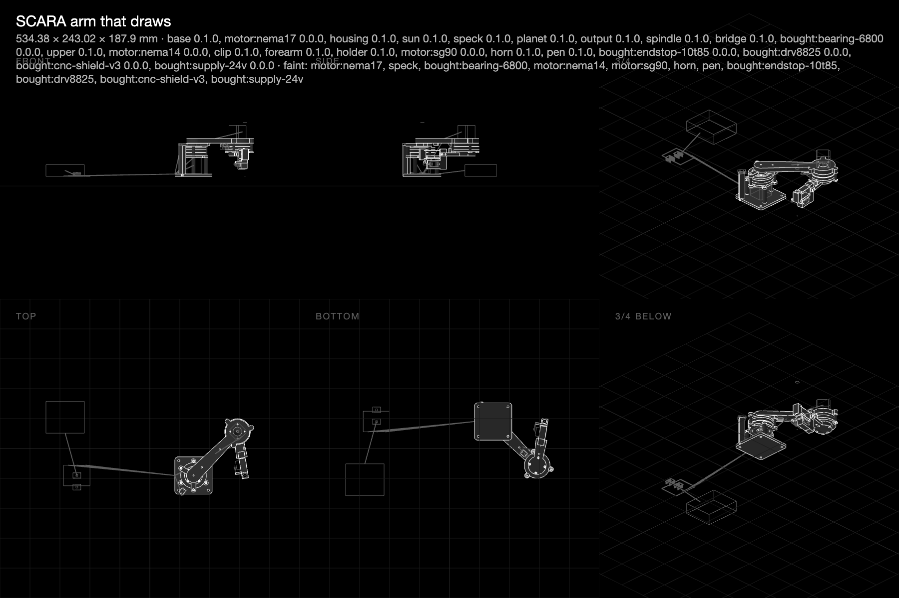

# An arm that draws, then lifts, then a leg

**10 November 2026 · @rulecad/robots 0.1 · pull requests [203](https://github.com/JoniBach/rulecad/pull/203) and [204](https://github.com/JoniBach/rulecad/pull/204)**

The kit could say whether a mechanism fits and turns. A machine asks more: whether the tool reaches the work, how fast and how accurately, whether the joints carry the arm, and how to wire and run it. A drawing arm is the test, because paper records every error.

Nothing here has been printed or moved. Every figure below is a prediction, and a table of predicted against measured will go here once there is one.

## The models

- [SCARA arm that draws](../../m/2026-11-09-arm-arm/): 160 + 115 mm links over an A5 sheet, a 38:1 compound planetary at each joint.
- [The arm upright, lifting](../../m/2026-11-10-arm-arm-upright/): the same parts on the same base, 100 g at the tool.
- [The gripper's closing check](../../m/2026-11-10-arm-gripper-check/): two compliant fingers on an SG90.
- [A leg on a test stand](../../m/2026-11-10-leg-stand/): hip and knee from the same gearbox.

## What the checks predict

| Machine | Check | Prediction | Rests on |
|---|---|---|---|
| Arm, drawing | Reach | whole A5 sheet, 5.6 mm to spare | geometry |
| Arm, drawing | Speed | 51.3 mm/s at the slowest point, against 50 | motors' working speed |
| Arm, drawing | Accuracy | 0.244 mm worst case, 0.11 mm root-sum-square, against 0.3 | an estimated 0.02° of play |
| Arm, drawing | Shoulder torque | 8.4 times over at 0.5 A | community motor figures |
| Arm, drawing | Supply | 0.7 A at 24 V, 3.1 times inside a 2.2 A supply | motor resistance, an estimated driver efficiency |
| Arm, upright | Shoulder torque | 2.65 times over at 0.8 A | community motor figures |
| Arm, upright | 6800 bearing | 38 times its static rating | manufacturer's rating |
| Arm, upright | Accuracy | 2.08 mm against 2.5 | link bending from coarse FE, an overestimate |
| Gripper | Holding 50 g | 2.3 times over | an estimated friction |
| Leg, on its stand | Worst joint | knee, 0.45 N m for a 1.5 kg robot's half share | statics only |

## What the arm's accuracy really depends on

The 0.244 mm assumes rubber bands bias the gears against their backlash, and those bands are holes in the parts for now, not checked items. With no bias the drawn backlash alone is about 1.2 mm at the far corner, four times the target. Bench tests 14 (play), 15 (twist) and 17 (repeatability) decide this, and `cad measured` writes each result back so the budget moves.

## Known limits

- With the gripper fitted, the upright arm's elbow is limited to 140°, since the servo meets the shoulder housing at 160°. Its home switch sits at 160°, so it can't home until that moves.
- A stall at 0.8 A puts about 19 MPa in the PLA spindle against 22: print it in PETG or use steel.
- Quasi-static only: no balance or feedback, and gaits are checked as a sequence of still poses.
- The streamer compiles for the Uno and passes a dry run. It has not driven a motor.
