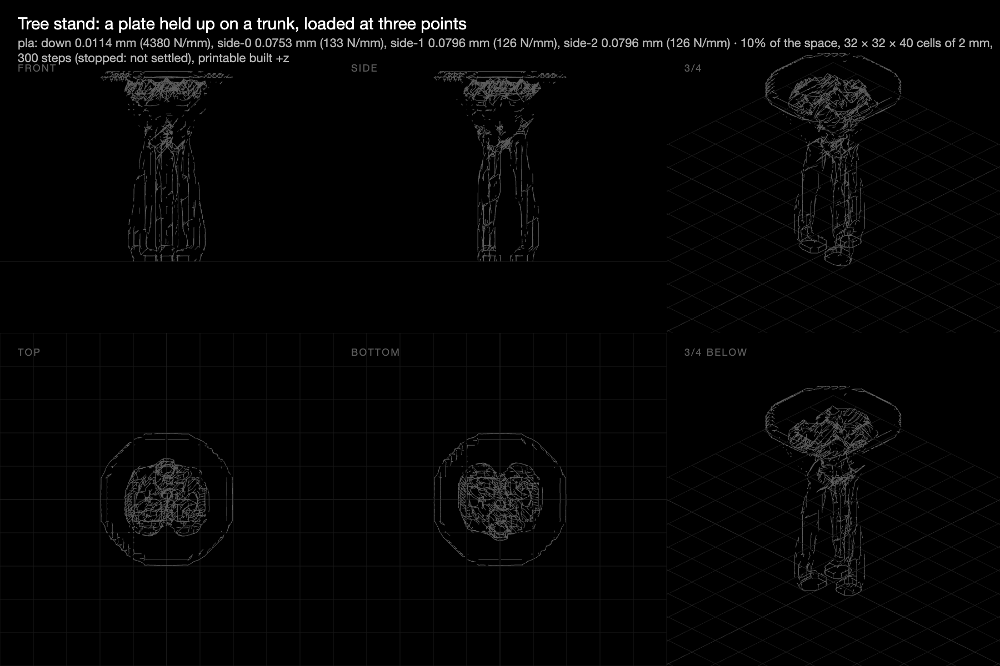

# Tree stand: from stool to goblet to Y

**29 October 2026 · @rulecad/cad 0.7.11 · `examples/bench/projects/showcase/problems/tree.json`**

The aim was a part that branches like a tree. A stand fits in a 60 × 60 × 70 mm box and prints as it's used: feet on the bed and a 50 mm plate on top, with nothing starting in mid-air (a lesson from the [twisted tube](../twist/)). The space is 32 × 32 × 40 cells of 2 mm, the struts are at least 5 mm thick, and it prints without supports. Three attempts changed only where the feet and loads sit, and how much material there is.

| Attempt | Feet | Loads | Material | Shape | Stiffness down / sideways | Run time | Model |
|---|---|---|---|---|---|---|---|
| 1 | 22 mm out, under the plate's edge | 50 N at 7 points over the plate, a 10 N push at half weight | 15% | A stool: three straight legs | 16,200 / 1,260 N/mm | 49 min | [Open in 3D](https://jonibach.github.io/rulecad-archive/m/tree/) |
| 2 | 8 mm out, a trunk | 50 N at 6 points round the edge, the push, a twist | 15% | A goblet: a cone flaring at 45° | 14,500 / 784 N/mm | 55 min | [Open in 3D](https://jonibach.github.io/rulecad-archive/m/tree-2/) |
| 3 | 8 mm out, a trunk | 50 N at 3 points round the edge, between the feet, the push | 10% | A Y: a trunk splitting into three arms | 6,910 / 387 N/mm | 87 min | [Open in 3D](https://jonibach.github.io/rulecad-archive/m/tree-3/) |
| 4 | as 3, kept regions held up, the faster solver | as 3 | 10% | A tree: a trunk, branches fanning under the plate; one foot left loose | 3,960 / 194 N/mm | 22 min | [Open in 3D](https://jonibach.github.io/rulecad-archive/m/tree-4/) |
| 5 | as 4 | as 3, the push from three directions | 10% | A tree from all three feet: complete, print-ready | 4,380 / 126–133 N/mm | 50 min | [Open in 3D](https://jonibach.github.io/rulecad-archive/m/tree-5/) |

## Findings

- **Where the loads sit decides whether a part branches.**
  - **Loads above the supports give straight columns.** With the feet under the plate's edge, the stiffest answer was three straight legs.
  - **A ring of loads, or a twist, gives a closed shell.** Six evenly spaced loads act like a ring, a cone is the stiffest answer to that, and a twist favours a closed shell (as the twisted tube showed).
  - **A few loads away from the supports give branches.** Three loads between the feet gave one arm to each.
- **The 45° rule shapes the branches.** Arms can't leave the trunk any flatter than 45°, so they split late, just under the plate, and the trunk is long. A shorter trunk, or loads further out, would give longer branches.
- **Building from the bed upward worked.** In all three attempts, the only cells with nothing below them are in the underside of the plate, with bridges of 2.6–3.3 mm. There were no icicles.
- **Holding the plate up costs stiffness.** With a kept cell that nothing holds up costing the optimiser (attempt 4), the branches fan out under the whole plate: bridges of 2.6 mm instead of 7.9, nothing in mid-air, at 57% of attempt 3's stiffness for the same material.
- **A kept foot the loads don't need is left loose.** Attempt 4's trunk grows from two feet; the third sits unattached. The loads must need every support: with a sideways push from three directions (attempt 5), all three feet carry a leg, and the part passes every print check.
- **There are still specks.** The third attempt has four loose specks of 1–2 cells. Drawing a part should drop pieces that aren't connected.
- **The twist report is wrong.** Attempt 2 reported its twist as moving 7.65 × 10¹³ mm.

## Next

- Fix the code: drop loose pieces; have `cad check` flag islands and parts in several pieces; report twisting loads as an angle; save runs so they can be replayed.
- A tree with longer branches: loads further out than the trunk is tall, or a lower plate. Finer cells would let the arms split more than once.
