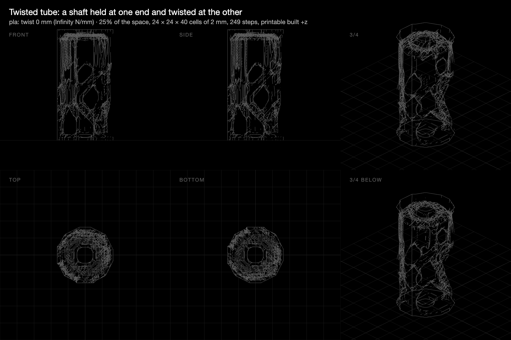

# Twisted tube: the first showcase part

**28 October 2026 · @rulecad/cad 0.7.5 · `examples/bench/projects/showcase`**

The aim was a small part that shows what topology optimisation does with empty space. A 40 mm cylinder, 80 mm tall, stands on the bed as it's printed. A ring at the bottom is held, and a ring at the top is twisted by four 25 N forces round its rim. A 6 mm shaft hole runs through both rings. Theory says twisting is best carried by spiral struts at 45° (Michell). It's PLA, on 2 mm cells (24 × 24 × 40 = 23,040), and has to print standing up without supports.

| Attempt | Material | Filter | Pieces | Run time | Model |
|---|---|---|---|---|---|
| First | 15% (8% for the struts) | 3 mm, 1.5 cells | 11 | 2 h 36 min, 268 steps | [Open in 3D](https://jonibach.github.io/rulecad-archive/m/twist/) |
| Second, printed | 25% (18% for the struts) | 5 mm, 2.5 cells | 1 | 19 min, 249 steps | [Open in 3D](https://jonibach.github.io/rulecad-archive/m/twist-2/) |

## Findings

- **Struts need to be at least 2.5 cells thick.** At 1.5 cells, the struts came out one cell wide. A one-cell strut at 45° is a staircase of cubes touching only at their edges, so the drawn part fell into 11 pieces with thin, non-solid bits.
- **Thin struts slow the solver badly:** 35 s a step, against 4.5 s once the struts were thick.
- **The second attempt is a perforated tube, not a cage.** Diamond windows run round it in a spiral. Open spiral struts would need finer cells.
- **It printed, with two faults:**
  - **Flat blocks, as if squashed into the corner of a room.** Twisting drives material to the outermost radius, so it piles up against the edge of the space. On a grid that edge is a staircase of flat faces, and the material takes their shape.
  - **Icicles that need supports.** `cad check` passed it ("no overhangs past 45°"), yet downward-pointing tips hung in mid-air. The check measures the slope of each face, but it misses a tip whose lowest point starts in mid-air with nothing below it.
- **The report is wrong for a twist.** A twist has no net force, so it says "moves 0 mm, Infinity N/mm". Twisting loads should be reported as an angle of twist and a torsional stiffness.
- **A finished run can't be replayed.** The live view keeps its steps in memory only.

## What to change

1. `cad check` should flag islands (any lowest point that isn't on the bed) and parts that come in more than one piece.
2. Drop loose pieces when drawing a part.
3. Keep material off the space's staircase edge: a margin of a cell inside a round space, or a smoother edge.
4. Report twisting loads as an angle and a torsional stiffness.
5. Save each run's steps, so a finished run can be replayed.
6. Next showcase parts should grow upward from their supports on the bed, so that nothing starts in mid-air.
