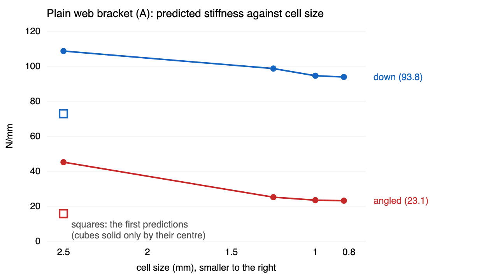

# Verification: how sure are the predictions?

**28 October 2026 · rulecad cad 0.7.2**

A prediction from a coarse grid can be well off. Each bench specimen was analysed again on smaller cells, and on cells a quarter bigger, to see whether its numbers had settled.

| Plain web bracket (A) | Straight down | At 45° |
|---|---|---|
| 2.5 mm cubes, solid only where a cube's centre is inside (the first predictions) | 72.8 N/mm | 15.7 N/mm |
| 2.5 mm cubes, each filled by the share the part takes up | 108.6 N/mm | 45.1 N/mm |
| 1.25 mm | 98.6 N/mm | 25.1 N/mm |
| 1 mm | 94.5 N/mm | 23.4 N/mm |
| 0.83 mm | 93.8 N/mm | 23.1 N/mm |

## Findings

- **The first bracket predictions were 15–35% too flexible.** On 2.5 mm cubes counted solid by their centre, the 6 mm back plate came out 5 mm thick, and bending stiffness goes with thickness cubed.
- **Coarse cells mislead either way.** Filling cubes by share fixes the plate but makes thin walls too stiff in bending. Only small cells settle.
- **What cad check does now:** given a cell size, it analyses a part on those cells and on cells a quarter bigger, and says whether the stiffness has settled (within 5%). It writes a report with the peak stress, where it is, and the safety factor.
- **The levers were already right.** Flat parts were always filled by share, and they settle within 2%.

Models: [A](https://jonibach.github.io/rulecad-archive/m/bracket-a/), [C](https://jonibach.github.io/rulecad-archive/m/bracket-c/).
